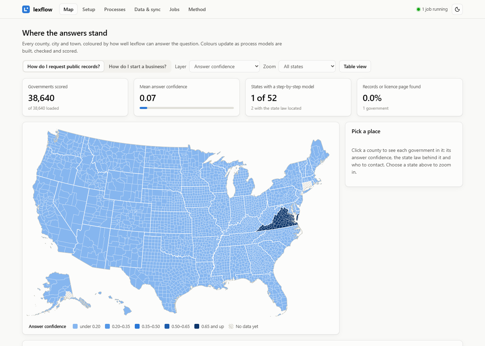
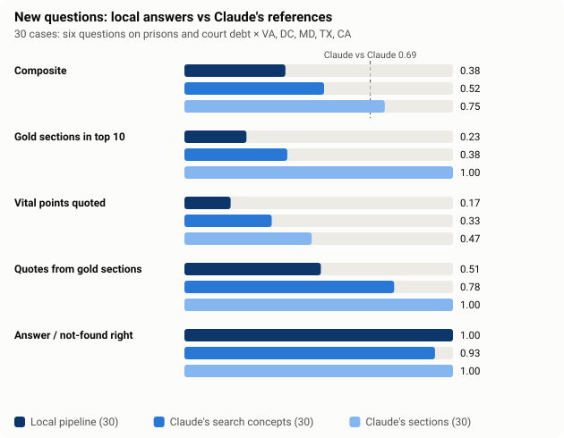
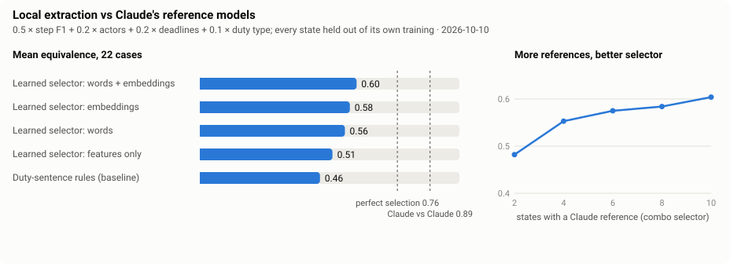
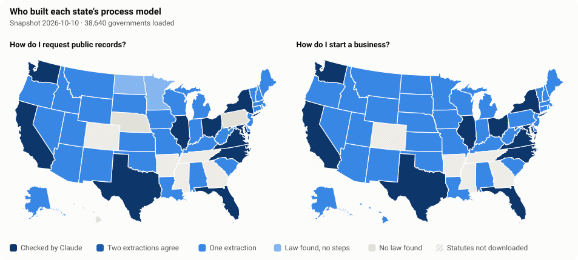
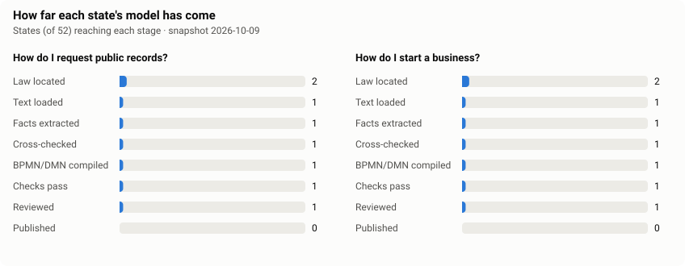
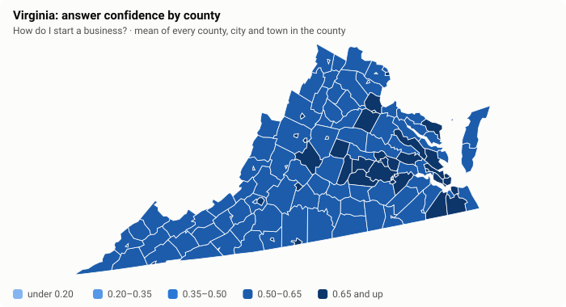
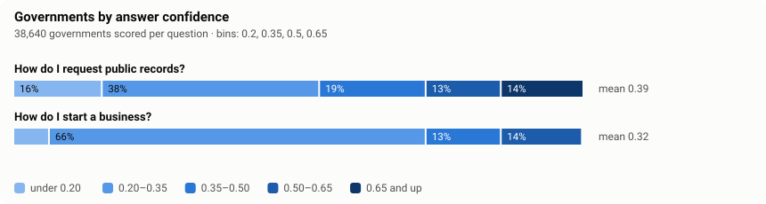
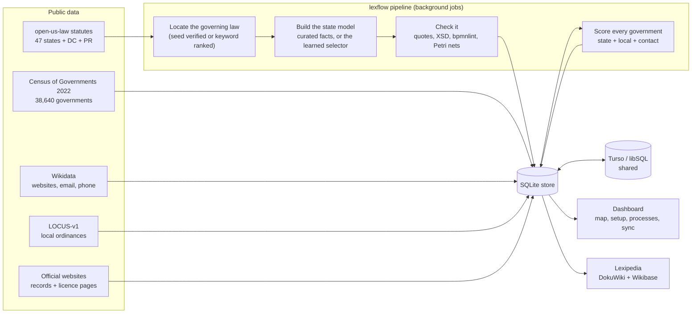

# lexflow

**Step-by-step process maps of US law, for every county, city and town.** lexflow answers two questions for all 38,640 general-purpose local governments in the Census of Governments:

- **How do I request public records?**
- **How do I start a business?**

It finds the state statute that governs each question, turns it into a checked BPMN process map and DMN decision tables (every step tied to a word-for-word quote), adds the local law and the right contact for each government, scores how confident each answer is, and draws all of it on a county map that updates as models are built.

Claude has written and reviewed reference models for 11 states: VA, DC, MD, CA, TX, NY, FL, IL, OH, WA and NC (22 models). Every other state with a verified statute gets a model from a **learned selector**: it is trained on those references, runs on a laptop CPU, and needs no chat model ([how well it does](#local-models-vs-claude)).

Everything is rebuilt from public data inside Docker. A dashboard walks a new user through the setup as a checklist, runs each step as a background job, and can share results through a [Turso](https://turso.tech) database, so a second machine pulls only the states it needs instead of rebuilding them.



## Answers for three places

The pipeline can run for a few governments instead of whole states (`--places va:charlottesville,dc,md:baltimore`, or the **Places** page). The first three are fully answered: a Claude-checked state model, a local procedure researched from official sources and re-checked by a second reviewer, and a direct contact.

| Place | Public records | Start a business | On Lexipedia |
|---|---|---|---|
| City of Charlottesville, VA | [answer](docs/answers/va-charlottesville.md) · Va. Code § 2.2-3704 | [answer](docs/answers/va-charlottesville.md#how-do-i-start-a-business-in-city-of-charlottesville) · seven business structures, SCC filing, local BPOL licence | [lexflow:va:charlottesville](https://lexipedia.xyz/doku.php?id=lexflow:va:charlottesville) |
| District of Columbia | [answer](docs/answers/dc-washington_dc.md) · D.C. Code §§ 2-532, 2-537 | [answer](docs/answers/dc-washington_dc.md#how-do-i-start-a-business-in-city-of-washington-dc) · DLCP registration, basic business license | [lexflow:dc:washington_dc](https://lexipedia.xyz/doku.php?id=lexflow:dc:washington_dc) |
| Baltimore City, MD | [answer](docs/answers/md-baltimore.md) · Md. General Provisions §§ 4-202, 4-203 | [answer](docs/answers/md-baltimore.md#how-do-i-start-a-business-in-city-of-baltimore) · SDAT filing, trader's licence | [lexflow:md:baltimore](https://lexipedia.xyz/doku.php?id=lexflow:md:baltimore) |

The state models behind them, with their BPMN maps and decision tables, are published at [lexipedia.xyz/lexflow:start](https://lexipedia.xyz/doku.php?id=lexflow:start) (copies in [docs/wiki](docs/wiki)). The business model's decision table covers seven structures in each state: sole proprietorship (with the trade-name filing), general partnership (and the LLP option), limited partnership, LLC, stock corporation, nonstock/nonprofit corporation, and professional corporation or LLC, each with its filing, office and fee and each rule quoted from the statute.

Each reference model was written by Claude from the statute text and went through two rounds of adversarial review: one reviewer checked legal accuracy against the statute words, another checked completeness, and a second round restructured the models with exclusive merges and deemed-denial routing. 136 findings were raised in round one; all but four were applied, and the four were rejected with reasons from the text. The 16 models for the eight later states went through the same draft, review and fix loop: 4 to 10 findings each, and every file passes `lexflow check-curated` with quality 0.99 or 1.00.

Further questions worth adding (building permits, questions for people in prison and reentry, FOIA and redaction work, and questions from city staff) are scoped in [docs/questions.md](docs/questions.md).

## Ask any question

The **Ask** page takes a question in plain words and any number of states, counties, cities or towns. An autocomplete covers every state and all 38,640 governments, and one checkbox adds every place in the chosen states. Each state's answer is worked out once, in a background job, and shared by every place in that state. A place adds its own layer: LOCUS ordinance headings that mention the question, and its contacts.

1. **Plan the question.** Two to ten concepts, each a list of words a state code would use for it ("expungement", "sealing" and "expunction" for clearing a record). They come from a small legal thesaurus, and a local model can add the code's own vocabulary. Each concept is weighed by how many sections of that state's code use it.
2. **Search the statutes.** Every downloaded section is in a full-text index (SQLite FTS5, one file per state, built in seconds: **Make the statutes searchable** on the Setup page). Several searches are fused: all core concepts in the heading, all anywhere, the two rarest, a procedure search ("petition", "application", "file") for how-do-I questions, one search per facet of a many-part question, and any concept. Then the code's own structure adds what the words miss: the sections the best hits cite, and the other sections of the chapters that hold them, since a procedure's deadlines and duties often never use the question's words. The results are reranked by meaning and by a small model trained on Claude's gold sections. Expired versions of a section are dropped, and versions not yet in force move down.
3. **Quote, then answer.** The clauses that answer the question become numbered quotes, word for word. At least one quote comes from every chosen section, and clauses carrying what the question asks for (deadlines, fees and caps, offices, orders of priority) are preferred. For a how-do-I question, the learned selector picks the procedure's steps, weighted by their relevance to the question, and they are compiled to a draft BPMN map.
4. **A plain-language summary (optional).** A local model (`LEXFLOW_ASK_MODEL`, default qwen3:1.7b) writes two to six claims, and each claim must cite the quotes it rests on. A claim that cites nothing, or states a number its quotes do not contain, is dropped, never repaired. The quotes are always shown, and they are the answer when no model is running.
5. **Say when the law is not there.** If no section clearly governs the question, the answer is "not found", with a pointer to where the law may live instead: regulations, court rules, contracts, agency policy or local ordinances.

Answers are machine-made and marked unreviewed. On the question's page, tick **For the wiki** to publish an answer as its own Lexipedia sub-page under its state or place.

**AskBench: Claude vs the open models on new questions.** Six questions on prisons, court debt and the microeconomics of the criminal-legal system ([docs/questions.md](docs/questions.md#d-prisons-court-debt-and-the-economics-of-the-criminal-legal-system)). For each, Claude wrote a reference answer for VA, DC, MD, TX and CA, 30 in all (`curated_ask/<question>/<state>.json`). Each reference has:
- the gold sections, with their roles;
- nuggets: atomic facts, each with a word-for-word quote;
- typed slots (fees, deadlines, offices, orders of priority);
- a coverage call (in the code, partly, or not at all, with where the rest lives);
- for process questions, the steps in the same schema as the state models.

Every reference passes `lexflow check-ask`. Then an adversarial reviewer re-read the statutes and a fixer applied the findings. `lexflow ask-bench` scores the local pipeline against them in four arms:
- **local**, the whole pipeline;
- **heuristic**, the same without the learned reranker;
- **profile**, searching with Claude's own concept groups, which shows what planning loses;
- **oracle**, Claude's gold sections handed to the same answering stages, which separates retrieval loss from answering loss.

The score covers gold sections in the top 10, vital nuggets quoted, citation precision, slots, steps, and whether "answered / not found" matches Claude's coverage call.

<picture>
  <source media="(prefers-color-scheme: dark)" srcset="docs/img/askbench-dark.svg">
  
</picture>

**Results** (30 cases, scorer version 2, [docs/askbench.json](docs/askbench.json)):

| Arm | Composite | Gold sections in top 10 | Vital points quoted | Quotes from gold sections | Fees and deadlines | Answer / not found right |
|---|---|---|---|---|---|---|
| Local pipeline | **0.376** | 0.23 | 0.17 | 0.51 | 0.25 | 1.00 |
| Local, hand-set reranker only | 0.343 | 0.19 | 0.14 | 0.50 | 0.22 | 0.93 |
| Local answering, Claude's search concepts | 0.520 | 0.38 | 0.33 | 0.78 | 0.46 | 0.93 |
| Same answering, Claude's sections given | 0.746 | 1.00 | 0.47 | 1.00 | 0.72 | 1.00 |

**Claude vs Claude: 0.69.** Six of the references have an independent second draft, made from the list of sections only. The two drafts agree on 0.56 to 0.83 of the sections and 0.84 to 1.00 of the vital points. In 3 of the 6 they make a different coverage call, each time "in the code" against "partly in the code".

What the arms show:
- **Retrieval is the main loss.** Given Claude's sections, the same answering stages score 0.75. With their own search they score 0.38. Claude's concept groups alone lift the local search to 0.52, so the planner's vocabulary is about 40% of that gap.
- **Answering from the right sections still misses half the vital points** (0.47 with Claude's sections). A quote is one clause chosen by meaning, and a vital point often spans clauses or sits deep in a list.

**What moved retrieval**, each measured on the same 30 references:

| Change | Gold sections found |
|---|---|
| Fused searches, reciprocal-rank fusion ([Cormack et al. 2009](https://doi.org/10.1145/1571941.1572114)) | top 20: 0.202 · top 80: 0.416 |
| \+ the code's structure: every section of the chapters that hold the best hits (the cluster hypothesis), and the sections those hits cite | top 20: **0.264** · top 80: **0.463** |
| Reranked by meaning and structure | top 10: 0.191 |
| \+ a small model trained on Claude's gold sections, scored leaving the whole question out | top 10: **0.231** |

Tried and dropped: pseudo-relevance feedback from the best headings (RM3, [Lavrenko & Croft 2001](https://doi.org/10.1145/383952.383972); top 80 0.452 → 0.444), splitting a phrase such as "building permit" from its bare words (no change), and telling the reranker which search found each section (0.235 → 0.231).

**The scorer was checked too.** An adversarial review found version 1 too generous: numbers matched as substrings (the 5 of 1995), one short clause counted as a whole nugget, and the same section number in another code counted as a gold citation. Version 2 fixes these. Every stored row carries a hash of the code and models behind it, and `docs/askbench.json` keeps only current rows. Nuggets with "vital" labels follow the TREC question-answering evaluations ([Voorhees 2003](https://trec.nist.gov/pubs/trec12/papers/QA.OVERVIEW.pdf)).

**Lexipedia layout.** Each place has a short main page (`lexflow:va:charlottesville`), and every process sits on its own sub-page beneath it (`lexflow:va:charlottesville:records`). Each state has a main page (`lexflow:va`) that lists its process models, places and answered questions.

## Local models vs Claude

<picture>
  <source media="(prefers-color-scheme: dark)" srcset="docs/img/benchmark-dark.svg">
  
</picture>

Every local strategy is scored against Claude's reference model of the same statute text: **equivalence** = 0.5 × step F1 + 0.2 × actor kinds + 0.2 × deadlines + 0.1 × duty type, with steps matched by the clause they quote. All 22 references are used, and a state is always left out of its own training, as a new state would be. Two numbers bound the scores:

- **Claude vs Claude: 0.89.** A second Claude draft of six of the references, made without seeing the first (only its list of sections), agrees with it at 0.72 to 0.99. That is about as close as two careful readers come, and it is the realistic target, not 1.0.
- **Perfect selection: 0.76.** Every strategy proposes candidate clauses and then picks some of them. Picking exactly the right ones would score 0.76 with today's candidates, up from 0.58 with the first version's.

What moved the numbers, from the 0.46 rule baseline to 0.60 (on the six original cases, from 0.56 to 0.69):

| Change | Mean |
|---|---|
| Duty-sentence rules (baseline) | 0.46 |
| Wider candidates: list items under "shall:", passives, "he shall", deemed outcomes | (perfect selection 0.58 → 0.74) |
| Selector trained on Claude's choices, features only | 0.50 |
| \+ word and word-pair vectors (TF-IDF): nearest labelled clauses, nearest Claude step, cross-state alignment | 0.52 |
| \+ the actor kind of the nearest Claude step, where the rules would guess "public body" | 0.54 |
| \+ `nomic-embed-text` embeddings alongside the words (a 274 MB one-off download) | 0.585 |
| \+ hard-wrapped lines rejoined (New York), and procedure without "shall": "the department files", "has three business days to", fee lines, "is formed when" | **0.604** |

On the final code, the variants score: words + embeddings 0.604 (records 0.55, business 0.65), embeddings only 0.578, words only 0.559, features only 0.511, rules 0.463. The best case is North Carolina business (0.82) and the worst is Washington records (0.35).

**Cross-state alignment.** Each other state's process is matched one-to-one against this statute's candidates, most similar pairs first. The share of states that pick a clause is a feature. It uses the shape of whole processes, not just single sentences, and it keeps the step count in line with how Claude models the same question elsewhere.

**What did not help.**
- **Small chat models judging sentences.** qwen3:1.7b and gemma3:1b were tried in several prompt designs. On the cases they ran, the best scored 0.58 where the selector scores 0.64.
- **qwen3:4b on the borderline sentences only**, with the most similar sentences Claude labelled elsewhere as examples. It matched the selector on Virginia records (0.71 both), but took 25 minutes for 12 judgements on this CPU, so it is off by default (`stack_llm`).
- **Relative-position features** overfit (0.585 → 0.569).
- **A candidate for the request implied by "upon request", and for a second duty in one sentence.** These raise perfect selection to 0.78, but they add more noise than the selector can sort (0.559 → 0.534 with words only). They are switched off.

**Round 2: what was tried next, and what held up.** Four literature reviews planned these experiments, and each was kept only if its paired 90% bootstrap interval cleared zero on the 22 held-out cases ([scripts/selector_experiments.py](scripts/selector_experiments.py), [scripts/selector_ablation.py](scripts/selector_ablation.py)):

| Experiment | Change in equivalence | Kept? |
|---|---|---|
| A step budget per statute, from expected F1 (instead of one threshold per question) | −0.013 (−0.030 to −0.000) | no: the scores are not calibrated well enough |
| The same, skipping near-duplicate clauses | −0.012 | no |
| A second-stage model over the clause sequence (neighbours' scores, list siblings, section best) | −0.044 (−0.083 to −0.012) | no |
| Deadlines: compound numbers ("one hundred twenty days"), "not exceed", "at the end of the second business day", "seven or 14 business days"; borrowing a time limit from a list lead-in, the first item, or the next clause | deadlines matched under perfect selection 58% → 74%; equivalence ±0 | yes: the parses are right |
| Active learning: Claude labelled the 758 sentences the selector was least sure of, in 12 states without references (295 steps) | −0.0002 (−0.021 to +0.025) | data kept, off by default |
| List items compared together with their lead-in ("A custodian who denies the application shall: within 10 working days ...") | +0.006 (−0.013 to +0.029) | yes |

The selector sits at about 0.60 on these 22 cases: none of these moves it beyond the noise of 22 cases. The losses left are candidate recall (perfect selection 0.76) and the selector's precision on long business statutes.

**What scales.** The selector improves with each reference: 0.48 with 2 training states, 0.55 with 4, 0.58 with 6 and 8, and 0.60 with 10 (two random draws each). The gain flattens, so the next 10 states should add a few hundredths, not tenths. A reference costs Claude time once and helps every state after it. Everything else is a one-off cost per clause: the embeddings are cached on disk, and a state takes seconds to a few minutes on a CPU.

Reproduce with `lexflow run benchmark --strategies stack_combo,stack_tfidf,rules`, `lexflow ceiling` and `python scripts/learning_curve.py`. The **Benchmark** page shows every case.

## Where it stands

<picture>
  <source media="(prefers-color-scheme: dark)" srcset="docs/img/states-tier-dark.svg">
  
</picture>

<picture>
  <source media="(prefers-color-scheme: dark)" srcset="docs/img/pipeline-dark.svg">
  
</picture>

<picture>
  <source media="(prefers-color-scheme: dark)" srcset="docs/img/county-confidence-dark.svg">
  
</picture>

<picture>
  <source media="(prefers-color-scheme: dark)" srcset="docs/img/confidence-dark.svg">
  
</picture>

These charts are drawn from [`docs/status.json`](docs/status.json), a snapshot of the database taken on 10 October 2026. Statutes are downloaded for 47 states. The governing law is verified for 44 states (records) and 46 (business). 22 models are checked by Claude, and 65 more were built by the learned selector.

<!-- status:start -->
_Snapshot 2026-10-10. Regenerate with `lexflow export-status` and `node tools/web/readme_charts.mjs`._

- [x] **Load every county, city and town** (required, done): 38,640 governments in 51 states
- [x] **Download state statutes** (required, done): 47 states downloaded, 5 not in the release
- [x] **Make the statutes searchable** (recommended, done): 47 of 47 states searchable
- [x] **Find the state law for each question** (required, done): Public records: 44 states; Start a business: 46 states
- [ ] **Find contacts on Wikidata** (recommended, partly done): 3 of 51 states checked; 4 governments with an email or phone
- [x] **Pull the local models** (recommended, done): Ready: nomic-embed-text, qwen3:1.7b, gemma3:1b
- [ ] **Build the state process models** (required, partly done): Checked by Claude or a person: 22; One extraction: 65; Law found, no steps yet: 3; No state law found: 14
- [x] **Load checked local answers** (optional, done): 3 places loaded of 3 researched places
- [ ] **Score every government and refresh the maps** (required, partly done): 77,280 answers scored; re-score CA, DC, FL, IL, MD, NC, NY, OH and 3 more (inputs changed since)
- [ ] **Look for records and licence pages on official websites** (optional, partly done): 1 of 51 states scanned; 3 governments with a records or licence page
- [ ] **Scan local ordinances (LOCUS-v1)** (optional, partly done): 1 of 51 states scanned; local law found for 110 governments
- [ ] **Find court decisions that cite the law** (optional, partly done): 150 court decisions found for 4 states with models
- [x] **Load the Lexipedia Wikibase** (optional, done): 1,413 items on https://lexipedia.wikibase.cloud
- [x] **Publish to Lexipedia** (optional, done): 22 of 22 reviewed or agreed models published to https://lexipedia.xyz
- [x] **Share through Turso** (optional, done): Last push 2026-10-09T19:06:07Z: 172,987 rows
<!-- status:end -->

## Run it

You need Docker (Docker Desktop on Windows or macOS).

```bash
git clone https://github.com/alibama/lexflow
```

```bash
cd lexflow && cp .env.example .env
```

```bash
docker compose up -d
```

Open http://localhost:8000 and go to **Setup**. Each step shows a checkbox that ticks itself when its data is in place, what it needs first, and what it costs to run. **Quick start** runs every required step for the states you name (`va`, `va,dc` or `all`).

| Profile | Adds | Command |
|---|---|---|
| (none) | dashboard, API, pipeline | `docker compose up -d` |
| `llm` | Ollama, for local model builds | `docker compose --profile llm up -d` |
| `shared` | a local libSQL server, a stand-in for Turso | `docker compose --profile shared up -d` |
| `search` | SearXNG | `docker compose --profile search up -d` |
| `test` | the test suite | `docker compose --profile test run --rm test` |

Local models run much faster on a GPU. With an NVIDIA card, add `-f docker-compose.gpu.yml`. On a Mac, Docker cannot reach the GPU, so run Ollama natively and set `OLLAMA_URL=http://host.docker.internal:11434` in `.env`. The default pair (`qwen3:1.7b` and `gemma3:1b`) is small enough for a laptop CPU; for real quality, set `LEXFLOW_MODEL_A` and `LEXFLOW_MODEL_B` to larger models from two different families.

Downloads go to `./data/raw` on the host, so they survive `docker compose down -v`. The database, job logs and built models live in the `lexflow-data` volume.

The same steps run from the command line:

```bash
docker compose exec app lexflow status
```

```bash
docker compose exec app lexflow run quickstart --states va
```

## How it works



1. **Governments.** The Census Government Units List gives every county, municipality and township, with an official's title, mailing address, website and FIPS codes.
2. **Statutes.** [open-us-law](https://github.com/Vaquill-AI/open-us-law) publishes one parquet file per state, with a manifest that lists each file's SHA-256, and each section carries the URL of the government publisher. Arkansas, Colorado, Georgia, Mississippi and Tennessee are not in the current release.
3. **Locate the law.** Every section is ranked by its title, chapter and text. A known section number (for example Va. Code § 2.2-3704) is used only after it is found in the file, in force and on topic. Otherwise the top keyword match is used with a lower score, and the other candidates are kept for review.
4. **Build the process model.** Curated facts come first: written by Claude or a person, with every quote re-checked against the downloaded text. Otherwise the learned selector reads the located section and the related sections its verification listed (requests, responses, fees, appeals), keeps the clauses that are process steps, and the deterministic compiler turns them into BPMN 2.0 and DMN 1.3. The result is checked against the OMG schemas, bpmnlint with five legal rules, quote matching and Petri-net soundness. When Ollama has a model, a second, independent extraction by a local chat model (`LEXFLOW_CHECK_STRATEGY`) is compared with it. The pair counts as **two extractions agree** only when their steps, actors and deadlines match. A strategy that needs no chat model never counts as its own second opinion.
5. **Local law and contacts.** LOCUS finds local ordinances on public records and business licences. Wikidata (the data behind govdirectory.org) and a polite home-page scan (robots.txt respected) find websites, emails, phone numbers and records or licence pages.
6. **Score.** Each government's answer gets a confidence score (below). A build re-scores each state as soon as its models are done, so the map follows along.
7. **Share and publish.** Results can be pushed to Turso, and pages can be published to Lexipedia (DokuWiki over JSON-RPC, plus Wikibase QuickStatements).

## The dashboard

| Page | What it does |
|---|---|
| **Map** | US counties coloured by answer confidence, state model tier, completion, quality, contacts or local law. One question at a time. Click a county to see each government in it, zoom to a state, or switch to a sortable table. |
| **Setup** | The checklist: service status (Ollama, Turso, wiki), quick start, and every step with its checkbox, cost, options and progress. |
| **Ask** | Ask a new question for any states, counties, cities or towns (autocomplete; one checkbox for every place in a state). Each answer shows the governing sections, the key provisions word for word, the steps and a draft map, the local layer, and how it was found; tick an answer for the wiki to publish it as a sub-page. |
| **Processes** | How many states reach each stage, and a card for every state model. Each model page has the BPMN map, the steps with the exact words they come from, the decision tables, the statute text with quotes highlighted, the local-model runs, and other sections the locator considered. Downloads: `.bpmn`, `.dmn`, `.svg`, facts `.json`. |
| **Data & sync** | Turso status, push and pull (all data or chosen states), pull-as-needed, row counts local vs shared, who built what, and the sync history. |
| **Jobs** | Every background job, with progress and its log. |
| **Method** | The scoring weights and ladders, editable, with a one-click re-score. |

The dashboard checks for changes every few seconds while jobs run, and colours the map again as models are built, checked and scored. It works offline: d3, topojson, the US atlas and bpmn-js are served from the image, not a CDN.

The API is at `/docs` (OpenAPI). For a browser plugin, `/api/lookup?url=<any page on a government site>` returns the government that owns the site, with its answers, steps, citations and contacts.

## Sharing through Turso

The local store is one SQLite file. To share it, set `TURSO_DATABASE_URL` and `TURSO_AUTH_TOKEN` in `.env`:

```bash
turso db create lexflow
```

```bash
turso db show lexflow --url
```

```bash
turso db tokens create lexflow
```

Or use the bundled libSQL server: `docker compose --profile shared up -d`, with `TURSO_DATABASE_URL=http://libsql:8080`.

- **Push** sends rows changed since your last push, optionally for chosen states only.
- **Pull** fetches chosen states. With **pull as needed** on (the default), opening a state that has nothing locally pulls it in the background.
- When the same row is edited in two places, the newer `updated_at` wins. Every row records the machine that wrote it (`LEXFLOW_ORIGIN`), and the dashboard shows who built which models.
- lexflow talks to Turso over its HTTP API (`/v2/pipeline`), so no native driver is needed, and the same code works with Turso cloud and self-hosted `libsql-server`.
- Rows are never deleted on the shared side. A re-scan retires stale local-law matches by setting their score to zero, which syncs like any other change.

## How answers are scored

`confidence = w_state × state law + w_local × local law + w_contact × contact`

| | State law | Local law | Contact |
|---|---|---|---|
| Public records | 0.60 | 0.10 | 0.30 |
| Start a business | 0.45 | 0.35 | 0.20 |

| State model tier | Score | | Contact level | Score |
|---|---|---|---|---|
| Checked by Claude or a person | 1.0 | | Records or licence page, or a records email | 1.0 |
| Two independent extractions agree | 0.8 | | Email or phone | 0.6 |
| One extraction (learned selector or one local model) | 0.5 | | Website only | 0.35 |
| Law found, no steps yet | 0.3 × locator score | | Mailing address only | 0.15 |
| No state law found | 0 | | None | 0 |

Local law found in LOCUS scores 0.6 × match strength. All of these numbers can be changed on the Method page.

Each state model also records **completion** (eight stages: law located, text loaded, facts extracted, cross-checked, BPMN/DMN compiled, checks pass, reviewed, published) and **quality**. Quality is the mean of: the share of quotes that match exactly, schema validity, bpmnlint, Petri-net soundness, the share of elements grounded explicitly in the text, and agreement between the two models.

## What is verified

As of 10 October 2026, on a Windows laptop with no GPU (Docker with 8 CPUs and 8 GB):

- **Tests:** 150 pass inside the Docker image. One more, a live DokuWiki round trip, is skipped unless a test wiki is configured.
- **Claude reference models:** 22, for VA, DC, MD, CA, TX, NY, FL, IL, OH, WA and NC. Every quote matches the statute text word for word, there are no schema or bpmnlint errors, every Petri net is sound, and quality is 0.99 to 1.00 (`lexflow check-curated <state> <question>`).
- **AskBench references:** 30, by Claude: six questions × VA, DC, MD, TX and CA. Each was drafted, then re-read against the statute text by an adversarial reviewer, then fixed (90 agents). All pass `lexflow check-ask`: every nugget quote is word for word, every slot number appears as a whole number in its nugget, and the steps compile. Six more are independent second drafts, made from the list of sections only.
- **Ask:** 47 states have a statute index (about 4 GB in all, a few seconds to build per state). A batch over Virginia and all 322 of its governments took 165 seconds, with the state answer worked out once.
- **Statute seeds:** 44 states were checked by an agent reading the downloaded text, and 83 sections were kept. A section is kept only if its reference resolves and a quote from it appears word for word ([curated/seeds.json](curated/seeds.json); North Dakota records is marked not found because its file has the wrong text). The locator finds a verified or known section for 44 states for records and 46 for business. Keyword guesses score at most 0.6 and are never used for a model.
- **Local extraction:** scored against the 22 references with each state held out ([above](#local-models-vs-claude)). The learned selector built 65 more models across 35 states; they count as one extraction and are not published as reviewed.
- **Lexipedia:** 43 pages are live at [lexipedia.xyz/lexflow:start](https://lexipedia.xyz/doku.php?id=lexflow:start): the index, a main page for each of the 11 states, the 22 reference models with their BPMN maps and decision tables, and the three places, each a short overview with one sub-page per process (`lexflow:va:charlottesville:records`). Only `lexflow:` pages are ever written.
- **Wikibase:** [lexipedia.wikibase.cloud](https://lexipedia.wikibase.cloud) holds 55 jurisdictions (the states plus the three places), 496 statute sections, the 22 reviewed processes with their 88 roles and 275 steps, and 117 court decisions, each linked to the sections it cites. Each item carries its lexflow key, so a re-run updates items instead of adding new ones. Models from one extraction are not loaded. An earlier run had loaded 26 of them; their items are now marked "Unreviewed draft", and none were deleted.
- **Case law:** CourtListener decisions that cite the sections: 150 so far, for CA, DC, MD and VA. The rest of the run stopped at CourtListener's anonymous rate limit. With a free `COURTLISTENER_TOKEN` in `.env`, run **Find court decisions** again; a rate limit now stops the run, so it is never recorded as "no opinions".
- **Wikidata:** matched 319 of Virginia's 322 governments. **LOCUS:** read 106,155 Virginia rows in about 12 seconds and found local law on the two questions for 110 governments.
- **Sync:** a full push to libSQL matched every table row for row. A second, empty lexflow instance pulled Virginia automatically when it was opened, and showed the same scores.

**Not yet verified:**
- **Selector-built models.** These are not reviewed. The benchmark predicts about 0.6 agreement with a Claude reference, so treat them as drafts. The second, independent extraction that would make them "agreed" needs a chat model, which is too slow on this CPU.
- **Website scan.** The home-page scan has only been run for DC.

## Known gaps

- **Missing statutes.** No statute file for AR, CO, GA, MS or TN in open-us-law v2026.09.1. The records law for HI (HRS § 92F-11), NE and PA (the Right-to-Know Law sits in unconsolidated statutes), and PR's corporation law are not in the downloaded files. ND records is located but its file text is wrong, and MN and PR records found no steps.
- **Old map boundaries.** The map uses 2017 county boundaries. Connecticut now reports by planning region, so its old counties show statewide figures, and Valdez-Cordova, AK shows its two successor areas.
- **Local business law.** "Start a business" covers state entity formation; local business licences count only through LOCUS matches. No local process models are built yet.
- **Licences.** LOCUS labels are machine-made and CC BY-NC; LOCUS is used to find law, never to cite it. open-us-law is CC BY-NC 4.0, and commercial use needs a licence from Vaquill AI.

## Data sources and licences

| Source | Used for | Terms |
|---|---|---|
| [Census of Governments 2022](https://www.census.gov/programs-surveys/gus.html) | the list of governments | US government work |
| [open-us-law](https://github.com/Vaquill-AI/open-us-law) (Vaquill AI) | state statutes | data CC BY-NC 4.0; statute text itself is a government edict |
| [LOCUS-v1](https://huggingface.co/datasets/LocalLaws/LOCUS-v1) | finding local ordinances | CC BY-NC 4.0 |
| [Wikidata](https://www.wikidata.org) | websites, emails, phones | CC0 |
| [us-atlas](https://github.com/topojson/us-atlas) | map shapes | ISC, from Census cartographic boundaries |
| pm4py, powl | Petri nets | AGPL-3.0 |
| SpiffWorkflow | simulation | LGPL-3.0 |

No licence has been chosen for lexflow itself yet. None of this is legal advice: take the licensing questions to counsel before loading derived data anywhere public.

## Layout

```
lexflow/            the package
  ir.py, bpmn_xml.py, dmn_xml.py, layout.py, validate.py, petri.py, ...   the core (see docs/core.md)
  ask/              new questions: index.py (statute search), plan.py, retrieve.py, relevance.py, answer.py, local.py,
                    pipeline.py, reference.py (Claude's reference answers), bench.py (AskBench)
  extract/          facts schema, Ollama client, compiler, scorer; segment.py (clauses), selector.py (the learned
                    selector), strategies.py (every extraction strategy), benchmark.py (scoring against Claude)
  municipal/        governments, statutes, locator, contacts, crawl, LOCUS scan, build, quality, scoring, stats
  store/            SQLite store and Turso sync
  pipeline/         the setup checklist (steps) and background jobs
  api/              FastAPI app: the dashboard's API and the plugin lookup
  cli.py            python -m lexflow ...
dashboard/          the web dashboard (no build step)
curated/            Claude's reference models per state and question, verified statute seeds, local answers
curated_alt/        independent second drafts of six references (the Claude-vs-Claude ceiling)
curated_ask/        Claude's reference answers to new questions (AskBench); curated_ask_alt/ holds second drafts
curated_labels/     Claude's labels for the sentences the selector was least sure of (active learning)
scripts/            make_seeds.py, bench_summary.py, learning_curve.py, selector_experiments.py, train_relevance.py
tools/web/          front-end libraries and the README chart renderer
tools/node*         bpmnlint (+ legal rules), dmnlint, bpmn-auto-layout
docs/               core documentation, status snapshot, README images
tests/              96 tests
fixtures/           LOCUS rows, gold facts, Legistar sample, and every statute section the references cite (11 states)
```

To refresh the charts and the status block above after a run:

```bash
docker compose exec app lexflow export-status /data/status.json
```

```bash
docker compose cp app:/data/status.json docs/status.json
```

```bash
node tools/web/readme_charts.mjs docs/status.json docs/img
```

The BPMN/DMN core, the gold models, the patches for bpmn-assistant and SpiffWorkflow, and publishing to DokuWiki and Wikibase are documented in [docs/core.md](docs/core.md).
