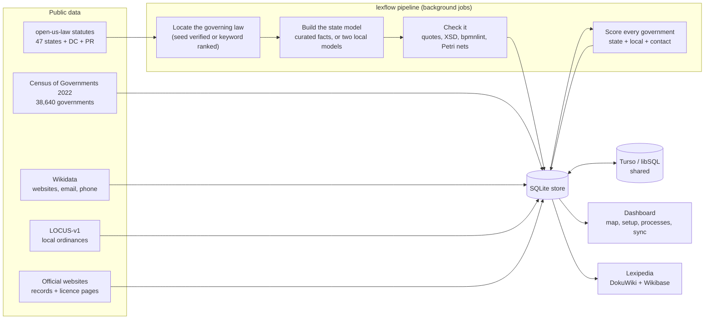

# lexflow

**Step-by-step process maps of US law, for every county, city and town.** lexflow answers two questions for all 38,640 general-purpose local governments in the Census of Governments:

- **How do I request public records?**
- **How do I start a business?**

It finds the state statute that governs each question, turns it into a checked BPMN process map and DMN decision tables (every step tied to a word-for-word quote), adds the local law and the right contact for each government, scores how confident each answer is, and draws all of it on a county map that updates as models are built.

Everything is rebuilt from public data inside Docker. A dashboard walks a new user through the setup as a checklist, runs each step as a background job, and can share results through a [Turso](https://turso.tech) database, so a second machine pulls only the states it needs instead of rebuilding them.


## Where it stands

<picture>
  <source media="(prefers-color-scheme: dark)" srcset="docs/img/states-tier-dark.svg">
  
</picture>

<picture>
  <source media="(prefers-color-scheme: dark)" srcset="docs/img/pipeline-dark.svg">
  
</picture>

<picture>
  <source media="(prefers-color-scheme: dark)" srcset="docs/img/county-confidence-dark.svg">
  
</picture>

<picture>
  <source media="(prefers-color-scheme: dark)" srcset="docs/img/confidence-dark.svg">
  
</picture>

These charts are drawn from [`docs/status.json`](docs/status.json), a snapshot of the database. The snapshot below comes from the first end-to-end run on 9 October 2026, which covered Virginia and the District of Columbia. Every other state needs its statutes downloaded first; that is the next box to tick.

<!-- status:start -->
_Snapshot 2026-10-09. Regenerate with `lexflow export-status` and `node tools/web/readme_charts.mjs`._

- [x] **Load every county, city and town** (required, done): 38,640 governments in 51 states
- [ ] **Download state statutes** (required, partly done): 2 states downloaded
- [x] **Find the state law for each question** (required, done): Public records: 2 states; Start a business: 2 states
- [ ] **Find contacts on Wikidata** (recommended, partly done): 2 of 51 states checked; 0 governments with an email or phone
- [x] **Pull two local models** (recommended, done): Ready: qwen3:1.7b, gemma3:1b
- [ ] **Build the state process models** (required, partly done): Checked by Claude or a person: 2
- [x] **Score every government and refresh the maps** (required, done): 77,280 answers scored
- [ ] **Look for records and licence pages on official websites** (optional, partly done): 1 of 51 states scanned; 1 government with a records or licence page
- [ ] **Scan local ordinances (LOCUS-v1)** (optional, partly done): 1 of 51 states scanned; local law found for 110 governments
- [ ] **Publish to Lexipedia** (optional, not set up): Set DOKUWIKI_URL and DOKUWIKI_TOKEN (a bot account) to enable
- [x] **Share through Turso** (optional, done): Last push 2026-10-09T19:06:07Z: 172,987 rows
<!-- status:end -->

## Run it

You need Docker (Docker Desktop on Windows or macOS).

```bash
git clone https://github.com/alibama/lexflow
```

```bash
cd lexflow && cp .env.example .env
```

```bash
docker compose up -d
```

Open http://localhost:8000 and go to **Setup**. Each step shows a checkbox that ticks itself when its data is in place, what it needs first, and what it costs to run. **Quick start** runs every required step for the states you name (`va`, `va,dc` or `all`).

| Profile | Adds | Command |
|---|---|---|
| (none) | dashboard, API, pipeline | `docker compose up -d` |
| `llm` | Ollama, for local model builds | `docker compose --profile llm up -d` |
| `shared` | a local libSQL server, a stand-in for Turso | `docker compose --profile shared up -d` |
| `search` | SearXNG | `docker compose --profile search up -d` |
| `test` | the test suite | `docker compose --profile test run --rm test` |

Local models run much faster on a GPU. With an NVIDIA card, add `-f docker-compose.gpu.yml`. On a Mac, Docker cannot reach the GPU, so run Ollama natively and set `OLLAMA_URL=http://host.docker.internal:11434` in `.env`. The default pair (`qwen3:1.7b` and `gemma3:1b`) is small enough for a laptop CPU; for real quality, set `LEXFLOW_MODEL_A` and `LEXFLOW_MODEL_B` to larger models from two different families.

Downloads go to `./data/raw` on the host, so they survive `docker compose down -v`. The database, job logs and built models live in the `lexflow-data` volume.

The same steps run from the command line:

```bash
docker compose exec app lexflow status
```

```bash
docker compose exec app lexflow run quickstart --states va
```

## How it works



1. **Governments.** The Census Government Units List gives every county, municipality and township, with an official's title, mailing address, website and FIPS codes.
2. **Statutes.** [open-us-law](https://github.com/Vaquill-AI/open-us-law) publishes one parquet file per state, with a manifest that lists each file's SHA-256, and each section carries the URL of the government publisher. Arkansas, Colorado, Georgia, Mississippi and Tennessee are not in the current release.
3. **Locate the law.** Every section is ranked by its title, chapter and text. A known section number (for example Va. Code § 2.2-3704) is used only after it is found in the file, in force and on topic. Otherwise the top keyword match is used with a lower score, and the other candidates are kept for review.
4. **Build the process model.** Curated facts come first: written by Claude or a person, with every quote re-checked against the downloaded text. Otherwise two local models from different families each extract quote-anchored facts, the existing deterministic compiler turns them into BPMN 2.0 and DMN 1.3, and the result is checked against the OMG schemas, bpmnlint with five legal rules, quote matching and Petri-net soundness. The pair counts as **two models agree** only when their steps, actors and deadlines match.
5. **Local law and contacts.** LOCUS finds local ordinances on public records and business licences. Wikidata (the data behind govdirectory.org) and a polite home-page scan (robots.txt respected) find websites, emails, phone numbers and records or licence pages.
6. **Score.** Each government's answer gets a confidence score (below). A build re-scores each state as soon as its models are done, so the map follows along.
7. **Share and publish.** Results can be pushed to Turso, and pages can be published to Lexipedia (DokuWiki over JSON-RPC, plus Wikibase QuickStatements).

## The dashboard

| Page | What it does |
|---|---|
| **Map** | US counties coloured by answer confidence, state model tier, completion, quality, contacts or local law. One question at a time. Click a county to see each government in it, zoom to a state, or switch to a sortable table. |
| **Setup** | The checklist: service status (Ollama, Turso, wiki), quick start, and every step with its checkbox, cost, options and progress. |
| **Processes** | How many states reach each stage, and a card for every state model. Each model page has the BPMN map, the steps with the exact words they come from, the decision tables, the statute text with quotes highlighted, the local-model runs, and other sections the locator considered. Downloads: `.bpmn`, `.dmn`, `.svg`, facts `.json`. |
| **Data & sync** | Turso status, push and pull (all data or chosen states), pull-as-needed, row counts local vs shared, who built what, and the sync history. |
| **Jobs** | Every background job, with progress and its log. |
| **Method** | The scoring weights and ladders, editable, with a one-click re-score. |

The dashboard checks for changes every few seconds while jobs run, and colours the map again as models are built, checked and scored. It works offline: d3, topojson, the US atlas and bpmn-js are served from the image, not a CDN.

The API is at `/docs` (OpenAPI). For a browser plugin, `/api/lookup?url=<any page on a government site>` returns the government that owns the site, with its answers, steps, citations and contacts.

## Sharing through Turso

The local store is one SQLite file. To share it, set `TURSO_DATABASE_URL` and `TURSO_AUTH_TOKEN` in `.env`:

```bash
turso db create lexflow
```

```bash
turso db show lexflow --url
```

```bash
turso db tokens create lexflow
```

Or use the bundled libSQL server: `docker compose --profile shared up -d`, with `TURSO_DATABASE_URL=http://libsql:8080`.

- **Push** sends rows changed since your last push, optionally for chosen states only.
- **Pull** fetches chosen states. With **pull as needed** on (the default), opening a state that has nothing locally pulls it in the background.
- When the same row is edited in two places, the newer `updated_at` wins. Every row records the machine that wrote it (`LEXFLOW_ORIGIN`), and the dashboard shows who built which models.
- lexflow talks to Turso over its HTTP API (`/v2/pipeline`), so no native driver is needed, and the same code works with Turso cloud and self-hosted `libsql-server`.
- Rows are never deleted on the shared side. A re-scan retires stale local-law matches by setting their score to zero, which syncs like any other change.

## How answers are scored

`confidence = w_state × state law + w_local × local law + w_contact × contact`

| | State law | Local law | Contact |
|---|---|---|---|
| Public records | 0.60 | 0.10 | 0.30 |
| Start a business | 0.45 | 0.35 | 0.20 |

| State model tier | Score | | Contact level | Score |
|---|---|---|---|---|
| Checked by Claude or a person | 1.0 | | Records or licence page, or a records email | 1.0 |
| Two local models agree | 0.8 | | Email or phone | 0.6 |
| One local model | 0.5 | | Website only | 0.35 |
| Law found, no steps yet | 0.3 × locator score | | Mailing address only | 0.15 |
| No state law found | 0 | | None | 0 |

Local law found in LOCUS scores 0.6 × match strength. All of these numbers can be changed on the Method page.

Each state model also records **completion** (eight stages: law located, text loaded, facts extracted, cross-checked, BPMN/DMN compiled, checks pass, reviewed, published) and **quality**. Quality is the mean of: the share of quotes that match exactly, schema validity, bpmnlint, Petri-net soundness, the share of elements grounded explicitly in the text, and agreement between the two models.

## What is verified

As of 9 October 2026, on a Windows laptop with no GPU:

- **Tests:** 64 pass inside the Docker image, the 45 original ones plus 19 for the product layer. One more, a live DokuWiki round trip, is skipped unless a test wiki is configured.
- **Checked Virginia models:** records (Va. Code § 2.2-3704) and business formation (§§ 13.1-1010, -1011, -1005, -1004). All 30 quotes match the statute text word for word; there are no schema or bpmnlint errors, and both Petri nets are sound. Quality is 0.98 and 1.00.
- **Locator:** found all four laws for Virginia and DC through known section numbers, each verified against the downloaded text. With the known section numbers switched off, keyword ranking alone also picks the right section in all four cases on the full statute files (Va. Code §§ 2.2-3704 and 13.1-1011, D.C. Code §§ 2-532 and 29-802.01).
- **Wikidata:** matched 319 of Virginia's 322 governments. **LOCUS:** read 106,155 Virginia rows in about 12 seconds and found local law on the two questions for 110 governments.
- **Scores:** Virginia's mean confidence is 0.70 for records and 0.56 for business. The earlier run on the Mac gave 0.69 and 0.52.
- **Sync:** a full push to libSQL matched every table row for row. A second, empty lexflow instance pulled Virginia automatically when it was opened, and showed the same scores.

**Not yet verified:**
- **Local-model quality.** The first live run of the two-model path, `qwen3:1.7b` and `gemma3:1b` on CPU for DC, generates about 4 tokens a second. Choosing models for real use needs a GPU and the scorer in `lexflow/extract/evaluate.py`.
- **All states.** The locator has not been run across every state yet.
- **Live publishing.** Nothing has been published to lexipedia.xyz.
- **Website scan.** The home-page scan has only been run for DC.

## Known gaps

- **Missing statutes.** No statute file for AR, CO, GA, MS or TN in open-us-law v2026.09.1. The earlier run found no public-records act in the data for IL, NE or PA; seeds for those states are hints and need checking.
- **Old map boundaries.** The map uses 2017 county boundaries. Connecticut now reports by planning region, so its old counties show statewide figures, and Valdez-Cordova, AK shows its two successor areas.
- **Local business law.** "Start a business" covers state entity formation; local business licences count only through LOCUS matches. No local process models are built yet.
- **Licences.** LOCUS labels are machine-made and CC BY-NC; LOCUS is used to find law, never to cite it. open-us-law is CC BY-NC 4.0, and commercial use needs a licence from Vaquill AI.

## Data sources and licences

| Source | Used for | Terms |
|---|---|---|
| [Census of Governments 2022](https://www.census.gov/programs-surveys/gus.html) | the list of governments | US government work |
| [open-us-law](https://github.com/Vaquill-AI/open-us-law) (Vaquill AI) | state statutes | data CC BY-NC 4.0; statute text itself is a government edict |
| [LOCUS-v1](https://huggingface.co/datasets/LocalLaws/LOCUS-v1) | finding local ordinances | CC BY-NC 4.0 |
| [Wikidata](https://www.wikidata.org) | websites, emails, phones | CC0 |
| [us-atlas](https://github.com/topojson/us-atlas) | map shapes | ISC, from Census cartographic boundaries |
| pm4py, powl | Petri nets | AGPL-3.0 |
| SpiffWorkflow | simulation | LGPL-3.0 |

No licence has been chosen for lexflow itself yet. None of this is legal advice: take the licensing questions to counsel before loading derived data anywhere public.

## Layout

```
lexflow/            the package
  ir.py, bpmn_xml.py, dmn_xml.py, layout.py, validate.py, petri.py, ...   the core (see docs/core.md)
  extract/          facts schema, Ollama client, compiler, scorer
  municipal/        governments, statutes, locator, contacts, crawl, LOCUS scan, build, quality, scoring, stats
  store/            SQLite store and Turso sync
  pipeline/         the setup checklist (steps) and background jobs
  api/              FastAPI app: the dashboard's API and the plugin lookup
  cli.py            python -m lexflow ...
dashboard/          the web dashboard (no build step)
curated/            checked facts per state and question (curated/va/*.json)
tools/web/          front-end libraries and the README chart renderer
tools/node*         bpmnlint (+ legal rules), dmnlint, bpmn-auto-layout
docs/               core documentation, status snapshot, README images
tests/              64 tests
fixtures/           LOCUS rows, gold facts, Legistar sample, Virginia statute sections
```

To refresh the charts and the status block above after a run:

```bash
docker compose exec app lexflow export-status /data/status.json
```

```bash
docker compose cp app:/data/status.json docs/status.json
```

```bash
node tools/web/readme_charts.mjs docs/status.json docs/img
```

The BPMN/DMN core, the gold models, the patches for bpmn-assistant and SpiffWorkflow, and publishing to DokuWiki and Wikibase are documented in [docs/core.md](docs/core.md).
