# Cross-references as decision requirements: Cal. Bus. & Prof. Code § 480

_10 October 2026. A design prototype. It shows how the cross-references in one statute section define a DMN decision, and how the process models that produce that decision's inputs link to each other. The worked example is Cal. Bus. & Prof. Code § 480, which governs denying a license because of a conviction. Va. Code § 54.1-204 is the second example. Statute text comes from the lexflow index (open-us-law v2026.09.1, `I.text_of('ca', 5)`). The cross-references come from the gold set `fixtures/xref/gold_b.json`. Nothing was written to the database, the wiki or Wikibase._

Files:

| File | What it is |
|---|---|
| `out/design/bpc_480.dmn` | A DMN 1.3 model with a full decision requirements diagram (DRD) and its decision tables: 15 decisions (9 tables with 43 rules, 4 FEEL literal expressions, 2 findings), 20 input data, 32 knowledge sources, 89 requirements (42 information, 47 authority), and DMNDI shapes and edges. |
| `out/design/check_bpc_480.py` | Validates and evaluates the model, then mutates copies of it. All 9 check groups pass (the run is recorded in §7). |
| `lexflow/law/links.py` | Prototype of the link schema: `ProvidedStatus`, `RequiredInput`, `ProcessLink`, `propose_links`, `shared_sections`. |
| `tests/test_links.py` | 32 tests. The last 8 pin fixes to the DMN through its checker, so they need `out/design` (or copies named by `LEXFLOW_BPC480_DIR`) and are skipped without it. All 32 pass in the container with the copies named. |

**Revised after verification.** `docs/design/verify-dmn-links.md` checked the first version adversarially. This version fixes what it found:

- **Date defect.** Discipline with no date, or dated after the application, no longer counts as older than seven years. A new literal decision, `discipline_older`, is true only for a date strictly earlier than seven years before the application. Rows 7 and 8 of `discipline_ground` require it, and a new row 9 gives no ground when neither `discipline_recent` nor `discipline_older` holds.
- **Every rule pinned.** The first checks pinned only 28 of the 41 rules. There are now 26 applicants and 16 counterfactuals (the numbers here are those of the version revised after the second re-check, below). Each one states the value of every decision and the rule every table must hit, and together they reach all 43 rules. A new check group (9) flips each rule's output, and applies 31 semantic mutations, on copies of the model. Every mutant is caught, and each one changes `may_deny` or its basis for some applicant.
- **Registration tier.** It is an input now, not a finding on the offense, because PEN § 290(d) assigns the tier from more than the offense. The factors are listed in its documentation (part 4).
- **§ 7.5(a) finality** has its own input, `conviction_final`, and its own row (row 7 of `conviction_ground`).
- **Numbers.** Two of the three borrowed definitions get term keys, not three. § 480 has 14 dismissal references, not 15.
- **Readings.** The third reading of the older-discipline sentence is now in part 5, and so is a note on the serious-felony finding.

**Revised again after the re-check.** The re-check (the last section of `verify-dmn-links.md`) found that pinning every rule's output did not pin every cell or literal. Seven one-line changes still passed every check, and group 6 overrode the four date decisions. This version closes those gaps. It does not change any answer the model gives.

- **The seven changes now fail.** Each one changes `may_deny` for an applicant added for it (§7):
  - the "presently incarcerated" limb removed: Y;
  - `release_date <= application_date` removed: Z;
  - a unit dropped from the (a)(1)(B) list: D1 (professional fiduciaries), D3 (private investigators), D4 (funeral directors) and D5 (cemetery managers). D2 (contractors) does the same for the contractor unit, which F caught only as an intermediate value;
  - `discipline_older` widened alone: R′.
- **Group 6 no longer masks the date decisions.** The comparison with the curated table used to override `conviction_recent`, `incarceration_recent`, `discipline_recent` and `discipline_older`. It now realises the curated `within_seven_years` with concrete dates and present incarceration, and evaluates the whole DRD. The evaluator no longer accepts overrides at all. The dates sit five months or more from the seventh anniversary, and none falls after the application. So the curated boolean is not taken to settle the boundary readings; the applicants pin those. There are 672 realisations.
- **A sweep of single changes** is now part of check 9. In that version it covered every operator, connective and conjunct of the date literals, with each duration made one year shorter and one year longer; every input cell set to `-`; every boolean cell negated; every list cell with one value dropped or added; and every complementary pair of list cells changed together. The sweep found three more changes that passed: the date of application itself excluded from each "within" window (`<=` → `<`). Counterfactuals L′, Z′ and S′ now pin the model's reading that the date of application counts. G″ (tier two) pins a change that only group 6 had caught. All 444 single changes of that version failed a check. The third revision, below, widens the sweep.
- **Readings are labelled in the model.** In the DMN's "Source" annotation column, every citation whose grounding is `implied` now carries "(reading)". Four rules have such citations, with five marks between them: `conviction_ground` r7, `discipline_ground` r7 and r9, and `may_deny` r2. The checker verifies the column. Row 9 of `discipline_ground` was the unclear case. Its two quotes (Q12 and Q17) are both readings, and part 4 now marks each one.
- **The time of "presently".** The text does not say whether "presently incarcerated" means on the date of application or when the board decides. The model takes the input as given, and part 5, reading 3 now says so. Applicant Z avoids the question: Z was jailed only between the application and the board's decision, so on either date Z was not incarcerated.

**Revised a third time, after the second re-check.** The second re-check (the section "Re-check 2" of `verify-dmn-links.md`) found two gaps in the checks and two in wording. The conviction and release windows could be widened by less than seven months (`P7Y1M`, `P7Y6M`) with every check passing. Check 9 stopped with a traceback when a mutation's target was missing from the model. The checker's docstring said every input cell was negated. And the wording on "presently incarcerated" named only one of the two cases where its two readings differ (the re-check accepted the model's choice itself). This version closes all four. It changes no answer the model gives. The only change to the model itself is the wording of one note (the last item below).

- **The day before the anniversary is pinned for a conviction and for a release,** as R′ and T′ already pinned it for discipline. Counterfactual J′ is J convicted on 2019-09-30, and I′ is I released on 2019-09-30. Both expect `may_deny` false. Durations in the model are whole months, and lengthening a window's duration by any whole number of months brings 2019-09-30 inside it, so every such change turns J′'s or I′'s `may_deny` true. Semantic mutations 30 and 31 widen each window by one month (`P7Y1M`), and J′ and I′ catch them.
- **The sweep moves each duration by months,** by every whole number of months from 1 to 12, shorter and longer: 24 changes per duration, where the earlier sweep made only the two one-year changes. It also swaps `-` and `+` and replaces each `*_date` name by each other `*_date` name of the same literal. For list cells it adds negation (putting a list into `not(...)`, or taking it out) and putting another allowed value in place of a listed one, in single cells and in complementary pairs. All 608 single changes fail a check.
- **A mutation that cannot be applied is reported, not raised.** `run_mutant` used to stop the checker when the model had been edited so that a mutation's target text was gone. It now catches the failure, and check 9 prints it as a failing check ("the copy is unchanged: the mutation cannot be applied …") and goes on, so the applicant table and the final `FAILED:` line are still printed. The sweep counts such a change as not caught. A test pins this on the release-bound edit that the re-check used.
- **Wording.** The checker's docstring now says what the sweep does to boolean cells and to list cells. Both kinds are now negated.
- **The time of "presently".** The note on `incarceration_recent` and part 5, reading 3 now name both cases where the two views differ. One is an applicant incarcerated on the date of application and released before the decision. The other is an applicant first incarcerated after the application and still incarcerated when the board decides.

## Summary

- **One decision, five kinds of reference.** The gold set records 53 references in § 480, 38 of them to other sections or units. Only a few of those references shape the decision, and each one plays a different part:
  - Definitions: PEN § 1192.7 "serious felony", BPC § 7.5 "conviction", BPC §§ 726 and 729.
  - Scope: the licensing chapters listed in (a)(1)(B)(i)–(v), and the PEN § 290(d) tiers.
  - Prerequisite processes: the five dismissal sections PEN §§ 1203.4–1203.425, the certificate of rehabilitation under PEN §§ 4852.01 et seq., and BPC § 482.
  - Authority: the board's regulations.
  - Overrides: "any other provision of this code".

  In the DMN, each reference becomes a knowledge source. The role it plays, taken from the gold set, determines what the source attaches to.
- **Precedence lives in the DRD, not in rule order.** "However" in (a)(1) is an exception to the time limit, not to the ground, so it gets a decision of its own (`lookback_lifted`) that feeds the ground. "Notwithstanding any other provision of this code" in (b) and (c) gets a decision (`conviction_barred`) that the top decision tests first. In every row where the bar applies, the top table ignores the conviction ground (`-`). Every table is UNIQUE, so each table can be checked for Catala's two failures: *conflict* (two rules match) and *empty* (no rule matches). No table uses FIRST or PRIORITY. Section 3 explains why.
- **Three inputs are statuses that other procedures produce.**
  - `conviction_dismissed` comes from the dismissal model `ca.record_sealing`. Its outcome `dismissed` is quoted from § 1203.4.
  - `certificate_of_rehabilitation` comes from a court process that has no model yet.
  - `showing_of_rehabilitation` comes from the board's own § 482 finding inside `ca.license_conviction`.

  The link prototype finds the first of these with no hand-written mapping. It matches the targets of § 480's `prerequisite_process` references against the gold sections of the other curated models. It reports § 4852.01 as a model to build.
- **The check results:**
  - The model validates against the OMG DMN 1.3 XSD, passes dmnlint, and imports into bpmn.io's dmn-moddle (the reader behind dmn-js and the DokuWiki plugin) with no warnings.
  - All 55 quotes are verbatim, and each sits in the subdivision it cites.
  - All 23 knowledge-source spans equal the gold cross-references.
  - 26 applicants and 16 counterfactuals evaluate as expected, decision by decision. Together their rule paths reach all 43 rules. SpiffWorkflow and lexflow's evaluator agree on all 376 points of the tables' domains.
  - With no discipline record, the DRD gives the same answer as the curated FIRST table in `curated_ask/license_conviction/ca.json` at all 672 points tested. Each point is realised with concrete dates, so the date decisions are evaluated too.
  - Every copy of the model with one rule's output flipped (43), one semantic mutation (31) or one single change of the sweep (608) fails these checks. Each flip and each semantic mutation changes `may_deny` or its basis for some applicant. This covers the sweep's families of change, not every possible edit (§7).
- **Virginia is a different shape.** § 54.1-204 has no time limit and no bright-line bars. Whether a conviction "directly relates" is a nine-factor standard, which DMN should hold as a *finding* with nine inputs, not as a table. The section cites no other process. The link to record sealing comes from §§ 19.2-392.4(B) and 19.2-392.15(C), which sit in the same chapters as the sealing model's sections: a weaker, undirected signal (score 0.3).

---

## 1. What § 480 says, as structure

| Subdivision | What it does | Force | Words |
|---|---|---|---|
| (a) | The board may deny on a conviction or on formal discipline "only if" (1) or (2) holds | ground, with an override of the rest of the code | "Notwithstanding any other provision of this code" |
| (a)(1) | Substantially related conviction within 7 years, or incarceration or release within 7 years | base rule | |
| (a)(1)(A), (B) | The 7-year limit does not apply to a serious felony or a tier two/three registrable crime (A), or to a fiduciary financial felony for a listed license (B) | exception to the *limit* | "However, the preceding seven-year limitation shall not apply" |
| (a)(2) | Formal discipline within 7 years, for misconduct and substantially related; older discipline only for BPC § 726 or § 729(a) conduct | base rule, with its own exception | "However, prior disciplinary action … shall not be the basis" |
| (b) | No denial on a conviction after a certificate of rehabilitation, clemency or pardon, or a § 482 showing | override | "Notwithstanding any other provision of this code" |
| (c) | No denial on a conviction dismissed under PEN §§ 1203.4–1203.425 or a comparable dismissal | override | same |
| (d) | No denial on an arrest that did not end in a conviction | override | same |
| (h) | "Conviction" has the meaning of § 7.5, whose subdivision (a) also says when a board may act on one (finality) | definition by reference | |

Subdivisions (e), on false statements, (f) and (g), on procedure and records, and (i), the excluded entities, are outside this decision. They belong to the process model (`ca.license_conviction`).

## 2. The decision requirements diagram

Arrows point from what is required to the element that requires it, as DMN draws them. Solid arrows are information requirements and dashed arrows are authority requirements. Knowledge sources are shown in groups. The model has one knowledge source per cited section, and each is listed in the table under the diagram.

```mermaid
flowchart BT
  subgraph inputs[Input data]
    app([application_date]); off([offense]); tier([sex_offender_tier]); disp([disposition]); cdate([conviction_date])
    fin([conviction_final]); incar([presently_incarcerated]); rel([release_date]); prof([profession]); sub([substantially_related])
    cert([certificate_of_rehabilitation]); pard([pardon_or_clemency]); show([showing_of_rehabilitation])
    dism([conviction_dismissed]); fd([formal_discipline]); ddate([discipline_date]); cause([misconduct_cause_for_discipline])
    drel([discipline_substantially_related]); rests([discipline_rests_on_conviction]); sex([sexual_misconduct_726_729])
  end
  sf[serious_felony*]; fid[fiduciary_financial_felony*]
  ea[exception_a]; eb[exception_b]; ll[lookback_lifted]
  cr[conviction_recent~]; ir[incarceration_recent~]; dr[discipline_recent~]; dold[discipline_older~]
  cg[conviction_ground]; dg[discipline_ground]; rb[rehabilitation_bar]; db[dismissal_bar]; cb[conviction_barred]
  top[may_deny]
  off --> sf & fid; prof --> fid & eb
  sf --> ea; tier --> ea; fid --> eb; ea --> ll; eb --> ll
  app --> cr & ir & dr & dold; cdate --> cr; incar --> ir; rel --> ir; ddate --> dr & dold
  disp --> cg; fin --> cg; sub --> cg; cr --> cg; ir --> cg; ll --> cg
  fd --> dg; cause --> dg; drel --> dg; dr --> dg; dold --> dg; rests --> dg; dism --> dg; sex --> dg
  cert --> rb; pard --> rb; show --> rb; dism --> db; rb --> cb; db --> cb
  cb --> top; cg --> top; dg --> top; rests --> top
  K480>"§ 480 (a), (a)(1), (a)(1)(A), (a)(1)(B), (a)(2), (b), (c), (d), (h)"] -.-> top & cg & dg & ea & eb & ll & rb & db & cb
  KDEF>"definitions: PEN 1192.7, BPC 7.5, 726, 729"] -.-> sf & cg & dg
  KPROC>"processes: ca.record_sealing (PEN 1203.4 to 1203.425), ca.certificate_of_rehabilitation (PEN 4852.01), BPC 482"] -.-> db & dg & rb
```



`*` marks a finding (no executable logic) and `~` marks a FEEL literal expression.

**Decisions.** Each decision's authority requirement points at the § 480 subdivision that governs it. The check script verifies that every decision has one.

| Decision | Question | Logic | Governing subdivision | Other authorities |
|---|---|---|---|---|
| `serious_felony` | Serious felony as defined in PEN § 1192.7(c)? | finding: a closed list (a candidate business knowledge model, BKM). Some items turn on how the offense was committed, so it reads the record of conviction, not only the code section (part 5, reading 9). | (a)(1)(A) | PEN § 1192.7 (definition) |
| `fiduciary_financial_felony` | Financial felony directly and adversely related to fiduciary duties? | finding: board regulations | (a)(1)(B) | regulations adopted by the board (authority, unresolved) |
| `exception_a`, `exception_b` | Does (A) or (B) apply? | UNIQUE tables | (a)(1)(A), (a)(1)(B) | PEN 1192.7 (definition), PEN 290 (scope); BPC 6500, 7000, 7512, 7600, 10000 (scope) |
| `lookback_lifted` | "However": is the seven-year limit lifted? | UNIQUE | (a)(1) | |
| `conviction_recent`, `incarceration_recent` | Within the preceding seven years? | FEEL literal (date arithmetic) | (a)(1) | |
| `conviction_ground` | Is the (a)(1) ground met? | UNIQUE | (a), (a)(1), (d), (h) | BPC § 7.5 (definition, and the finality of (a)), BPC § 481 (criteria; an *incoming* reference) |
| `discipline_recent` | Discipline within seven years? | FEEL literal | (a)(2) | |
| `discipline_older` | Discipline earlier than seven years preceding the date of application? | FEEL literal | (a)(2) | |
| `discipline_ground` | Is the (a)(2) ground met? | UNIQUE | (a), (a)(2) | BPC 726, 729 (definition), BPC 2000 et seq. (condition), process `ca.record_sealing` |
| `rehabilitation_bar` | Does the (b) bar apply? | UNIQUE | (b) | process `ca.certificate_of_rehabilitation` → PEN 4852.01; BPC 482; executive clemency |
| `dismissal_bar` | Does the (c) bar apply? | UNIQUE | (c) | process `ca.record_sealing` → PEN 1203.4, 1203.4a, 1203.41, 1203.42, 1203.425 |
| `conviction_barred` | "Notwithstanding": is denial on the conviction barred? | UNIQUE | (b), (c) | |
| `may_deny` (top) | May the board deny on a conviction or prior discipline? | UNIQUE, outputs `may_deny` and `basis` | (a), (b), (c) | used by task `decide_ground` of `ca.license_conviction` (`usingTask`) |

**Knowledge sources by role.** The role is the gold reference's role. The check script verifies each span against `gold_b.json`, character for character.

| Role | Sources | Attached to |
|---|---|---|
| governs | § 480(a), (a)(1), (a)(2); (a)(1)(A), (a)(1)(B) (exceptions); (b), (c), (d) (overrides); (h) (definition by reference) | the decision each subdivision governs |
| definition | PEN § 1192.7 (span "Section 1192.7 of the Penal Code", 1109–1141), BPC § 7.5, § 726, § 729 | the classification or ground decision that uses the defined term |
| scope | PEN § 290 ((d)(2), (d)(3)), BPC §§ 6500, 7000, 7512, 7600, 10000 | `exception_a`, `exception_b` |
| prerequisite_process | PEN §§ 1203.4, 1203.4a, 1203.41, 1203.42, 1203.425, 4852.01; BPC § 482 | PEN §§ 1203.4–1203.425 and 4852.01: through the producing *process-model* source, which requires them (knowledge source → knowledge source). BPC § 482: directly on `rehabilitation_bar` (the board's own finding). |
| authority | "regulations adopted by the board" (unresolved, Cal. Code Regs.); executive clemency (no citation in the text) | `fiduciary_financial_felony`, `rehabilitation_bar` |
| condition | BPC §§ 2000 et seq. (the physician-and-surgeon yardstick) | `discipline_ground` |
| criteria (incoming) | BPC § 481 | `conviction_ground`. § 480 does not cite § 481, but § 481(a) governs the "substantially related" finding. |
| provides | `lexflow:process:ca.record_sealing`, `lexflow:process:ca.certificate_of_rehabilitation` (proposed) | the decisions that read their statuses |

Two things were dropped for tooling reasons:

- **The board as decision maker.** DMN's `decisionMaker` must point at an `organizationUnit`, which bpmn.io's dmn-moddle (as used by dmnlint) cannot read. dmnlint failed with "unparsable content <organizationUnit>". The board is therefore carried as `lex:decisionMaker`, keyed `lexflow:role:ca:license_conviction:board`.
- **Human-readable names.** Element names are snake_case so that they are valid both as FEEL names and as SpiffWorkflow Python names. The readable text is in DMN 1.3's `label` attribute, but dmn-js shows names.

## 3. Hit policy: how "notwithstanding" and "however" are encoded

The literature review (§2 of `links-literature.md`) set the constraints:

- Statutes are a static tree of exceptions (Catala).
- PRIORITY ranks output *values*, not rules (DMN 1.3).
- Sibling exceptions should be UNIQUE.
- Parent-over-child precedence goes either to FIRST with the exceptions above the base rule, or to chained decisions.

**Choice: chained decisions, one per exception level, with every table UNIQUE.** The levels are:

1. **Base grounds.** `conviction_ground` holds (a)(1) and `discipline_ground` holds (a)(2).
2. **"However" in (a)(1).** This is an exception to the *seven-year limitation*, not to the ground. Its siblings (A) and (B) are separate decisions. `lookback_lifted` combines them in a UNIQUE table that writes the both-apply row out explicitly (A and B together lift the limit, so the case is not a conflict). That table feeds the ground as one column.
3. **"However" in (a)(2).** This exception sits inside the same paragraph and has the same consequence (no ground). It stays a row of `discipline_ground` (row 4). It is mutually exclusive with base rows 5 and 6 through the "based on the conviction" and "dismissed" columns.
4. **"Notwithstanding" in (b) and (c).** Each bar is its own decision, so that each authority requirement points at its own subdivision. `conviction_barred` merges the two bars. The top decision tests that merged bar, and in every row where it is true the conviction-ground column is `-`. That dash is what "notwithstanding" means here: when the override applies, the base rule is not consulted. (d) has the same force. It sits in row 1 of `conviction_ground`, because without a § 7.5 conviction the (a)(1) ground never arises. § 7.5(a)'s finality sits beside it, in row 7: a conviction that is not yet final gives no ground yet.

**Why not FIRST.** FIRST would work. Bars first and grounds last is how the curated `conviction_ground` table does it, and §7 shows the two are equivalent. But under FIRST the precedence lives only in row order:

- Rows overlap by design, so the overlap report cannot tell intended shadowing from a mistake.
- Catala's *conflict* check stops being meaningful, because the table always silently picks the first match.
- A reordering edit changes the law without any diff in the cells.

The DMN specification itself calls FIRST "not considered good practice".

**Why not PRIORITY.** It ranks output values. For `may_deny` the ranking "barred > may deny > no ground" happens to coincide with the precedence, but only by accident:

- The ranking fails as soon as two reasons share an output value with different precedence.
- It is undefined for the free-text `basis` output, which has no list of allowed values.
- lexflow's own evaluator (`dmn_eval.decide`) treats every hit policy other than UNIQUE and COLLECT as first-hit, so a PRIORITY table would silently run as FIRST.

**ANY** is the honest alternative for agreeing siblings. Rows `(true, -)` and `(-, true)` with the same output are valid under ANY. It was not used, because `dmn_eval` does not check ANY's same-output rule, and the explicit both-apply row keeps the model checkable by the UNIQUE overlap test.

## 4. The decision tables

Every rule cites its subdivision and quotes the words it rests on. In the `.dmn` file each rule carries its full quotes in `lex:grounding/lex:source`. The "Source" annotation column, which dmn-js shows, gives the rule's citations, with "(reading)" after each implied one, and its first quote. Here the quotes are numbered once, and the tables refer to them. The check script verifies that each quote is verbatim in the index text and that it lies inside the cited subdivision, using an outline of the cited section's paragraphs. "(reading)" marks an interpretation the text does not state in terms (grounding `implied`). Section 5 explains each one.

Quotes from § 480:

- **Q1** (a)(1)(A): "The applicant was convicted of a serious felony, as defined in Section 1192.7 of the Penal Code"
- **Q2** (a)(1)(A): "a crime for which registration is required pursuant to paragraph (2) or (3) of subdivision (d) of Section 290 of the Penal Code"
- **Q3** (a)(1)(B): "The applicant was convicted of a financial crime currently classified as a felony that is directly and adversely related to the fiduciary qualifications, functions, or duties of the business or profession for which the application is made, pursuant to regulations adopted by the board"
- **Q4** (a)(1)(B): "for which the applicant is seeking licensure under any of the following:"
- **Q5** (a)(1): "However, the preceding seven-year limitation shall not apply in either of the following situations:"
- **Q6** (d): "a board shall not deny a license on the basis of an arrest that resulted in a disposition other than a conviction"
- **Q7** (h): "as used in this section shall have the same meaning as defined in Section 7.5"
- **Q8** (a)(1): "that is substantially related to the qualifications, functions, or duties of the business or profession for which the application is made"
- **Q9** (a)(1): "The applicant has been convicted of a crime within the preceding seven years from the date of application that is substantially related to the qualifications, functions, or duties of the business or profession for which the application is made, regardless of whether the applicant was incarcerated for that crime"
- **Q10** (a)(1): "for which the applicant is presently incarcerated or for which the applicant was released from incarceration within the preceding seven years from the date of application"
- **Q11** (a): "a board may deny a license regulated by this code on the grounds that the applicant has been convicted of a crime or has been subject to formal discipline only if either of the following conditions are met"
- **Q12** (a)(2): "The applicant has been subjected to formal discipline by a licensing board in or outside California within the preceding seven years from the date of application"
- **Q13** (a)(2): "based on professional misconduct that would have been cause for discipline before the board for which the present application is made"
- **Q14** (a)(2): "and that is substantially related to the qualifications, functions, or duties of the business or profession for which the present application is made"
- **Q15** (a)(2): "However, prior disciplinary action by a licensing board within the preceding seven years shall not be the basis for denial of a license if the basis for that disciplinary action was a conviction that has been dismissed pursuant to Section 1203.4, 1203.4a, 1203.41, 1203.42, or 1203.425 of the Penal Code or a comparable dismissal or expungement."
- **Q16** (a)(2): "Formal discipline that occurred earlier than seven years preceding the date of application may be grounds for denial of a license only if the formal discipline was for conduct that, if committed in this state by a physician and surgeon licensed pursuant to Chapter 5 (commencing with Section 2000) of Division 2, would have constituted an act of sexual abuse, misconduct, or relations with a patient pursuant to Section 726 or sexual exploitation as defined in subdivision (a) of Section 729."
- **Q17** (a)(2): "Formal discipline that occurred earlier than seven years preceding the date of application may be grounds for denial of a license only if"
- **Q18** (b): "if that person has obtained a certificate of rehabilitation under Chapter 3.5 (commencing with Section 4852.01) of Title 6 of Part 3 of the Penal Code"
- **Q19** (b): "has been granted clemency or a pardon by a state or federal executive"
- **Q20** (b): "or has made a showing of rehabilitation pursuant to Section 482"
- **Q21** (b): "Notwithstanding any other provision of this code, a person shall not be denied a license on the basis that the person has been convicted of a crime, or on the basis of acts underlying a conviction for a crime"
- **Q22** (c): "Notwithstanding any other provision of this code, a person shall not be denied a license on the basis of any conviction, or on the basis of the acts underlying the conviction, that has been dismissed pursuant to Section 1203.4, 1203.4a, 1203.41, 1203.42, or 1203.425 of the Penal Code, or a comparable dismissal or expungement"
- **Q23** (b): "or on the basis of acts underlying a conviction for a crime"
- **Q24** (c): "or on the basis of the acts underlying the conviction"
- **Q25** (a): "only if either of the following conditions are met"
- **Q26** (a)(1): "within the preceding seven years from the date of application"

Quote from BPC § 7.5, which (h) brings in:

- **Q27** § 7.5(a): "Any action which a board is permitted to take following the establishment of a conviction may be taken when the time for appeal has elapsed, or the judgment of conviction has been affirmed on appeal or when an order granting probation is made suspending the imposition of sentence."

**Findings** (no executable logic; the evaluator takes them as given): `serious_felony` (boolean) and `fiduciary_financial_felony` (boolean, under the board's regulations).

**The registration tier is an input, not a finding.** `sex_offender_tier` takes `"none"`, `"tier_one"`, `"tier_two"` or `"tier_three"`: the tier as ascertained. The first version derived it from `offense` alone. PEN § 290(d) does not work that way, so the input's description in the model lists what the tier turns on:

- (d)(1) **tier one**: a registrable misdemeanor, or a registrable felony that is not a serious or violent felony under § 667.5(c) or § 1192.7(c).
- (d)(2) **tier two**: a registrable offense also described in § 667.5(c) or § 1192.7(c); § 285; § 286(g) or (h); § 287(g) or (h); § 289(b); or a second or subsequent § 647.6 conviction brought and tried separately.
- (d)(3) **tier three** if any one of these applies:
  - after a registrable conviction, a later conviction of a violent felony in a separate proceeding ((A));
  - commitment as a sexually violent predator under Welf. & Inst. Code §§ 6600 et seq. ((B));
  - a conviction of an offense listed in (C) or (I)–(R);
  - a SARATSO risk level of well above average at release ((D));
  - habitual sex offender status under § 667.71 ((E));
  - two separately tried § 288(a) convictions ((F));
  - a sentence of 15 to 25 years to life under § 667.61 ((G));
  - registration under § 290.004 ((H)).
- (d)(4): registration under § 290.005, for another jurisdiction's offense or registration duty.
- (d)(5): the Department of Justice may place a person in a tier-to-be-determined category, and must ascertain the tier within 24 months. The model does not evaluate that category: the tier has to be ascertained first.

Applicant G shows why the tier is an input. A misdemeanor under § 647.6(a) is tier one by the offense, but tier three when the SARATSO risk level was well above average at release.

**FEEL literal expressions.** The date arithmetic follows FEEL: a date minus a years-and-months duration clamps the day to the end of the month, so 2024-02-29 + P7Y = 2031-02-28.

- `conviction_recent`, (a)(1) Q26: `conviction_date != null and conviction_date >= application_date - duration("P7Y") and conviction_date <= application_date`. Both ends are readings (part 5, reading 3). The anniversary counts as within, and so does the date of application itself; a later date does not.
- `incarceration_recent`, (a)(1) Q10: `presently_incarcerated = true or (release_date != null and release_date >= application_date - duration("P7Y") and release_date <= application_date)`. Release dates have the same two ends. `presently_incarcerated` is taken as given (part 5, reading 3).
- `discipline_recent`, (a)(2) Q12: the same form as `conviction_recent`, on `discipline_date`
- `discipline_older`, (a)(2) Q17: `discipline_date != null and discipline_date < application_date - duration("P7Y")`. The comparison is strict, so the anniversary stays in `discipline_recent`. A null date, or a date after the application, makes both `discipline_recent` and `discipline_older` false.

**`exception_a`**: does (a)(1)(A) apply? UNIQUE.

| # | Serious felony | Registration tier | → (A) applies | Rests on |
|---|---|---|---|---|
| 1 | `true` | `-` | `true` | (a)(1)(A) Q1 |
| 2 | `false` | `"tier_two","tier_three"` | `true` | (a)(1)(A) Q2 |
| 3 | `false` | `not("tier_two","tier_three")` | `false` | (a)(1)(A) Q2 |

**`exception_b`**: does (a)(1)(B) apply? UNIQUE. LISTED = `"bpc_d3_ch6_professional_fiduciary","bpc_d3_ch9_contractor","bpc_d3_ch11_3_private_investigator","bpc_d3_ch12_funeral_director","bpc_d3_ch12_cemetery_manager","bpc_d4_real_estate"`. These are units (i)–(v): the Professional Fiduciaries Act, the Contractors State License Law, the Private Investigator Act, funeral directors and cemetery managers under the Cemetery and Funeral Act, and the Real Estate Law. Other Chapter 12 licenses are `"other"`.

| # | Fiduciary financial felony | License applied for | → (B) applies | Rests on |
|---|---|---|---|---|
| 1 | `true` | LISTED | `true` | (a)(1)(B) Q3; (a)(1)(B) Q4 |
| 2 | `true` | `not(`LISTED`)` | `false` | (a)(1)(B) Q4 |
| 3 | `false` | `-` | `false` | (a)(1)(B) Q3 |

**`lookback_lifted`**: "However": is the seven-year limitation lifted? UNIQUE.

| # | (A) applies | (B) applies | → Lifted | Rests on |
|---|---|---|---|---|
| 1 | `true` | `true` | `true` | (a)(1) Q5 (both apply: same effect, no conflict) |
| 2 | `true` | `false` | `true` | (a)(1) Q5 |
| 3 | `false` | `true` | `true` | (a)(1) Q5 |
| 4 | `false` | `false` | `false` | (a)(1) Q5 (neither situation applies) |

**`conviction_ground`**: is the (a)(1) ground met? UNIQUE.

| # | Disposition | Final (§ 7.5(a)) | Substantially related | Convicted within 7 years | Incarcerated, or released within 7 years | Limit lifted | → Ground | Rests on |
|---|---|---|---|---|---|---|---|---|
| 1 | `not("conviction")` | `-` | `-` | `-` | `-` | `-` | `false` | (d) Q6; (h) Q7 |
| 2 | `"conviction"` | `true` | `false` | `-` | `-` | `-` | `false` | (a)(1) Q8 |
| 3 | `"conviction"` | `true` | `true` | `true` | `-` | `-` | `true` | (a)(1) Q9 |
| 4 | `"conviction"` | `true` | `true` | `false` | `true` | `-` | `true` | (a)(1) Q10 |
| 5 | `"conviction"` | `true` | `true` | `false` | `false` | `true` | `true` | (a)(1) Q5 |
| 6 | `"conviction"` | `true` | `true` | `false` | `false` | `false` | `false` | (a) Q11 |
| 7 | `"conviction"` | `false` | `-` | `-` | `-` | `-` | `false` | § 7.5(a) Q27 (reading); (h) Q7 |

The input `conviction_final` is true when the time for appeal has elapsed, the judgment has been affirmed on appeal, or an order granting probation has suspended the imposition of sentence. The first version folded this condition into the value `"conviction"` of `disposition`.

**`discipline_ground`**: is the (a)(2) ground met? UNIQUE.

| # | Formal discipline | Cause for discipline here | Substantially related | Within 7 years | Earlier than 7 years | Based on the conviction | Conviction dismissed | § 726 / § 729(a) conduct | → Ground | Rests on |
|---|---|---|---|---|---|---|---|---|---|---|
| 1 | `false` | `-` | `-` | `-` | `-` | `-` | `-` | `-` | `false` | (a)(2) Q12 |
| 2 | `true` | `false` | `-` | `-` | `-` | `-` | `-` | `-` | `false` | (a)(2) Q13 |
| 3 | `true` | `true` | `false` | `-` | `-` | `-` | `-` | `-` | `false` | (a)(2) Q14 |
| 4 | `true` | `true` | `true` | `true` | `-` | `true` | `true` | `-` | `false` | (a)(2) Q15 ("However") |
| 5 | `true` | `true` | `true` | `true` | `-` | `false` | `-` | `-` | `true` | (a)(2) Q12 |
| 6 | `true` | `true` | `true` | `true` | `-` | `true` | `false` | `-` | `true` | (a)(2) Q12 |
| 7 | `true` | `true` | `true` | `false` | `true` | `-` | `-` | `true` | `true` | (a)(2) Q16 (reading) |
| 8 | `true` | `true` | `true` | `false` | `true` | `-` | `-` | `false` | `false` | (a)(2) Q17 |
| 9 | `true` | `true` | `true` | `false` | `false` | `-` | `-` | `-` | `false` | (a)(2) Q12 (reading); (a)(2) Q17 (reading) |

Rows 7 and 8 need a discipline date strictly earlier than seven years before the application. In the first version they needed only "not within seven years". That let discipline with no date, or dated after the application, count as older: with § 726 conduct, row 7 then fired and `may_deny` became true. Row 9 now catches those cases and gives no ground.

Row 9 rests on a reading, not on words of the text, so both of its quotes are marked "(reading)", as they are in the model (grounding `implied`). The text does not mention discipline with no date, or dated after the application. The model reads that such discipline is neither "within the preceding seven years" (Q12) nor "earlier than seven years preceding the date of application" (Q17), so neither sentence makes it a ground (part 5, reading 3). Applicants U and U′ pin the reading.

**`rehabilitation_bar`**: does the (b) bar apply? UNIQUE.

| # | Certificate of rehabilitation | Clemency or pardon | § 482 showing | → Bar | Rests on |
|---|---|---|---|---|---|
| 1 | `true` | `-` | `-` | `true` | (b) Q18 |
| 2 | `false` | `true` | `-` | `true` | (b) Q19 |
| 3 | `false` | `false` | `true` | `true` | (b) Q20 |
| 4 | `false` | `false` | `false` | `false` | (b) Q21 (none of the three) |

**`dismissal_bar`**: does the (c) bar apply? UNIQUE. Row 1: `true` → `true`. Row 2: `false` → `false`. Both rest on (c) Q22.

**`conviction_barred`**: "Notwithstanding": is a denial on the conviction barred? UNIQUE.

| # | (b) | (c) | → Barred | Rests on |
|---|---|---|---|---|
| 1 | `true` | `true` | `true` | (b) Q21; (c) Q22 (same effect, no conflict) |
| 2 | `true` | `false` | `true` | (b) Q21 |
| 3 | `false` | `true` | `true` | (c) Q22 |
| 4 | `false` | `false` | `false` | (b) Q21; (c) Q22 (neither bar) |

**`may_deny`** (top): may the board deny the license on the basis of a conviction or prior discipline? UNIQUE.

| # | Barred | (a)(1) ground | (a)(2) ground | Discipline based on the conviction | → May deny | → Basis | Rests on |
|---|---|---|---|---|---|---|---|
| 1 | `true` | `-` | `false` | `-` | `false` | "Barred by 480(b) or (c); no discipline ground" | (b) Q21; (c) Q22 |
| 2 | `true` | `-` | `true` | `true` | `false` | "Barred: the discipline rests on the acts underlying the barred conviction" | (b) Q23 (reading); (c) Q24 (reading) |
| 3 | `true` | `-` | `true` | `false` | `true` | "May deny on prior discipline (480(a)(2)) only; the conviction is barred" | (a) Q11 |
| 4 | `false` | `true` | `false` | `-` | `true` | "May deny: conviction ground (480(a)(1))" | (a) Q11 |
| 5 | `false` | `true` | `true` | `-` | `true` | "May deny: conviction (480(a)(1)) and discipline (480(a)(2)) grounds" | (a) Q11 |
| 6 | `false` | `false` | `true` | `-` | `true` | "May deny: prior discipline (480(a)(2))" | (a) Q11 |
| 7 | `false` | `false` | `false` | `-` | `false` | "No ground under 480(a)" | (a) Q25 |

`may_deny = true` only means that the board *may* deny. § 480(a) is permissive, and the curated model's own gaps note says the same.

## 5. Readings, ambiguities and simplifications

Each of these is flagged in the model, as grounding `implied` or as a `lex:note`, and needs a lawyer's review.

1. **Older discipline, "only if" (row 7 of `discipline_ground`).** The last sentence of (a)(2) has three readings:
   - **The model's reading.** "Only if" adds a *necessary* condition to a permission the sentence implies. Older discipline for § 726/§ 729(a) conduct is a ground, and the (a)(2) requirements of misconduct and substantial relation still apply to it.
   - **§ 726/§ 729 conduct is sufficient.** The conduct is a ground on its own, without the other (a)(2) requirements.
   - **The sentence only restricts.** "May be grounds … only if" states a necessary condition and grants nothing. (a) allows denial "only if" (1) or (2) holds, and (2) covers only discipline within the preceding seven years. On this reading older discipline is never a ground, and row 7 would give `false`.

   Semantic mutation 2 in check 9 is exactly the third reading, and applicant R catches it. So if review adopts that reading, the change is one output cell, and the checks will show which expectations change with it.
2. **The bars reach discipline that rests on the conviction (row 2 of `may_deny`).** (b) and (c) forbid a denial "on the basis of acts underlying" a conviction. Discipline imposed for those same acts is read as such a basis. (a)(2)'s own "However" (Q15) covers the dismissed-conviction case within seven years. The model applies the bar to the certificate and pardon cases as well, and to older discipline.
3. **The seven-year boundary.** The model treats the anniversary as "within" (`>=`). It treats a conviction, release or discipline on the date of application itself as within too, and one *after* that date as not "preceding" it (`<= application_date`). The text settles none of these. This is the date ambiguity Monat, Fromherz and Merigoux (2024) warn about. "Earlier than seven years preceding" is read strictly (`<`), so the anniversary is within and not older. A discipline with no date, or one after the application, is neither within nor older, so it is no ground (row 9). The first version broke this reading: its rows 7 and 8 tested only "not within seven years", so such discipline counted as older.

   The text also does not say *when* "presently incarcerated" is assessed: on the date of application, or when the board decides. The two differ in two cases. The first is an applicant who was incarcerated on the date of application and released before the decision. On the first view that applicant is "presently incarcerated". On the second, neither limb applies, because the release does not precede the application. The second case is an applicant first incarcerated after the application and still incarcerated when the board decides. On the first view neither limb applies; on the second the applicant is "presently incarcerated". The model does not choose. It takes `presently_incarcerated` as given, so in both cases the answer depends on how the input is filled in. Applicant Z is chosen so that the question does not arise.

   Applicants pin these boundary dates: the anniversary (I for a release, J for a conviction, S for discipline); the day before it (I′ for a release, J′ for a conviction, R′ and T′ for discipline); the date of application (L′, Z′, S′); a date after it (L, Z, U′); and no date (U). Check 9's semantic mutations move each of these boundaries in turn, and each one changes some applicant's `may_deny` or basis. Its sweep also moves each duration by every whole number of months up to a year either way, and each of those moves fails a check.
4. **One conviction and one discipline record per evaluation.** An applicant with several convictions is evaluated once per conviction. The aggregation (deny if any conviction gives a ground that no bar reaches) is not in the DRD. `discipline_rests_on_conviction` ties the discipline to *this* conviction.
5. **"Comparable dismissal or expungement"** in (a)(2) and (c) covers other jurisdictions' processes. The status type `lexflow:status:ca:conviction-dismissed` (part 6) can therefore have providers in other states. `propose_links` only matches within one state.
6. **A discrepancy in the curated model.** The `lookback_exception` input of `curated_ask/license_conviction/ca.json` is labelled "Serious felony, sex-offender-registrable crime, or fiduciary financial felony for a listed license". (A) covers only registration under § 290(d)(2) or (3), which is tiers two and three. A tier-one registrant's conviction is still limited to seven years. The curated table is a boolean, so only the label misleads. Fix it after the benchmark, while `curated*/` is frozen.
7. **Finality under § 7.5(a) (row 7 of `conviction_ground`).** § 7.5(a) says a board's action that follows a conviction "may be taken when" the time for appeal has elapsed, the judgment has been affirmed, or probation has been ordered with the imposition of sentence suspended. The model reads that as "not before", so a conviction that is not yet final gives no (a)(1) ground yet (grounding `implied`). The verification note found the condition folded into `disposition`. Documenting it, or giving it an input of its own, would both answer that. The model takes the conservative option, an input of its own (`conviction_final`). It makes the assumption visible and checkable, where the first version hid it in the value `"conviction"`. Applicant K pins it. The third sentence of § 7.5(a), "a board may not deny a license to an applicant who is otherwise qualified pursuant to subdivision (b) or (c) of Section 480", points back at the bars that are already modelled.
8. **Registration tier.** The tier is an input taken as ascertained under PEN § 290(d). The model does not evaluate a tier-to-be-determined placement under § 290(d)(5). Part 4 lists the factors.
9. **Serious felony.** Most items of PEN § 1192.7(c) name an offense, but some turn on how it was committed. Examples are (c)(8), personally inflicting great bodily injury or personally using a firearm, and (c)(23), personally using a dangerous or deadly weapon. The finding therefore reads the record of conviction, not only the code section. It stays a finding, because the model does not encode the list.

## 6. Cross-process links

### 6.1 Which inputs come from other processes

| Input | Status type | Produced by | How the value arrives | Cited by |
|---|---|---|---|---|
| `conviction_dismissed` | `lexflow:status:ca:conviction-dismissed` | `ca.record_sealing`, outcome `dismissed` (decision `dismissal_relief`), or automatic DOJ relief under § 1203.425 | **register**: the DOJ report. (c)'s second sentence requires proof of dismissal "if it is not reflected on the report furnished by the Department of Justice", for § 1203.4–1203.42 only. | (a)(2) Q15, (c) Q22 |
| `certificate_of_rehabilitation` | `lexflow:status:ca:certificate-of-rehabilitation` | a court process under PEN Chapter 3.5 (§§ 4852.01–4852.22, 21 sections in the index: petition, hearing, order "known as a certificate of rehabilitation", § 4852.13(a)); **no model yet** | **document** the applicant brings | (b) Q18 |
| `pardon_or_clemency` | `lexflow:status:ca:pardon-or-clemency` | "a state or federal executive", outside the code; no section is cited | **document** | (b) Q19 |
| `showing_of_rehabilitation` | `lexflow:status:ca:showing-of-rehabilitation-482` | the board itself, under § 482(b), from evidence submitted in step `submit_rehab_evidence` of `ca.license_conviction` | **finding** inside the same process | (b) Q20 |
| `substantially_related` | `lexflow:status:ca:crime-substantially-related` | the board, with its § 481 criteria | **finding** | (a)(1) Q8 |
| `sex_offender_tier` | (none yet) | the registration tier under PEN § 290(d), which turns on more than the offense: prior and later convictions, an SVP commitment, the SARATSO risk level, habitual-offender status, the sentence. Under § 290(d)(5)(B) the Department of Justice ascertains the tier designation. | an input taken as ascertained (not modelled) | (a)(1)(A) |
| `serious_felony` | (none) | the definition in PEN § 1192.7(c) applied to the record of conviction | a lookup, which could become a BKM | (a)(1)(A) |
| `conviction_final` | (none) | the court's judgment, appeal or probation order (BPC § 7.5(a)) | the record of conviction (not modelled) | (h) Q7; § 7.5(a) Q27 |

The pattern: a `prerequisite_process` reference ("dismissed pursuant to", "has obtained … under") almost always names a *status another procedure leaves behind*, not a procedure the board runs. None of § 480's references is a call.

### 6.2 The link schema

There are three kinds of record. The schema keys everything by stable strings, never by index row ids. It uses the DB model id form (`ca.record_sealing`), as the codebase map recommends.

1. **A status type, shared by both sides.**
   - Key: `lexflow:status:{state}:{slug}`.
   - Fields: a type, allowed values, the quote-anchored sections whose procedures create it, and an optional concept. For example, `lexflow:concept:expungement` has a Wikidata judgment of Q2352928, exact, from `fixtures/xref/wikidata_terms.json`.
   - Several providers can produce one type: a § 1203.4 petition, § 1203.425 automatic relief, or a comparable dismissal elsewhere.
2. **`Provides`** on the producing model. It names a status type and the element that yields it: an end event or outcome id, or `decision.output`, with the condition under which it does so.
   - The prototype's `ProvidedStatus.key` is `lexflow:status:{model_id}:{element}`, for example `lexflow:status:ca.record_sealing:dismissed`.
3. **`Requires`** on the consuming model. It names a status type and the variable that holds it: a DMN input data name and BPMN condition variable, keyed `lexflow:input:{model_id}:{variable}`. It also records the decision and task that read it, the citing words (`via`), and the **evidence**: `register` (a record the consumer reads), `document` (a paper the applicant brings), `finding` (the consumer decides it) or `call` (the consumer runs the procedure and waits for it).

A **`ModelLink`** joins a `Provides` to a `Requires` with the same status type. It is derived and stored, never hand-edited. Its fields are `method` (xref-gold-match, curated or reviewed), `score`, and the cited sections.

The proposed addition to the IR is below. It would sit at `ir.py:238-251` (`LegalProcessModel`) and `ir.py:167-206` (`Decision`), with checks in `_integrity`. It is not written into `ir.py`, which is frozen while the benchmark runs. `lexflow/law/links.py` prototypes the same records as dataclasses.

```python
class StatusType(BaseModel):
    key: str                                   # lexflow:status:ca:conviction-dismissed
    label: str
    type_ref: Literal["boolean", "string", "number", "date"] = "boolean"
    values: list[str] | None = None
    sections: list[Source] = []                # PEN 1203.4 ... 1203.425, quote-anchored
    concept: str | None = None                 # lexflow:concept:expungement

class Provides(BaseModel):                     # LegalProcessModel.provides
    status: str                                # StatusType.key
    element: str                               # end event / outcome id, or "decision_id.output"
    when: str | None = None                    # e.g. "relief_granted"
    sources: list[Source]

class Requires(BaseModel):                     # LegalProcessModel.requires
    status: str
    variable: str                              # = InputData.name in the DRD
    decision: str | None = None
    node: str | None = None                    # the task that reads it
    evidence: Literal["register", "document", "finding", "call"]
    via: list[Source]                          # "dismissed pursuant to Section 1203.4, ..."

class InputData(BaseModel):                    # LegalProcessModel.inputs: the DRD's input data
    id: str; name: str; label: str
    type_ref: Literal["string", "number", "boolean", "date"]
    term: str | None = None                    # lexflow:term:ca:Cal. BPC § 7.5:conviction
    sources: list[Source] = []

class KnowledgeSourceRef(BaseModel):           # LegalProcessModel.knowledge_sources
    id: str; name: str
    kind: Literal["statute", "subdivision", "chapter", "regulation", "process-model", "external"]
    role: str                                  # the reference role: definition, scope, prerequisite_process, ...
    citation: str | None = None; pinpoint: str | None = None
    key: str | None = None                     # lexflow:statute:ca:Cal. PEN § 1203.4 or lexflow:process:...
    act_id: str | None = None
    location: str | None = None                # official URL (later: the Lexipedia item)
    requires: list[str] = []                   # knowledge source -> knowledge source (a process model's statutes)
    span: Source | None = None                 # the citing words in the governing section

# Decision gains: label, requires: list[str] (information requirements), authorities: list[str],
# literal: str | None (FEEL literal expression), finding: str | None, maker: str | None, using_task: str | None
```

`_integrity` would check four things:

- every `requires` and `authorities` id resolves;
- every `Requires.variable` is an `InputData.name`;
- every `Provides.element` is a node id or a decision output;
- every status key exists.

A cross-model checker would resolve `ModelLink` endpoints against `process_models`. It would also look for the process-architecture anti-patterns of Eid-Sabbagh et al. (2012), such as two models that wait on each other.

### 6.3 How BPMN shows it

Choose by **evidence**:

| Evidence | BPMN | § 480 example |
|---|---|---|
| register | a `dataStoreReference` the consumer's task reads (`dataInputAssociation`), with `lex:requires` naming the status type and the provider | `decide_ground` reads the "DOJ criminal history report" store. The dismissal model's `report_disposition` step (court → Department of Justice, PEN § 13151(a)) writes it. |
| document | a `messageFlow` from the party's pool to the receiving step, with a `message` whose `lex:status` names the type | "Proof of dismissal" when the DOJ report does not show it ((c), second sentence); "Certificate of rehabilitation" |
| finding | nothing crosses a pool. The status is a `dataObject` written by the consumer's own step. | `submit_rehab_evidence` → § 482 showing |
| call | a `callActivity` with `calledElement` set to the provider's process key, when the text sends the step to another procedure ("in the manner provided in", "in accordance with") | none in § 480; Cal. BPC § 485(a) → the Administrative Procedure Act formal hearing |

```xml
<bpmn:dataStoreReference id="doj_report" name="DOJ criminal history report" dataStoreRef="doj_report_store">
  <bpmn:extensionElements>
    <lex:requires status="lexflow:status:ca:conviction-dismissed" providedBy="lexflow:process:ca.record_sealing"
                  element="dismissed" variable="conviction_dismissed"/>
  </bpmn:extensionElements>
</bpmn:dataStoreReference>
<bpmn:businessRuleTask id="decide_ground" camunda:decisionRef="d_may_deny"> ...
  <bpmn:dataInputAssociation id="decide_ground_dia_0"><bpmn:sourceRef>doj_report</bpmn:sourceRef> ...
```

A call activity is wrong for a status: the board does not run the court's § 1203.4 procedure. A message flow alone is also wrong when the status sits in a register the board reads. The `lexflow:status` key is what lets the simulator (`lexflow.simulate`) bind the provider's end state to the consumer's variable when both models are loaded.

### 6.4 How DMN shows it

These are the elements in `bpc_480.dmn`:

```xml
<inputData id="in_conviction_dismissed" name="conviction_dismissed" label="Conviction dismissed under Penal Code § 1203.4, ...">
  <extensionElements>
    <lex:requires status="lexflow:status:ca:conviction-dismissed" providedBy="lexflow:process:ca.record_sealing"
                  element="dismissed" evidence="register" via="Cal. PEN § 1203.4; ...; Cal. PEN § 1203.425"/>
    <lex:term term="expungement" key="lexflow:concept:expungement" wikidata="Q2352928" match="exact" .../>
  </extensionElements>
  <variable name="conviction_dismissed" typeRef="boolean"/>
</inputData>
<knowledgeSource id="ks_proc_record_sealing" name="lexflow model ca.record_sealing (dismissal of a conviction)"
                 locationURI="lexflow:process:ca.record_sealing">
  <authorityRequirement><requiredAuthority href="#ks_pen_1203_4"/></authorityRequirement> ... (five)
  <type>lexflow process model</type>
</knowledgeSource>
<decision id="d_dismissal_bar" name="dismissal_bar"> ...
  <informationRequirement><requiredInput href="#in_conviction_dismissed"/></informationRequirement>
  <authorityRequirement><requiredAuthority href="#ks_480_c"/></authorityRequirement>
  <authorityRequirement><requiredAuthority href="#ks_proc_record_sealing"/></authorityRequirement>
```

DMN has no arrow from a knowledge source *to* an input data. An authority requirement from a knowledge source to an input means the opposite: that the source was derived from the data. The producing process therefore appears as a knowledge source of the *decision that reads the input*. That source in turn requires the statutes that govern the process, through knowledge source → knowledge source authority requirements. The input names the same provider in `lex:requires`.

When a provider publishes its own DMN, the stronger form is a DMN `import` of the provider's namespace plus `requiredDecision href="https://lexipedia.xyz/ns/decision/ca_record_sealing#dismissal_relief"`. Two things argue against it here:

- It makes the licensing model unevaluable without the provider.
- It cannot express "or a comparable dismissal", which has many providers.

### 6.5 How the wiki and Wikibase show it

**Wikibase** (lexipedia.wikibase.cloud). These are proposals only, and no write was made. Most of them need only properties that already exist.

| Item (P25 key) | Statements |
|---|---|
| `lexflow:decision:ca.license_conviction:may_deny` (new) | P5 → Q9 *decision point*, or a new class "decision (DMN)"; P9 *part of* → the process item; P19 *governed by norm* → "Cal. BPC § 480", qualifier P22 "(a)–(c)"; P13 *references* → the status items it reads |
| `lexflow:decision:ca.license_conviction:conviction_ground` | P19 → § 480, P22 "(a)(1)"; **P21 *defeated by*** → § 480, qualifier P22 "(b)", and again with "(c)": the "notwithstanding" override, in LegalRuleML terms |
| `lexflow:status:ca:conviction-dismissed` (new kind) | P5 → a new class "legal status"; P14 *based on* → the items for PEN §§ 1203.4, 1203.4a, 1203.41, 1203.42, 1203.425; a close match → Wikidata Q2352928 *expungement* once a close-match property exists (P8 is reserved for exact matches) |
| the step `lexflow:step:ca.license_conviction:decide_ground` | **P18 *condition*** → the decision item (P18's description already says it "may reference a DMN decision") |
| the process items `ca.record_sealing` and `ca.license_conviction` | new property **provides status** → the status item, qualifier "element" = `dismissed`; new property **requires status** → the status item, qualifier "variable" = `conviction_dismissed` |

The two new properties and a "reference role" qualifier for P13 are writes to the property namespace. They need the user's go-ahead. The keys must also be added to `retire_drafts` (`wikibase_lexipedia.py:209-232`). Only models that are reviewed, or that two extractions agree on, publish their links. That follows the rule already in the loader and in the project's publishing notes.

**DokuWiki** (lexipedia.xyz, `lexflow:` namespace):

- **Model page** (`render_state_model`). Add a "Decision requirements" section that embeds the DRD with `<bpmnio type="dmn">`, which renders through dmn-js. Then add an "Inputs from other processes" table with these columns:
  - the input;
  - the status;
  - the model that produces it, as a link to that model's page;
  - the citing words (Q22).

  Add the reverse table on the provider's page: "Used by: Licensing (§ 480(c))".
- **Law page** (`render_law_page`). Add "Cited by decisions" beside the existing "Used by processes" list. For example, the page for § 1203.4 would list `ca.license_conviction: dismissal_bar, discipline_ground`.

## 7. Validation and evaluation

Repository tooling was found by grepping for DMN validation:

- `lexflow.validate.xsd_errors` (OMG `schemas/dmn/DMN13.xsd`);
- `validate.dmnlint` (dmnlint 0.2.0, with only the `label-required` and `no-duplicate-requirements` rules);
- `lexflow.feel` (FEEL unary tests and literals only, with no dates);
- `lexflow.dmn_eval` (UNIQUE, FIRST and COLLECT);
- SpiffWorkflow 3.2's `DMNEngine` (Python dialect, one table per file, used by `tests/test_simulation.py`);
- dmn-moddle 12 in `tools/node`.

No FEEL engine for literal expressions is installed. `check_bpc_480.py` therefore carries a small FEEL evaluator for exactly the grammar the four date decisions use: names, null, booleans, `date()` and `duration()`, date minus a years-and-months duration, comparisons, three-valued `and`/`or`, and parentheses.

To run it from Git Bash: `out/` is not bind-mounted into the container, so the model is copied into a fresh directory there, which is removed afterwards. `TMPDIR` keeps the script's temporary files inside that directory. The run takes about five minutes, most of it check 9.

```bash
D=$(MSYS_NO_PATHCONV=1 docker exec lexflow-app-1 mktemp -d /tmp/bpc480_run_XXXXXX)
MSYS_NO_PATHCONV=1 docker cp out/design/bpc_480.dmn lexflow-app-1:$D/bpc_480.dmn
MSYS_NO_PATHCONV=1 docker exec -i -e TMPDIR=$D lexflow-app-1 python -u - $D/bpc_480.dmn < out/design/check_bpc_480.py
MSYS_NO_PATHCONV=1 docker exec lexflow-app-1 rm -rf $D
```

The run of 10 October 2026, on the model as revised after the second re-check (md5 `e3e9a0c4ffeb453678652139256aa1bc`), printed `ALL CHECKS PASSED` (exit 0, 112 checks ok and none failed, in 4 min 43 s):

| Check | Result |
|---|---|
| DMN 1.3 XSD / dmnlint / dmn-moddle import | 0 errors / clean / 0 warnings, 67 DRG elements |
| DRD integrity | every `href` resolves; requirement kinds are right; each table's columns are exactly its information requirements; variable name = element name; acyclic; one top decision; nothing unused; every decision has a § 480 authority; 67 shapes and 89 edges |
| Quotes | 55 quotes (27 distinct) verbatim; each inside the subdivision it cites; each rule's "Source" annotation gives its citations, each implied one marked "(reading)" (5 marks on 4 rules), and its first quote |
| Knowledge sources | each citation resolves to its recorded `act_id` and official URL; 23 spans equal `gold_b.json` at the same offsets, with the same role |
| Catala checks per table | no conflict and no empty point in any of the 9 tables (domains of 2 to 256 points) |
| Applicants | all 42 (26 applicants, 16 counterfactuals) give the stated value of every decision and hit the stated rule in every table; their paths reach all 43 rules |
| SpiffWorkflow vs lexflow | agree on all 376 points of the tables' domains |
| Equivalence with the curated FIRST table | `may_deny` = `denial_permitted` on all 672 realisations of its 32-point grid (no discipline record, a final conviction). `within_seven_years` is realised by dates and present incarceration (`WINDOW_WAYS`), and every decision is evaluated, the date decisions included |
| Links | the `RequiredInput` records match the DRD's `lex:requires`; `propose_links` on the gold references proposes `ca.record_sealing` for `conviction_dismissed` |
| Virginia | the 7 quotes used in part 8 are verbatim and in the cited subsection |
| Mutations | the unmutated model passes groups 4–6. All 31 semantic mutations and all 43 rule-output flips are caught, and each one changes `may_deny` or its basis for some applicant. All 608 single changes of the sweep are caught: 432 first by group 4 and 176 by group 5 |

**Structural mutations.** The first version was tried, by hand, against mutated copies, and each copy failed the expected check. The verifier reproduced five of these kinds:

| Mutation | Check that failed |
|---|---|
| a quote altered | quote verbatim |
| a quote cited in the wrong subdivision | subdivision |
| a rule cell widened | conflict, in the table and in evaluation |
| a rule cell flipped | empty and conflict |
| an information requirement redirected | columns = requirements |
| a top-table cell flipped | conflict |

**Semantic mutations (check 9).** Structural checks cannot see a change to what a rule *says*. The verifier showed that in the first version, 13 of the 41 rules could have their output flipped with every check still passing:

- `lookback_lifted` r1 and `conviction_ground` r1;
- `discipline_ground` r2–r8;
- `may_deny` r2, r3, r5 and r6.

Ten semantic mutations also passed. Check 9 now makes such mutations itself, each on a copy of the model, and re-runs groups 4–6 on the copy:

- It flips the output of each of the 43 rules in turn. All 43 are caught. For each one, some applicant's `may_deny` or basis changes, not only an intermediate value.
- It applies the 31 semantic mutations listed below. Every one is caught, and the check requires each one to change some applicant's `may_deny` or basis. The verifier's note names five of its ten, and those are marked "(verifier)". Its anniversary mutation is applied to each of the three windows. "(re-check)" marks the seven one-line changes that its re-check found passing the revised checks. "(re-check 2)" marks the two windows that the second re-check found could be widened by under seven months. "(sweep)" marks the three that the sweep found passing. The rest of the list covers what the note found unchecked (the carve-out, the bar reaching discipline, the date edges, the readings of part 5) and each window on its own.
- It runs the sweep of single changes (`single_changes`), 608 of them:
  - **literals**: in each of the four date literals, each comparison operator and connective swapped; `-` and `+` swapped; each duration made shorter and longer by every whole number of months from 1 to 12 (`P6Y`, `P6Y1M`, …, `P6Y11M`, `P7Y1M`, …, `P8Y`); each `*_date` name replaced by each other `*_date` name of the literal; and each conjunct or disjunct dropped where what is left still parses;
  - **cells**: each input cell set to `-`; a boolean cell negated (or, from `-`, set to `true` and to `false`); a list cell negated (put into `not(...)` or taken out of it), each of its values dropped (when it lists more than one) or replaced by each allowed value it does not list, and each allowed value it does not list added;
  - **paired cells**: in each pair of a list cell and its `not(...)` in the same column, each allowed value dropped from both or added to both, and each listed value replaced in both by each allowed value they do not list.

  Every one must fail group 4, 5 or 6, and every one does. Group 4 catches 432 first and group 5 the other 176. None is left to group 6. Before J′ and I′ were added, the one-year widenings of the conviction and the incarceration window were caught only by group 6. The curated comparison can see them because it evaluates the date decisions, on dates five months inside and seven months outside the boundary, and it still does (a test pins this). A widening of under seven months does not reach its outside dates (2019-03-01, seven months beyond the anniversary), so only J′ and I′ catch it. A change that cannot be applied to the model counts as not caught. The sweep does not change outputs, which the flips cover. It does not change two unrelated cells at once, add rows, or reword a basis. So "every rule pinned" still does not mean that every possible edit is caught.

| # | Semantic mutation | Caught by applicant |
|---|---|---|
| 1 | (verifier) the (a)(2) "However" row removed: discipline resting on a dismissed conviction becomes a ground | C (basis) |
| 2 | (verifier) older § 726 / § 729(a) discipline made a non-ground (part 5, the third reading) | R |
| 3–5 | (verifier) the anniversary excluded (`>=` → `>`) from `conviction_recent`, `incarceration_recent` and `discipline_recent` | J, I, S |
| 6 | (verifier) the discipline window changed from 7 to 5 years | Q |
| 7 | (verifier) the incarceration window changed from 7 to 10 years | E |
| 8 | the conviction window changed from 7 to 10 years | E |
| 9 | tier one added to (a)(1)(A) | G′ |
| 10 | the Real Estate Law ((v)) dropped from the (a)(1)(B) list | D |
| 11 | the (b)/(c) bar no longer reaches discipline that rests on the barred conviction (part 5, reading 2 dropped) | W |
| 12 | a conviction after the application counts as within seven years | L |
| 13 | discipline after the application counts as within seven years | U′ |
| 14 | undated or post-application discipline counts as older (the date defect) | U |
| 15 | BPC § 7.5(a) finality ignored | K |
| 16 | (b) and (c) merged with "and" instead of "or" | B |
| 17 | (re-check) the "presently incarcerated" limb removed from `incarceration_recent` | Y |
| 18 | (re-check) a release after the application counts as within seven years (`and release_date <= application_date` removed) | Z |
| 19 | (re-check) the Professional Fiduciaries Act ((i)) dropped from the (a)(1)(B) list | D1 |
| 20 | the Contractors State License Law ((ii)) dropped from the (a)(1)(B) list | D2 |
| 21 | (re-check) the Private Investigator Act ((iii)) dropped from the (a)(1)(B) list | D3 |
| 22 | (re-check) funeral directors ((iv)) dropped from the (a)(1)(B) list | D4 |
| 23 | (re-check) cemetery managers ((iv)) dropped from the (a)(1)(B) list | D5 |
| 24 | (re-check) `discipline_older` alone widened from 7 to 10 years | R′ |
| 25 | `discipline_recent` alone widened from 7 to 10 years | R′ (an intermediate value); T′ (`may_deny`) |
| 26–28 | (sweep) the date of application itself excluded (`<=` → `<`) from `conviction_recent`, `incarceration_recent` and `discipline_recent` | L′, Z′, S′ |
| 29 | tier two dropped from (a)(1)(A) | G″ |
| 30 | (re-check 2) `conviction_recent` alone widened by one month (`P7Y` → `P7Y1M`) | J′ |
| 31 | (re-check 2) `incarceration_recent` alone widened by one month (`P7Y` → `P7Y1M`) | I′ |

**Applicants.** There are 26 applicants and 16 counterfactuals, all applying on 2026-10-01. Seven years before is 2019-10-01. The facts are illustrations, and F is hypothetical. Each applicant states:

- the value of every decision: `holds` names the boolean decisions that are true, and every other one must be false;
- its basis;
- the rule each table must hit.

The table below names, for each applicant, the rules that few others reach. The check prints the full paths.

| Applicant | Facts | `may_deny` | Rules it pins |
|---|---|---|---|
| A | grand theft (PEN 487(a)), convicted 2022-06-15, substantially related, contractor's license (Ch. 9); no dismissal, rehabilitation or discipline | **true**: "May deny: conviction ground (480(a)(1))" | `conviction_recent` = true → `conviction_ground` r3 (Q9) → `may_deny` r4 |
| B | robbery (PEN 211, a serious felony under § 1192.7(c)(19)), convicted 2009-03-02, released 2014-08-29, real estate license; **certificate of rehabilitation** | **false**: "Barred by 480(b) or (c); no discipline ground" | `exception_a` r1 → `lookback_lifted` r2 → `conviction_ground` r5 (true: no time limit), but `rehabilitation_bar` r1 → `conviction_barred` r2 → `may_deny` r1. Notwithstanding beats however. |
| B′ | B without the certificate | **true** | `conviction_ground` r5 → `may_deny` r4 |
| C | DUI (VEH 23152(a)), convicted 2021-01-11 and **dismissed under PEN 1203.4**; a Nevada board disciplined the applicant in 2022 for it | **false** | `conviction_ground` r3 (true); `dismissal_bar` r1 → `conviction_barred` r3; `discipline_ground` r4 = false ((a)(2)'s own "However", Q15) → `may_deny` r1 |
| D | embezzlement in 2015, which the board's regulations class as a fiduciary financial felony; real estate license | **true** | `exception_b` r1 → `lookback_lifted` r3 → `conviction_ground` r5 |
| D1–D5 | D applying for a license under each other unit of (a)(1)(B): professional fiduciary (i), contractor (ii), private investigator (iii), funeral director (iv), cemetery manager (iv) | **true** | `exception_b` r1 for each listed unit |
| E | the same kind of felony in 2017, released 2018-06-01; a license (a)(1)(B) does not list | **false** | `exception_b` r2, `lookback_lifted` r4, `conviction_ground` r6, `may_deny` r7 |
| F | hypothetical: a 2013 conviction that is both a serious felony and a fiduciary financial felony; contractor's license | **true** | `lookback_lifted` r1 (both exceptions) |
| G | misdemeanor PEN 647.6(a) in 2012; **tier three** because of a SARATSO risk level of well above average at release (§ 290(d)(3)(D)) | **true** | `exception_a` r2 → `lookback_lifted` r2 |
| G′ | G at tier one (§ 290(d)(1)) | **false** | `exception_a` r3 with tier one; `exception_b` r3 |
| G″ | G at tier two (§ 290(d)(2)) | **true** | `exception_a` r2 with tier two |
| H | an arrest in 2024 that ended in a citation | **false** | `conviction_ground` r1 ((d)) |
| I | second-degree burglary in 2010, released on 2019-10-01, the anniversary | **true** | `incarceration_recent` = true → `conviction_ground` r4 |
| I′ | I released on 2019-09-30, the day before the anniversary | **false** | `incarceration_recent` = false one day outside the window → `conviction_ground` r6 |
| J | forgery, convicted on 2019-10-01, the anniversary | **true** | `conviction_recent` = true at the boundary |
| J′ | J convicted on 2019-09-30, the day before the anniversary | **false** | `conviction_recent` = false one day outside the window → `conviction_ground` r6 |
| K | convicted 2026-08-20, appeal pending | **false** | `conviction_ground` r7 (§ 7.5(a)) |
| L | convicted 2026-10-05, after the application; probation ordered, imposition of sentence suspended | **false** | `conviction_recent` = false after the application |
| L′ | L convicted on 2026-10-01, the date of application | **true** | `conviction_recent` = true on the date of application (reading 3) |
| M | reckless driving in 2023, not substantially related | **false** | `conviction_ground` r2 |
| N | false pretences in 2022; another state's board suspended the license in 2023 for the same acts | **true**: both grounds | `discipline_ground` r6 → `may_deny` r5 |
| O | no conviction; discipline in 2023 for conduct that would not be cause for discipline here | **false** | `discipline_ground` r2 |
| P | no conviction; discipline in 2024, not substantially related | **false** | `discipline_ground` r3 |
| Q | certificate of rehabilitation for a 2005 conviction; discipline on 2020-11-15 for billing fraud, not based on the conviction | **true**: "May deny on prior discipline (480(a)(2)) only; the conviction is barred" | `discipline_ground` r5 → `may_deny` r3 |
| R | no conviction; discipline in 2015 by another state's medical board for § 726 conduct | **true** | `discipline_older` = true → `discipline_ground` r7 → `may_deny` r6 |
| R′ | R disciplined on 2019-09-30, the day before the anniversary | **true** | `discipline_older` = true one day outside the window |
| S | no conviction; discipline on 2019-10-01, the anniversary | **true** | `discipline_recent` = true and `discipline_older` = false at the boundary |
| S′ | S disciplined on 2026-10-01, the date of application | **true** | `discipline_recent` = true on the date of application (reading 3) |
| T | no conviction; discipline in 2016, not § 726 / § 729(a) conduct | **false** | `discipline_ground` r8 |
| T′ | T disciplined on 2019-09-30, the day before the anniversary | **false** | `discipline_ground` r8 one day outside the window |
| U | no conviction; discipline for § 726 conduct, date not known | **false** | `discipline_ground` r9 |
| U′ | U disciplined on 2026-10-06, after the application | **false** | `discipline_ground` r9 |
| V | convicted 2021, pardoned | **false** | `rehabilitation_bar` r2 → `conviction_barred` r2 |
| W | convicted 2020, a § 482 showing of rehabilitation; discipline in 2021 for the same acts | **false**: "Barred: the discipline rests on the acts underlying the barred conviction" | `rehabilitation_bar` r3; `may_deny` r2 |
| X | convicted 2020, dismissed under PEN 1203.4 and pardoned | **false** | `conviction_barred` r1 (both bars) |
| Y | forgery (several counts), convicted 2017-11-20, more than seven years before; presently incarcerated for it, on the date of application and still | **true** | `incarceration_recent` = true by the "presently incarcerated" limb → `conviction_ground` r4 |
| Z | grand theft in 2015 with probation; jailed for it from 2026-10-02 to 2026-10-09, after the application | **false** | `incarceration_recent` = false for a release after the application (reading 3) → `conviction_ground` r6 |
| Z′ | Z jailed from 2026-09-25 and released on 2026-10-01, the date of application | **true** | `incarceration_recent` = true on the date of application (reading 3) |

In C the same dismissal reaches the decision twice: through (c)'s override and through (a)(2)'s exception. Both produce the same value, so Catala would see no conflict. A flip of `discipline_ground` r4 is still caught on C, because it changes C's basis from that of `may_deny` r1 to that of r2.

## 8. Generalising: Va. Code § 54.1-204 and its "directly relates" test

§ 54.1-204 (the quotes are verified by check 8):

- (A): "A person shall not be refused a license, certificate, or registration to practice, pursue, or engage in any regulated occupation or profession solely because of a prior criminal conviction, unless the criminal conviction directly relates to the occupation or profession for which the license, certificate, or registration is sought."
- (A): "A regulatory board shall not use vague or arbitrary terms, including "good moral character" or "moral turpitude" to refuse a license, certificate, or registration."
- (B): "In determining whether a criminal conviction directly relates to an occupation or profession, the regulatory board shall consider the following criteria:", followed by nine criteria: the nature and seriousness of the crime; its relationship to the purpose of the license; the opportunity for similar crimes; its relationship to fitness for the duties; the extent of past criminal activity; the person's age at the time; the time elapsed since the last involvement; conduct before and after; and evidence of rehabilitation.
- (C) requires notice of "how the criminal history directly relates to the occupation pursuant to subsection B, and how the regulatory board weighed the rehabilitation factors in subsection B when making its decision".
- (D): "A regulatory board shall consider the criminal information as contained in the applicant's state or national criminal history in lieu of the applicant providing certified copies of such court records".

**The DRD has a different shape.** "Directly relates" is a *standard*, not a rule:

- **`directly_relates` is a finding.** It is a decision with no executable logic, nine input data (one per criterion) as information requirements, and an authority requirement to § 54.1-204(B), role *criteria*. Its output should be a context: the finding, plus a note per criterion of how it was weighed. That way (C)'s notice can be generated from it. Writing a table that pretends to compute a balancing test would misstate the law.
- **The constraints are a small UNIQUE table**, `may_refuse`, all hit policy UNIQUE:

| # | Vague terms the reason ("good moral character", "moral turpitude") | Refusal rests only on not disclosing a sealed or expunged record | Directly relates (finding) | → May refuse | Rests on |
|---|---|---|---|---|---|
| 1 | `true` | `-` | `-` | `false` | § 54.1-204(A), second sentence |
| 2 | `false` | `true` | `-` | `false` | § 19.2-392.15(C): "Such an application may not be denied solely because of the applicant's refusal to disclose information concerning any arrest, charge, or conviction against him that has been sealed."; § 19.2-392.4(B), for expunged records |
| 3 | `false` | `false` | `false` | `false` | § 54.1-204(A), first sentence |
| 4 | `false` | `false` | `true` | `true` | § 54.1-204(A), first sentence |

**How the two states compare:**

| | Cal. BPC § 480 | Va. Code § 54.1-204 |
|---|---|---|
| Test | "substantially related" (board criteria, § 481) | "directly relates" (nine statutory criteria, (B)) |
| Time limit | seven years, with the (A)/(B) exceptions | none; elapsed time is criterion 7 |
| Overrides | (b) certificate, pardon or § 482 showing; (c) dismissal; (d) arrest only | vague terms banned ((A)); sealed or expunged non-disclosure (§§ 19.2-392.15(C), 19.2-392.4(B)), outside the section |
| Inputs from other processes | dismissal (`ca.record_sealing`), certificate (PEN § 4852.01, no model), pardon | sealed or expunged status (`va.record_sealing`, §§ 19.2-392.12 and 19.2-392.2); predetermination (§ 54.1-204.1, a binding written determination; steps `request_predetermination` and `issue_predetermination` of `va.license_conviction`) |
| DMN shape | a chain of bright-line UNIQUE tables | one finding with nine inputs, plus one small UNIQUE constraint table |
| What `propose_links` finds from the section's text | 1 link (`ca.record_sealing`), 2 internal, 1 missing model, 3 borrowed definitions (2 with term keys) | nothing: the 3 references point at § 54.1-204 itself |
| What `shared_sections` finds | `ca.license_conviction` ↔ `ca.record_sealing` share Cal. BPC § 480 and PEN § 11122 (score 0.6) | `va.license_conviction` ↔ `va.record_sealing` share Title 19.2 Chapters 23.1 and 23.2 (score 0.3, no direction) |

The general pattern for other states, such as the dc, md and tx `license_conviction` models in `curated_ask`, has three templates:

1. **Ground plus time window plus exceptions** to the window: a chain of decisions with a `*_lifted` decision.
2. **Override bars keyed by statuses from other processes**: one decision per bar, a merged `*_barred` decision, and a top table that ignores the base when barred. Each status input carries `lex:requires`.
3. **Criteria-based standards**: a finding decision with one input per criterion, and its output shaped for the notice duty.

The reference roles decide which template a reference feeds:

- `override` and `exception` set the precedence level;
- `prerequisite_process` creates a status input and a `Requires` record;
- `definition` and `scope` create knowledge sources on the classification decisions.

Whether Virginia lets a board see a sealed conviction at all depends on the permitted uses in § 19.2-392.13. That was not checked here.

## 9. The prototype: `lexflow/law/links.py`

`propose_links(consumer, xrefs, catalog, resolver=None, requires=(), terms=())` works in five steps:

1. **Input.** It takes cross-references of role `prerequisite_process` or `definition`. It accepts both the shape the sibling module `lexflow/law/xref.py` produces (`Reference`, with `sections` = `[{id, citation}]` and `unit` = `{path, …}`) and the gold fixtures' shape. It skips references to the citing section itself and to its own unit ("this subtitle").
2. **Catalog.** `load_catalog()` reads `curated/*/*.json`, where every section is primary, and `curated_ask/*/*.json`, which carries gold roles. Each model gets its gold sections, the sections its own steps and decisions quote, and its statuses: outcomes, and the boolean outputs of its decisions.
3. **Matching.**
   - `index_resolver()` matches by `act_id` through the statute index (read-only).
   - Otherwise matching is by normalised citation: code plus number, where a bare number matches any code.
   - A container reference also matches gold sections inside its unit, with weight 0.8.
4. **Scoring.**
   - Each gold section the provider *models* is weighted by its gold role: primary 1.0, supporting 0.7, definition 0.5.
   - A section the provider only lists as background, with no step quoting it, weighs 0.35, and the link carries a note saying so.
   - Links are grouped per (provider, role), so the 14 dismissal references in § 480 make one link. They are 5 + 5 + 4: (a)(2) and the first sentence of (c) cite all five sections, and the second sentence of (c) omits § 1203.425. Coverage is measured over the list group.
   - A target the consumer models itself is reported `internal` and is not offered to other models.
   - A procedure that the consumer only lists as background, and that no other model covers, is reported `missing`, with a suggested key.
   - A borrowed definition with no model becomes a `DefinitionRef`. When the gold terms name what it defines, it is keyed like `lexflow.law.terms.term_key`: `lexflow:term:{state}:{ref}:{slug}`. An unnamed definition has no slug, so its `term` and `key` are `None`.
5. **Binding.** `requires` binds a link to the consumer's `RequiredInput` whose `cites` it matched. That sets `required`, `status_type` and the BPMN `rendering`: `dataStoreReference` for register, `messageFlow` for document, `callActivity` for call or when "in the manner provided" appears.

`shared_sections(catalog)` proposes undirected `related` pairs that share a gold section (score 0.6) or a chapter (0.3).

**Output** of `python -m lexflow.law.links ca va`, using the gold-fixture references and the index resolver:

- **Cal. BPC § 480 → `ca.license_conviction`:**
  - **LINK provides-input** from `ca.record_sealing`, score 1.0, coverage 1.0, via PEN §§ 1203.4, 1203.4a, 1203.41, 1203.42, 1203.425. Status `lexflow:status:ca.record_sealing:dismissed`; input `conviction_dismissed`; status type `lexflow:status:ca:conviction-dismissed`; BPMN `dataStoreReference`.
  - internal: BPC § 482 (prerequisite_process) and BPC § 7.5 (definition).
  - MISSING model `lexflow:process:ca.pen_4852_01`, for PEN § 4852.01: background only in the consumer, and no other model covers it. A reviewer would name it `ca.certificate_of_rehabilitation`, as the DMN does.
  - Three borrowed definitions, two of them with term keys:
    - PEN § 1192.7, *serious felony* (`lexflow:term:ca:Cal. PEN § 1192.7:serious-felony`);
    - BPC § 729, *sexual exploitation* (`lexflow:term:ca:Cal. BPC § 729:sexual-exploitation`);
    - BPC § 726, with no key: the gold terms do not name what it defines.
- **Cal. PEN § 4852.01 → `ca.license_conviction`** (by fallback: no model *models* § 4852.01): a link from `ca.record_sealing` via § 1203.4. § 4852.01(b) lets some registrants petition only after a § 1203.4 dismissal. The future certificate model will therefore itself *require* `conviction-dismissed`, which is a chain of three models.
- **Cal. VEH § 42010** (no model): missing model for Streets and Highways Code § 97.
- **Va. Code § 54.1-204 → `va.license_conviction`:** none, because its 3 references are internal (subsection B, this section).
- **Va. Code §§ 19.2-349 and 19.2-354.1 → `va.court_debt`:** internal only. § 19.2-354, which `va.prison_wages` also lists, is not offered, because the consumer models it.
- **Va. Code § 53.1-190 → `va.prison_wages`:** internal § 53.1-42; missing § 53.1-43 ("Pay incentives for prisoners": background only).
- **Va. Code § 54.1-201** (no model): definition-from `va.license_conviction`, via § 2.2-4001 (Administrative Process Act definitions).
- **Shared pairs:**
  - score 0.6: `ca.license_conviction` ↔ `ca.record_sealing` (§ 480, PEN § 11122); `ca.court_debt` ↔ `ca.record_sealing` (PEN § 1465.9); `va.court_debt` ↔ `va.prison_wages` (§ 19.2-354);
  - score 0.3: seven pairs sharing a chapter, including `va.license_conviction` ↔ `va.record_sealing` (Chapters 23.1 and 23.2).

**With machine-made references.** `python -m lexflow.law.links ca va --xref` runs the same demo on the output of the sibling `lexflow/law/xref.py` instead of the gold set. That module was mid-edit early in this task; `references()` raised an IndexError in `role_of`, so the tests use a stand-in with the same fields as its `Reference`. Once it ran, the results for § 480 were as follows:

- The link to `ca.record_sealing` is the same: the same five sections, status, input and rendering.
- The internal and missing results for §§ 482, 7.5 and 4852.01 are also the same.
- There are **three spurious "missing models"**: BPC § 7600, BPC § 2000 and the (f)(1) list of chapters (§ 5500 and others). The gold set labels these `scope` or `condition`, and `xref.py` labels them `prerequisite_process`.
- One definition, BPC § 726, is not detected as a definition.
- § 54.1-204 gives no links, as with the gold set.

So detection and resolution are good enough for linking. The reference *role* is where the errors come from (see part 10).

**Limits.** These are proposals, not facts. A link inherits the errors of the reference role: a `scope` reference misread as `prerequisite_process` proposes a false link. Only same-state links are found, which misses "comparable dismissal" in other states. Status selection prefers an outcome quoted from a matched section, which works for `dismissed`. A provider with several outcomes from one section would need review.

## 10. Terms, and the "small model for small stuff"

The definition references in § 480 are where the user's point about *incorporator* meets this decision. A borrowed definition that the gold terms name becomes an addressable term item, and the DMN input that uses it carries `lex:term`. Two of § 480's three borrowed definitions qualify: PEN § 1192.7 (*serious felony*) and BPC § 729 (*sexual exploitation*). BPC § 726 has no gold term name, so it has no key until a reviewer names the term. The Wikidata judgments below come from `fixtures/xref/wikidata_terms.json`; no new reads were needed. They are the survey's judgments for the general term, so they belong on the *concept* item that the statute's term points at, not on the term itself: a statutory definition should not be an exact match to a general concept. The DMN's `lex:term` records each judgment with `matchSource` set to the survey.

| Term | Defined in | Concept and Wikidata judgment |
|---|---|---|
| conviction | BPC § 7.5(a), through 480(h) | Q2916183 *conviction*, exact |
| serious felony | PEN § 1192.7(c) | Q178844 *felony*, broader (no item for the California list) |
| sexual exploitation | BPC § 729(a) | no judgment |
| expungement / dismissal | PEN §§ 1203.4 et seq. | Q2352928 *expungement*, exact. The survey's separate term *record sealing* matched Q17145405, but § 1203.4 relief is a dismissal, which is closer to expungement. |
| pardon | (no citation) | Q537151 *pardon*, exact |
| certificate of rehabilitation | PEN § 4852.13(a) ("shall be known as a certificate of rehabilitation") | **none on Wikidata**. Like *incorporator*, it should be a Lexipedia-native term item. Neither exists yet: according to the verification note, Lexipedia Q168 is the item for the Fla. Stat. § 607.0201 *section* (P5 → Q10, "statute or legal provision"), not an incorporator term item. Creating either term item is a Wikibase write that needs the user's go-ahead. |

`propose_links` depends on one small classification: the role of a reference. Telling `prerequisite_process` from `scope` or `condition` is exactly the "small stuff" the user suggested a small model for. The sibling `xref.py` decides roles by cue words. On § 480 those cue words caused all three of its spurious "missing models" (part 9). A SetFit or logistic-regression classifier over the gold sets' 893 labelled references (360 in `gold_a`, 319 in `gold_b`, 214 in `gold_c`) would handle the remainder. The pattern is the same as `extract/selector.py`, on the CPU, with no chat model.

## 11. Open questions

1. Legal review of the readings in part 5:
   - older discipline, which has three readings;
   - the bars reaching discipline that rests on the conviction's acts;
   - the seven-year boundary, including the anniversary, the date of application itself, and undated and post-application dates;
   - when "presently incarcerated" is assessed (on the date of application or at the board's decision), which the model leaves to whoever fills in the input;
   - finality under § 7.5(a).

   Each reading the model takes is pinned by an applicant and a mutation in check 9, so changing one shows exactly which expectations move. The time of "presently" is not one of them: the model takes no position on it, so nothing pins it.
2. Should `StatusType` keys be minted per state (`lexflow:status:ca:…`), or as concepts with per-state refinements, so that a California board can accept a Virginia sealing as a "comparable dismissal"?
3. Where should statuses and links live: new `statuses` and `model_links` tables, SYNCED-shaped (codebase map §4.3), or only in the model JSON?
4. Creating the Wikibase properties *provides status*, *requires status* and *reference role* is a write that needs the user's go-ahead.
5. dmn-js shows element names, not DMN 1.3 labels. Should the DokuWiki rendering swap labels in, or should names become human-readable FEEL names? The second option would break SpiffWorkflow's Python dialect.
6. A certificate-of-rehabilitation model (PEN Chapter 3.5, §§ 4852.01–4852.22) is the clearest missing piece. Its own requirement of a § 1203.4 dismissal for some petitioners makes it a good test of chained links.
