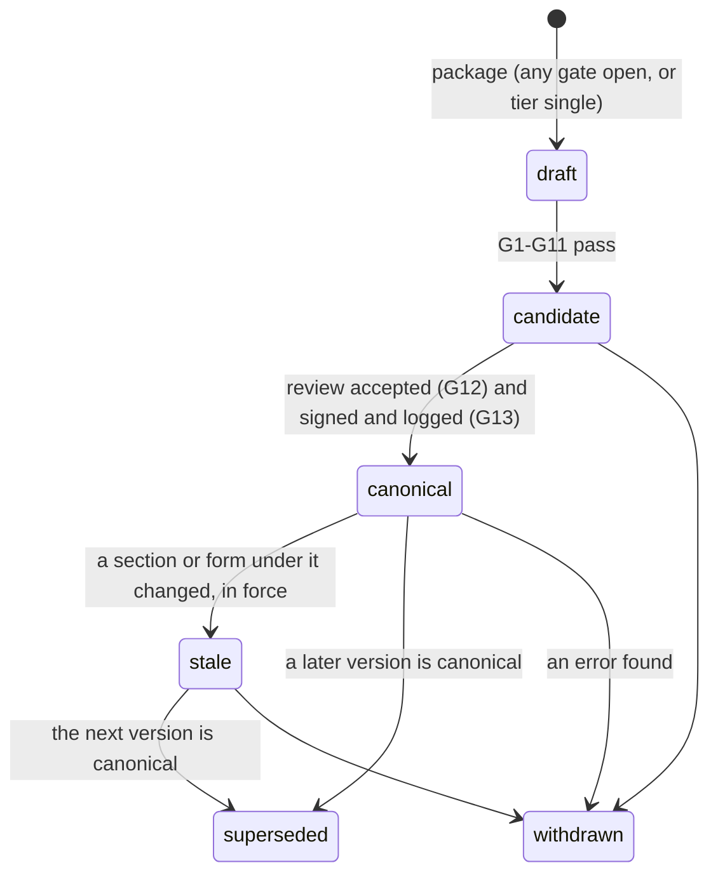
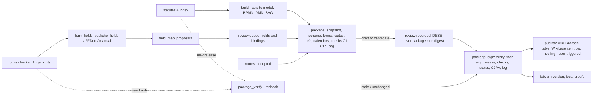

# Canonical workflow packages: one verifiable bundle per jurisdiction and process

_10 October 2026. Research and design only. This note designs a **canonical workflow package**: one versioned,
content-addressed, signed bundle per (jurisdiction, process). A person, an agency or an auditor can rely on it,
check it and trace it back to the statute words. It answers the user's request to see whether CommonForms
(https://github.com/jbarrow/commonforms) can be used "with a bit of backend to start thinking about the canonical
workflows", "adding c2pa to process" for "super clean audits". It builds on [commonforms.md](commonforms.md) and
[c2pa-provenance.md](c2pa-provenance.md), and fits the designs in [forms-plan.md](forms-plan.md),
[bpc-480-decision.md](bpc-480-decision.md), [entities-contacts.md](entities-contacts.md),
[terms-wikibase.md](terms-wikibase.md), [lab-plan.md](lab-plan.md), [links-codebase-map.md](links-codebase-map.md),
and the authority and escalation model in [authority-standards.md](authority-standards.md) and
[authority-wikibase.md](authority-wikibase.md). (`authority-escalation.md` did not exist when this was written. The
two authority notes hold the escalation and deferral model, and this note uses them.)_

_Method. The sibling notes above were read in full or in their relevant parts. Repository facts come from reading the
tree, plus read-only probes in the `lexflow-app-1` container: search-index lookups of 5 ILCS 140 and of the short
title of the Uniform Electronic Legal Material Act, and `SELECT`s on `statute_files` and `process_models` for counts,
digests and stored check metrics. No row was written. Web sources were read with GET requests, the User-Agent
`lexflow-research/0.1 (https://github.com/alibama/lexflow)` and at least one second between requests to one host:
RFC 8493 (BagIt), RFC 3161, the W3C Web Cryptography API (2017 Recommendation and the Level 2 draft), Federal Rule
of Evidence 902 (Cornell LII), the in-toto Statement and envelope specs, the DSSE protocol, SLSA v1.2 build
provenance, Sigstore's key-management and hardware-token pages, spot checks of the C2PA 2.4 specification,
c2pa.org/conformance, the C2PA Generator Product Security Requirements and Certificate Policy (conformance-public
v0.2), the EU ELI ontology, the JSON Schema 2020-12 meta-schema, pypdf's changelog and writer, the GNU coreutils
manual and the OpenSSL `ts` manual. Three large pages were written briefly to a scratch file to be searched, then
deleted. Nothing was downloaded to keep, installed, built, signed or published. `.env` was not read. When this note
was first written, no existing file was edited._

_Revision (10 October 2026). This version fixes every finding that [verify-canonical.md](verify-canonical.md) marks
wrong or missing. Each changed fact was read again at its source, read-only:_

- _the cited code and fixture lines;_
- _in `lexflow-app-1`: `SELECT`s on `/data/lexflow.db` and the per-state indexes, opened with `mode=ro`, plus `ls`,
  `/proc/mounts` and `pip list`;_
- _GET requests, with the same User-Agent and spacing, to: the C2PA 2.4 specification, the conformance-public v0.2
  Certificate Policy and Security Requirements, the Rekor v2 announcement, the cosign v3.1.3 release listing, the
  c2patool usage page, the c2pa-rs changelog, the W3C Secure Contexts and Web Cryptography pages, the OpenSSL `ts`
  manual, PyPI, npm, the Hugging Face API and RF-DETR's source._

_Pages were searched in memory and not saved. Nothing was downloaded, installed or run. The same review found errors
in the two research notes, and those passages were corrected too: [c2pa-provenance.md](c2pa-provenance.md) §2.2,
§2.7, §3.4, §5.3 and §6.4, and [commonforms.md](commonforms.md) §3.2 and §3.3._

_Privacy and credit. This note names organisations, offices, standards bodies, statutes and software projects.
People appear only as authors in citations. Nobody is a partner, advisor or endorser of lexflow. This is
information, not legal advice._

## Summary

- **The short answer to the question asked.** Yes, CommonForms can be used, but as one small input step under a
  bigger backend. What makes a workflow canonical is that backend: field maps that bind every form field to a step,
  a decision input, statute words or a defined term; a package that pins every file by hash; checks; reviews;
  signed statements; and a public log. CommonForms only adds boxes to flat PDFs. For licence reasons, use an adapter
  on `rfdetr` with the Apache-2.0 FFDetr weights, not the `commonforms` package ([commonforms.md](commonforms.md)
  §1.9). C2PA goes on the copies people pass around: diagrams, letters and fillable copies of official forms. The
  record of truth is a set of signed in-toto statements in a transparency log ([c2pa-provenance.md](c2pa-provenance.md)
  §5).
- **For today's 22 reviewed models, form detection matters for 1 to 3 forms, and field mapping for all 15** (measured
  on `fixtures/forms/forms.json`):
  - 17 of the 22 models have at least one form linked to a step as an `exact` match. 12 of them have an exact
    official PDF form.
  - That is 15 distinct PDF forms. 12 are already AcroForm, with 577 publisher fields on 53 pages. 1 is flat (the
    Illinois PAC Request for Review, 1 page). 2 could not be read (`il-sos-llc-5-5` timed out; `va-llc-1011` is
    disallowed by robots.txt).
  - So the field-map backend does almost all of the work, and it runs on publisher AcroForm fields with no model at
    all. Detection is for the 1 flat form, the 2 unread ones if they prove flat, and the flat forms of processes that
    are not among the 22 process models:
    - Washington LFO, which has no step file at all;
    - Virginia DPOR licensing, whose forms link to the `apply` and `present_case` steps (both partial matches) of
      `curated_ask/license_conviction/va.json`, but which has no `process_models` row.
- **What a package is.** A BagIt bag (RFC 8493) per version.
  - Keys: `lexflow:package:il.records` for the package and `lexflow:package:il.records@1` for a version.
  - A version is built in one or two profiles, `full` and `lean` (§1.14). Each profile build's identity is the
    SHA-256 of its own `data/package.json`, which lists every other file with its SHA-256.
  - The payload holds no timestamps, so assembling the same inputs at the same commit gives the same digest. The
    `package` step compiles the model itself, with a fixed `created` (§1.5).
  - Contents (§1): the statute snapshot (act ids, text hashes, release, dates), the facts, the IR model JSON, BPMN,
    DMN with knowledge sources, SVG and PNG; a typed data schema in which every field is tied to a statute element or
    a defined term; forms (official ones by URL and fingerprint, field maps, statute-grounded drafts); the authority
    ladder (accepted escalation and deferral routes); entity references with no contact values; the holiday
    calendars; the check results.
  - A tag directory holds the signed statements: build provenance, checks, reviews, status. It also holds the log
    receipts and the C2PA sidecars. It may grow after signing, and the payload never changes.
- **"Canonical" is lexflow's word for the one version it stands behind for a process. It never means "official"**
  (§2).
  - There are 13 gates. They include: tier `reviewed`, or `agreed` plus a review; every quote verbatim and under its
    cited subsection; schemas, lints, the Spiff parse and Petri-net soundness; decision tables free of gaps and of
    unexplained overlaps; every input typed and grounded; every field of every exact official form mapped and
    reviewed; every route accepted; a review over the exact digest; signed and logged.
  - Grades: *Claude-checked*, *person-reviewed* and *legal-reviewed*.
  - Status lives in signed, append-only **status statements**, not in the payload. A version can therefore become
    `stale`, `superseded` or `withdrawn` without a byte of it changing.
- **Today no package can be canonical. The gaps, measured:**
  - By their stored metrics, all 22 reviewed models pass the quote, XSD, bpmnlint, groundedness and soundness checks.
    But:
    - the model quote check only tests containment in the section text. It does not test placement under the cited
      subsection, and it does not visit `SequenceFlow.sources` (`lexflow/validate.py:126-160`);
    - dmnlint and the SpiffWorkflow parse run only in tests and scripts, not per model (`lexflow/municipal/quality.py`);
    - 52 of the 56 curated decision tables use FIRST, so their overlaps need a reviewed report;
    - section texts carry no act id and no hash (`lexflow/ir.py:209`);
    - DMN output has no knowledge sources (`lexflow/dmn_xml.py`, per [links-codebase-map.md](links-codebase-map.md)
      §2.4);
    - the forms fixture has no SHA-256 fingerprints yet ([forms-plan.md](forms-plan.md) §5);
    - no route records exist yet ([authority-standards.md](authority-standards.md) §7);
    - all 22 stored BPMN files say `reviewStatus="draft"`, inside the bytes a review would sign (§1.5);
    - the container cannot see a git commit (§3.2).
- **Supersession** (§2.4).
  - A watcher re-hashes every snapshot section against each new open-us-law release and against effective-date
    tags. It also re-checks form fingerprints, provider packages and entity status.
  - Unchanged sections earn a signed "still current" event and no new version. A changed section opens version N+1
    and marks N `stale` once the change is in force. A pending change gives two versions that coexist, each with its
    validity window.
  - Versions are never deleted.
- **The backend** (§3) has five steps: `form_fields` (detect), `field_map` (map), `package` (assemble),
  `package_sign` (sign) and `package_verify` (verify and re-check sources). `package_sign` runs in a separate `sign`
  service, the only place the private keys are mounted. Around the steps:
  - a storage layout and five tables, each with the `state`, `updated_at` and `origin` columns that `db.SYNCED`
    requires;
  - API routes under `/api/packages`;
  - a dashboard package page with a verification badge, the hash-chained audit trail, and "check a file I was sent",
    which hashes the file in the browser;
  - a "Package" table on each wiki process page;
  - a Wikibase package item with its own *package status* property. The model tier keeps the separate *review status*
    property of [authority-wikibase.md](authority-wikibase.md) §4.2, which replaces today's description-only
    "Unreviewed draft" marker.
- **The process lab** pins a case to a package version. It keeps the person's filled forms and timeline in the
  browser. It can hash the files the person sent, chain the records, sign them with a browser key that cannot be
  exported, and optionally obtain an RFC 3161 time-stamp over the hash alone. The person can then show that a file is
  unchanged since it was recorded. With a token, they can also show that the record existed by the token's time.
  The browser key shows only that one key signed every record, not when. lexflow keeps none of it (§3.8), which also
  spells out what this proves and what it does not.
- **Statute text is not the official record.** Seven of the eleven jurisdictions have the Uniform Electronic Legal
  Material Act in the local statute copy: CA, DC, IL, MD, OH, TX and WA. Under it, the official publisher must give
  users a way to check that a designated official electronic record is "unaltered". lexflow's open-us-law copy is not
  that record, so a package says so, keeps each row's publisher URL, and offers an optional comparison (§1.4).
- **Provenance and keys** (§4).
  - DSSE-signed in-toto statements (SLSA provenance, test-result, review, status) are entered in Rekor with a project
    key, or in a self-run tile log.
  - Rekor v2 has no search index. So lexflow also publishes a signed, append-only index of its own log entries; without
    it, an auditor sees only the statuses lexflow chooses to ship (§2.1).
  - C2PA manifests are embedded in SVG, PNG and PDF, with sidecars elsewhere. From phase 3, every manifest carries an
    RFC 3161 time-stamp from a TSA on the C2PA TSA Trust List. Without one, a manifest stops validating when its
    leaf certificate expires, after at most 366 days (§4.2).
  - The BagIt manifest is written so that `sha256sum -c` reads it.
  - Keys for development: a package key, and a private C2PA CA. The CA's leaf borrows the subject, key-usage, EKU and
    validity rules of the C2PA Assurance Level 1 leaf profile, but it does not match that profile in full. Both keys
    are encrypted at rest.
  - Production needs much more than a new certificate. That, and what C2PA does not prove, is in §4.2 and §4.4.
- **Plan** (§5): seven phases with effort, tests and measures. Phase 0 needs no download, and phase 1 needs only
  `cryptography` (4.75 MB).
  - Every download is listed with its source, size and licence. Two kinds were added in this revision:
    - phase 2b's transitive packages, 43,316,919 bytes, PyAV with FFmpeg bundled among them;
    - phase 4's `dmn-js`. Its further npm dependencies are named, but their sizes were not resolved.
  - From phase 3 the plan also needs a TSA, which is a network service and not a download.
  - No download was made, and each one needs the user's approval.

---

## 1. What a canonical workflow package contains

### 1.1 Identifiers and versions

| Thing | Identifier | Example | Notes |
|---|---|---|---|
| Package (the lineage for one process) | `lexflow:package:<model_id>` | `lexflow:package:il.records` | Uses the DB model id, as [bpc-480-decision.md](bpc-480-decision.md) §6.2 does. The IR id (`il-records`) is a second spelling ([links-codebase-map.md](links-codebase-map.md) §1), so it is recorded but never used as a key. It is minted once. It is a Wikibase P25 key, like every other lexflow key ([entities-contacts.md](entities-contacts.md) D2). |
| Version | `lexflow:package:<model_id>@<N>` | `lexflow:package:il.records@1` | `N` is an integer that only ever increases and is never reused. |
| Profile | `full` or `lean` (§1.14) | `full` | A field in `package.json`, `bag-info.txt`, the tables and the statements, never a new key spelling. A version may be built in both profiles. |
| Profile build content | `sha256:<hex>` of `data/package.json` | – | A content address, one per profile of a version. Everything else is listed inside `package.json` with its own SHA-256. Reviews and status statements name this digest. |
| Component | `<version>#<path>` | `lexflow:package:il.records@1#model/il.records.dmn` | The path inside `data/`. |
| Statute release | dataset, version, file, URL, SHA-256, bytes | `open-us-law`, `v2026.09.1`, `us_il_statutes.parquet` | From `statute_files`, which already holds them, and checked against upstream `index.json` (`lexflow/municipal/statutes.py`). |
| Section | `act_id` + text SHA-256, plus `lexflow:statute:<st>:<ref>` | `STATE_IL_C5_A140_S9.5` | `act_id` is unique per row in every state probed. Its stability across releases is unverified ([links-codebase-map.md](links-codebase-map.md) §1), so the snapshot also keeps the citation as a fallback. |
| Model elements | existing keys | `lexflow:step:il.records:request_review`, `lexflow:input:…`, `lexflow:status:…`, `lexflow:route:il.records:request_review`, `lexflow:role:il:records:pac`, `lexflow:agency:…`, `lexflow:post:…`, `lexflow:term:…`, `lexflow:field:<form_id>:<slug>` | No new spelling. The `lexflow:post:` and `lexflow:route:` keys follow [authority-standards.md](authority-standards.md) A6. |
| BPMN namespace | existing | `https://lexipedia.xyz/ns/process/il_records` | `targetNamespace`, `bpmn_xml.py:108` |
| DMN namespace | existing | `https://lexipedia.xyz/ns/decision/il_records` | `namespace`, `dmn_xml.py:45`. The stored `il.records` DMN carries it |
| Statements | SHA-256 of each DSSE envelope, plus its log index | – | §4 |

**Version rules.**

- **When a new version is cut.** Any change to a payload byte gives a new `N`. `package.json` records why, as a list
  `changes` with entries from `statute`, `model`, `schema`, `forms`, `authority`, `entities`, `calendars`, `checks`
  and `metadata`.
- **Schema version.** `schema_version` is an integer that rises only when the data schema (§1.6) changes in a way
  that breaks a consumer: an input removed, renamed or retyped, or a new `required` element. An agency that builds
  on the package keys its integration to this number, not to `N`.
- **Legal window.** `valid_from` and `valid_until` give the window the version describes, taken from effective-date
  tags (§1.4). When neither is stated, the basis says "in force according to the release; no date stated".
- **Lineage.** `supersedes` names the version this one replaces. A later status statement says which version
  superseded it (§2.4). The payload never points forward, because it must not change after signing.
- **The package never rewrites a model file.** The BPMN, DMN and SVG bytes are the bytes that the `package` step's
  own compile produced (§1.5), and nothing edits them afterwards. Package and version identity, and the package
  status, travel in `package.json`, the statements and the C2PA manifests, not inside the XML.

### 1.2 Layout: a BagIt bag

RFC 8493 (Informational, October 2018) defines a bag as tag files plus a `data/` payload directory. Every bag needs
`bagit.txt` and at least one `manifest-<algorithm>.txt`. A payload manifest "MUST list every payload file name
exactly once". Each line has the form `checksum filepath`, with "One or more linear whitespace characters"
between the two. A tag manifest lists the tag files, and its paths never begin `data/`.

lexflow writes **two spaces** between hash and path. GNU coreutils' untagged format is "the checksum, a space, a flag
indicating binary or text input mode" (a space for text mode), "and the file name". So the same manifest is a valid
BagIt manifest and valid input to `sha256sum -c`. An auditor needs no special tool for the first check.

```
il.records/v1/full/                         BagIt base directory, one per profile (data/ is immutable once signed)
  bagit.txt                                 BagIt-Version: 1.0 / Tag-File-Character-Encoding: UTF-8
  bag-info.txt                              Source-Organization: lexflow; External-Identifier: lexflow:package:il.records@1;
                                            Bag-Group-Identifier: lexflow:package:il.records; Lexflow-Profile: full;
                                            Bagging-Date; Payload-Oxum. Bagging-Date makes the tag files differ by day.
                                            Never Contact-Name, Contact-Phone or Contact-Email (privacy).
  manifest-sha256.txt                       every data/ file: "<sha256>␠␠data/<path>"
  tagmanifest-sha256.txt                    bagit.txt, bag-info.txt, manifest-sha256.txt and every provenance/ file
  data/
    package.json                            identity, components and digests, counts, notice (§1.3)
    NOTICE.txt                              licences; "not an official publication; not legal advice"
    statute/snapshot.json                   release, sections, text hashes, dates, roles (§1.4)
    statute/sections.json                   section texts: "full" profile only (§1.14)
    model/facts.json                        the curated or extracted facts the model is compiled from
    model/model.json                        LegalProcessModel (IR), compiled at the recorded commit; created = null (§1.5)
    model/<id>.bpmn, <id>.semantic.bpmn     BPMN with and without layout, from the package step's compile (§1.5)
    model/<id>.dmn, model/spiff/*.dmn       DMN 1.3 in FEEL with the DRD and knowledge sources; the Spiff dialect
    model/knowledge_sources.json            knowledge sources by role, until dmn_xml writes them (§1.5)
    model/<id>.svg, <id>.png                diagrams; C2PA embedded (§4)
    schema/data.schema.json                 typed inputs, outputs, statuses and lab events (§1.6)
    forms/index.json                        FormRefs and fingerprints for each step (§1.7)
    forms/<form_id>/<sha12>/overlay.json    field maps: publisher, detected or hand-drawn fields, with bindings
    forms/drafts/<spec>.json, .form.html, .letter.html   statute-grounded drafts, only where no official form exists
    authority/routes.json                   accepted escalation and deferral routes (§1.8)
    entities/references.json                roles → played-by keys and resolver rules; no contact values (§1.9)
    calendars/<st>.json                     the holiday and counting tables the lab uses (§1.10)
    checks/report.json                      every check: tool, version, configuration digest, result (§1.11)
  provenance/                               tag directory: append-only; listed in tagmanifest-sha256.txt
    keys.json                               public keys and fingerprints in force when signed
    release.intoto.json                     DSSE: SLSA provenance v1; subjects = every data/ file
    checks.intoto.json                      DSSE: in-toto test-result
    reviews/<review_id>.intoto.json         DSSE, signed by the reviewer (a Claude review: by the operator, §1.12)
    status/<seq>.intoto.json                DSSE: status statements, append-only (§2.1)
    log/<statement>.json                    Rekor bundles or tile-log inclusion proofs
    c2pa/<path>.c2pa                        sidecar manifests for files that cannot carry one
```

Reviews and statuses live in `provenance/` and not in `data/`, for two reasons. A review signs the digest of
`package.json`, so writing the review into the payload would change the digest it signs. And a status must be able to
change without the payload changing.

### 1.3 `package.json`: the Illinois records example

The values are real where the source holds them (read on 10 October 2026). The digests of files that do not exist
yet are shown as `…`.

```json
{
  "schema": "lexflow-package/1",
  "package": "lexflow:package:il.records",
  "version": 1,
  "profile": "full",
  "model_id": "il.records",
  "ir_id": "il-records",
  "jurisdiction": {"key": "lexflow:jurisdiction:il", "name": "Illinois"},
  "question": "records",
  "schema_version": 1,
  "changes": ["statute", "model", "schema", "forms", "authority", "entities", "calendars", "checks"],
  "supersedes": null,
  "valid": {"from": null, "until": null,
            "basis": "in force according to open-us-law v2026.09.1; no effective-date tag on these rows"},
  "source": {"repo": "https://github.com/alibama/lexflow", "commit": "<40 hex, passed in from the host>",
             "dirty": false, "diff_sha256": null, "image": "sha256:<image id, passed in from the host>"},
  "method": {"tier": "reviewed", "built_by": "claude", "curated_file": "curated/il/records.json"},
  "statute": {"dataset": "open-us-law", "version": "v2026.09.1", "file": "us_il_statutes.parquet",
              "url": "https://oss-data-us.vaquill.ai/v2026.09.1/us_il_statutes.parquet",
              "sha256": "8b698ea56155df37fd0fc48daff88c1d0522fde08f252a90c6ed8189b1986cec",
              "bytes": 31415695, "sections_in_file": 72251},
  "components": [
    {"path": "statute/snapshot.json", "role": "statute-snapshot", "media_type": "application/json", "sha256": "…", "bytes": 0},
    {"path": "model/il.records.bpmn", "role": "bpmn", "media_type": "application/xml", "sha256": "…", "bytes": 0},
    {"path": "forms/il-pac-request-for-review/<sha12>/overlay.json", "role": "form-overlay",
     "media_type": "application/json", "sha256": "…", "bytes": 0}
  ],
  "counts": {"quoted_sections": 3, "cited_sections": 2, "quotes": 48, "decisions": 3, "rules": 12,
             "exact_official_forms": 1, "routes": "…"},
  "notice": "lexflow's package for this process: a copy of the law with a model of the procedure. Not an official publication and not legal advice."
}
```

The JSON is written canonically (sorted keys, UTF-8, `\n` line ends). Assembling it twice at the same commit gives
the same bytes. That is check C16 in §1.11.

### 1.4 The statute snapshot (`statute/snapshot.json`)

**The fields of each section entry:**

| Field | Source | Why |
|---|---|---|
| `key`, `alt_key` | `lexflow:statute:<st>:<ref>`, plus the `act_id` form the links map proposes | Joins the section to the wiki and Wikibase |
| `act_id`, `citation`, `url` | open-us-law row. `url` is the government publisher's page | The row an auditor re-reads, and where the official text is |
| `role` | `quoted` (the model quotes it), `cited` (a knowledge source or route statute it does not quote), `definition`, `scope`, `prerequisite_process` (the roles of [bpc-480-decision.md](bpc-480-decision.md) §2) | Says why the section is in the package |
| `text_sha256`, `bytes` | SHA-256 of the UTF-8 bytes of the row's `text` | Ties the entry to the upstream file |
| `model_text_sha256`, `transform` | SHA-256 of the text after `strip_history` (`statutes.py:139`), and the transform's name and commit | The model's texts drop the trailing session-law line, so the auditor needs both hashes and the rule between them |
| `act_status`, `last_amended_year` | the parquet columns (`statutes.py:26-27`) | The search index does not keep these two columns, so they must be read from the parquet at assembly |
| `effective_from`, `effective_until` | `ask/index.effective(title)` (`lexflow/ask/index.py:45`), which parses tags such as "(Effective until December 1, 2026)" | The only effective dates the source gives. Without a tag the field is `null`, and the page says "not stated in the source", never a guessed date |
| `history` | the raw history line, when present | Points a reviewer to the session law that sets a date |
| `official` | `{"uelma": "<the state's act>", "checked_against_official": false}` | See below |

**Crosswalk.** These fields map onto the EU ELI ontology (OWL `owl:versionInfo` 1.5 at the Publications Office
URL): `effective_from` to `eli:first_date_entry_in_force`, `effective_until` to `eli:date_no_longer_in_force`,
`act_status` to `eli:in_force`, and the release date to `eli:version_date`. Wikibase already has P24 *effective date*,
which nothing writes today ([authority-wikibase.md](authority-wikibase.md) §1.2).

**Illinois, measured** (local index, open-us-law v2026.09.1; none of these rows has a history line, so the two hashes
are equal):

| Section | `act_id` | Role | Text SHA-256 | Bytes |
|---|---|---|---|---|
| 5 ILCS 140/3 | `STATE_IL_C5_A140_S3` | quoted | `209e81d8975a5fca75e53add524b6f51cbb088efcc017a7a1664d54c0794fad7` | 6,524 |
| 5 ILCS 140/9 | `STATE_IL_C5_A140_S9` | quoted | `602957cb08d6638936343e99363888f1fd27b93e5f4f98130f01ec393675da07` | 1,534 |
| 5 ILCS 140/9.5 | `STATE_IL_C5_A140_S9.5` | quoted | `759c06005e32decf570f87bf604340479de96968afd10c10b0a87e19358a1ea4` | 6,497 |
| 5 ILCS 140/11 | `STATE_IL_C5_A140_S11` | cited (judicial route) | `63ed43d7f495b7c8183b0d959a8dd811ae8d20cb807395d1d6239a9170b11962` | 4,595 |
| 5 ILCS 140/11.5 | `STATE_IL_C5_A140_S11.5` | cited (administrative review route) | `37a87cfffe86f8d70a980d57ccf3a87cc0f1cdb6ff886066d07f5ae0dea3a55e` | 566 |

The five texts are pure ASCII, so their UTF-8 byte counts equal their character counts. None of the five rows has an
effective-date tag in the index.

**Not the official record.** The local copy has the Uniform Electronic Legal Material Act in seven of the eleven
jurisdictions. A search for its short title finds six of them:

- California: Gov. Code §§ 10290 and 10298;
- Illinois: 5 ILCS 180/1;
- Maryland: State Gov't § 10-1611;
- Ohio: R.C. 149.21 and 149.26;
- Texas: Gov't Code § 2051.151;
- Washington: RCW 1.70.900.

The seventh is the District of Columbia, whose text does not use the short title. A search for "legal material" AND
"authenticat" finds it: D.C. Code §§ 2-651.01 to 2-651.09, act ids from `STATE_DC_T2_C6_S2-651.01` on.

- § 2-651.04: the official publisher "shall authenticate the record". To do so, it provides "a method for a user to
  determine that the record received by the user from the official publisher is unaltered from the official record".
- § 2-651.05(a): an authenticated record "is presumed to be an accurate copy of the legal material".
- § 2-651.01(3)(B): the official publisher of the District of Columbia Official Code is the General Counsel to the
  Council.
- § 2-651.02: the subchapter applies only to legal material "first published electronically on or after July 1,
  2017".

Neither search finds anything in FL, NC, NY or VA. Two text searches cannot prove that a law is absent.

The Washington text, read from the local copy:

- "Legal material" includes "The Revised Code of Washington" (RCW 1.70.010(2)(c)). Its official publisher is "the
  statute law committee" (RCW 1.70.010(3)(c)).
- An official publisher of a designated electronic record "shall authenticate the record", by providing "a method for
  a user to determine that the record received by the user from the publisher is unaltered from the official record
  published by the publisher" (RCW 1.70.040).
- An authenticated record "is presumed to be an accurate copy" (RCW 1.70.050(1)).

California's § 10294 uses the same words, and § 10291(c) makes the Legislative Counsel Bureau the official publisher.
D.C. Code § 2-651.04, quoted above, has the same rule.

So:

- A package never calls its section texts official or authenticated.
- `official.uelma` names the act where one is found, for D.C. "D.C. Code § 2-651.01 et seq.". Each row's `url`
  points at the publisher.
- A later, optional check (`checked_against_official`) compares the text with the publisher's own copy, where the
  publisher allows automated reads. Whether any of these publishers has designated and authenticated its online code
  was not checked.

### 1.5 Process model, BPMN and DMN with knowledge sources

- **Facts first.** The package holds `facts.json`, the curated or extracted facts. The `package` step compiles them
  itself at the recorded commit, because the database does not store the IR today. It writes `model.json` and the
  BPMN, DMN, SVG and PNG from that compile, through the same writers `quality.assess` uses. Check C16 compiles again
  and compares the bytes. Two settings of that compile differ from the build's:
  - **A fixed `created`.** The build passes `Provenance(…, created=db.now())` (`lexflow/municipal/build.py:225`),
    which would put the build time into `model.json`. That would break "no timestamp in `data/`" and C16's
    byte-identical rebuild. The `package` step passes `created=None`. The commit, and its time if wanted, travel in
    `package.json`'s `source`.
  - **`review.status` from the tier.** All 22 reviewed models' stored BPMN say `reviewStatus="draft"
    method="gold-manual"`, from `<lex:model reviewStatus=… method=…>` (`bpmn_xml.py:187-190`; read-only query of
    `process_models`). That attribute sits inside the bytes a review signs, so it cannot change after review. The
    `package` step therefore sets `review.status` before it writes. Tiers `reviewed` and `agreed`, the two that G1
    admits, get `machine-checked`, the value `lexflow/gold.py` gives its hand-built models. Tier `single` keeps
    `draft`.
  - **What the attribute means.** It states the model's review state when it was compiled. It is never the package
    status, which lives only in the status statements (§2.1). A package that later becomes `legal-reviewed` keeps the
    `machine-checked` BPMN it was reviewed with.
- **The DMN should be the DRD form prototyped in [bpc-480-decision.md](bpc-480-decision.md).**
  - `inputData` carries `lex:requires`, which names the status type and its provider.
  - There is one `knowledgeSource` per cited section, whose `locationURI` is the section key or URL. Knowledge
    sources link to each other with authority requirements, where a process model rests on its statutes.
  - Every decision has an authority requirement on its governing subdivision.
  - The deciding body is carried as `lex:decisionMaker`, because dmn-moddle cannot read `organizationUnit`.
- **Today `write_dmn` emits decision tables only** ([links-codebase-map.md](links-codebase-map.md) §2.4). Until it
  writes requirements, `model/knowledge_sources.json` carries the same records in the `KnowledgeSourceRef` shape of
  [bpc-480-decision.md](bpc-480-decision.md) §6.2, and gate G6 stays open (§2.2).
- **Decisions** cite the curated rule quotes. Each FIRST table carries its overlap report in the checks (C8).

### 1.6 The data schema (`schema/data.schema.json`)

The schema is a JSON Schema 2020-12 document (meta-schema `https://json-schema.org/draft/2020-12/schema`) with one
lexflow keyword, `x-lexflow`, on each property.

**Each property states:**

- **Identity:** `key`, a `lexflow:input:<model>:<variable>` key or a step data key.
- **Type:** `string`, `number`, `boolean`, `date` or an enumeration. These map one to one onto DMN `typeRef` and
  `itemDefinition`/`allowedValues` (`schemas/dmn/DMN13.xsd:232-240`) and onto the IR's `type_ref`.
- **Grounding**, at least one of:
  - a `source`: section, subsection and the exact quote (an *element*);
  - a `term`: `lexflow:term:<st>:<ref>:<slug>` ([terms-wikibase.md](terms-wikibase.md) §1).
- **Level:** one of the draft levels of `lexflow/forms/draft.py`: `required`, `if_asked`, `right`, `context`, `duty`
  or `notice`. Or `form_only` for what an official form asks and no statute element does
  ([commonforms.md](commonforms.md) §3.5).
- **Privacy:** `personal`, `case` or `none`. The default is `personal`, and the lab uses this class to decide what
  stays in the browser.
- **For a status from another process:** `evidence` (`register`, `document`, `finding` or `call`) and the
  provider's `lexflow:status:` key, following `Requires` in [bpc-480-decision.md](bpc-480-decision.md) §6.2.
- **Where it is used:** `decisions`, `conditions` and `fields`, which list the decision columns, flow conditions and
  form fields that read the property.

**Illinois `request_review`.** The quotes are those of `curated/il/records.json`.

```json
{
  "$schema": "https://json-schema.org/draft/2020-12/schema",
  "$id": "https://lexipedia.xyz/ns/package/il_records/1/data.schema.json",
  "type": "object",
  "properties": {
    "final_denial_date": {
      "type": "string", "format": "date",
      "x-lexflow": {"key": "lexflow:input:il.records:final_denial_date", "level": "context", "privacy": "case",
        "deadline_anchor": {"step": "lexflow:step:il.records:request_review", "amount": 60, "unit": "days",
                            "consequence": "right-lapses"},
        "source": {"section": "5 ILCS 140/9.5", "subsection": "a",
                   "quote": "not later than 60 days after the date of the final denial"}}},
    "request_copy": {
      "type": "boolean", "description": "A copy of the request for access to records is enclosed",
      "x-lexflow": {"level": "required", "privacy": "none",
        "source": {"section": "5 ILCS 140/9.5", "subsection": "a",
                   "quote": "include (i) a copy of the request for access to records"}}},
    "public_body_responses": {
      "type": "boolean", "description": "Any responses from the public body are enclosed",
      "x-lexflow": {"level": "required", "privacy": "none",
        "source": {"section": "5 ILCS 140/9.5", "subsection": "a",
                   "quote": "(ii) any responses from the public body"}}},
    "public_body": {
      "type": "string",
      "x-lexflow": {"level": "context", "privacy": "none", "entity": {"role": "lexflow:role:il:records:public_body",
                    "resolve_by": "record_holder"}}}
  }
}
```

- **The signature** is a form field (§1.7) bound to "signed by the requester". It is not a data property.
- **Lab events.** The same file defines the lab's event types: one per step a person takes or receives, each with a
  `date` and an optional list of file hashes (§3.8).
- **Two checks keep the schema honest** (C14). Every DMN input column, flow-condition variable and form binding must
  resolve to a property. Every property must be used. These are the "nothing unused" and "columns = requirements"
  rules of the bpc-480 check, applied to data.

### 1.7 Forms

**`forms/index.json`** holds, for each step, the FormRefs of [forms-plan.md](forms-plan.md) §2.2. Each FormRef gains
the `fingerprint` block that note's §5 proposes: `sha256`, `bytes`, `etag`, `last_modified`, `fields`, `pages` and
`revision`. The ETag and Last-Modified values drive that note's conditional fetch. Next to the block go the checker's
own reads (AcroForm, XFA, encrypted), `checked` and `final_url`. Three kinds of entry:

- **Official forms are listed by URL and hash, and never copied into the bag.** An overlay is valid only for the
  SHA-256 it was made from ([commonforms.md](commonforms.md) §3.7). A new hash sends the form back to `field_map`.
- **Field maps** (`overlay.json`) use the `FormOverlay` schema of [commonforms.md](commonforms.md) §3.5 for every
  official PDF form, flat or not. Each field has an `origin`:
  - `publisher`: the PDF's own `/T`, `/TU` and `/Rect`. This covers the 12 AcroForm forms of the reviewed models.
  - `detected`: FFDetr boxes.
  - `manual`: a box drawn in the review page. This alone is enough for the one-page Illinois PAC form, with no
    detector.

  Each field's bindings use the package's own keys: step, schema property, statute element, term, entity.
- **Drafts** (`lexflow-form-draft/1`, `lexflow/forms/draft.py`) are made only for steps that have no exact official
  form (draft rule 1). They carry their own `checks`: elements, quotes found, problems.

**Blank fillable copies are never part of the bag.**

- They are made on demand, as a pypdf incremental update of the official bytes. The official file is then an exact,
  hash-checkable prefix of the copy. They carry C2PA (§4.1).
- pypdf's changelog for 6.12.0 lists "Block encrypting writer in incremental mode" (#3789). Whether an incremental
  update to a permission-encrypted official file still works was not checked. Encrypted forms therefore start with
  the overlay only.

**What the forms gate (G7) means for the current data.**

- Of the 22 reviewed models, 10 have no exact official PDF or Word form. Their steps link sample letters, portals or
  web pages, or nothing. G7 asks of them only that each linked form is fingerprinted, or that its status is
  `blocked` or `not_fetched`.
- The other 12 need their 15 forms fingerprinted and every field mapped and reviewed:
  - 577 publisher fields on 12 forms;
  - one flat page (Illinois PAC);
  - the 2 unread forms, after a person imports them ([commonforms.md](commonforms.md) §2.3).
- **Outside the 22-model plan.** 11 more exact official PDF forms sit on `curated_ask` step files, all AcroForm:
  - record sealing: CA CR-180 and CR-181, MD CC-DC-CR-148, the Texas OCA model nondisclosure petition (§ 411.0725),
    VA CC-1201;
  - court debt: CA TR-320/CR-320, MD DCA-131 and CC-088, VA DC-211;
  - licence conviction: TDLR ENF001 (Texas), DPOR A406-01PREDET (Virginia).

  These processes have no `process_models` rows, so they get no package yet. G7 grows to cover their forms when they
  do (read from `fixtures/forms/forms.json`).

### 1.8 The authority ladder (`authority/routes.json`)

- **The records.** The file holds the **accepted** route records of [authority-standards.md](authority-standards.md)
  §5.3:
  - the route itself: kind, direction, trigger, the step that invokes it, and the invoker;
  - its target: absolute, or a relative rule such as "head of the decider" that is resolved when the answer is made;
  - its limits: scope rule, time limit, reviewer deadline with its deemed outcome;
  - its effect: exhaustion, next routes, powers, burden, standard and suspensive effect;
  - the Hohfeld positions, and the quote-anchored sources.

  Proposed routes stay out of the package.
- **Posts by key** (`lexflow:post:…`, `lexflow:post-type:…`). There are no holders, by rule A1 of that note.
- **Illinois** (from [authority-standards.md](authority-standards.md) §5.4). `lexflow:route:il.records:request_review`:
  - kind `external_review`, to the Public Access Counselor in the Office of the Attorney General;
  - scope rule: not the General Assembly (§ 9.5(a));
  - time limit: 60 days;
  - exhaustion: `alternative`, because suit under § 11 is open without it;
  - powers: binding opinion or mediation;
  - next routes: administrative review (§ 11.5) and enforcement (§ 11(a-5)).

  The remedy-notice rule of § 9(a) becomes a route check on `denial_notice`.
- **On the package page** the ladder is drawn bottom-up: decision, then reconsideration or internal appeal, then
  external review, then court. Each rung shows who decides (a post, never a person), the time limit, whether it must
  come first, and the words it rests on. Unknown exhaustion reads "the statute does not say whether you must do this
  first".

### 1.9 Contacts by reference only (`entities/references.json`)

The file has one row per model actor:

- the role key;
- its `played-by` target: an agency, office type, post type, government rule or `lexflow:private-party`
  ([entities-contacts.md](entities-contacts.md) §1.4, §1.5);
- the resolver rule and context, such as `{"resolve_by": "record_holder"}`;
- the Wikidata QID as a crosswalk hint only.

**No contact value is ever signed into a package.** Contacts change on their own schedule. The entities plan found
43 % of verifiable websites stale, and 3 hijacked domains (D8). It re-checks contacts by tier (D9) and quarantines bad
values (D7). Signing a mailbox into a "canonical" bundle would freeze a stale or hostile value behind a green badge.
So the package page shows live contacts next to the badge, outside the signature, each with its own `checked_at` and
`verified_at` from `contact_status`. A contact change never creates a package version.

### 1.10 Calendars (`calendars/<st>.json`)

A timeline in the lab is computed from the holiday and counting tables in `lexflow/lab/deadlines.py`. There are 12
calendars: 10 states, D.C. and federal (`CALENDARS`, `deadlines.py:723`). So the package carries the table it was
checked with:

- holidays with their statute citations;
- the weekend-shift and roll-forward rules;
- variants;
- the published 2026–2027 schedules.

A case records this file's digest, so the same dates can be recomputed later (§3.8).

### 1.11 Checks and their results (`checks/report.json`)

| # | Check | Tool (existing unless marked) | Shows | Gate |
|---|---|---|---|---|
| C1 | Each quote appears verbatim in its section. `_norm` (`validate.py:122-123`) collapses whitespace and folds U+2019 to `'`; it does not fold “, ” or ‘ | `validate.lex_checks` | The words exist | G2 |
| C2 | Each quote lies under its cited subsection, to the cited depth | `forms/draft.locate` applied to model sources (**new use**) | The words are where the citation says. Today's C1 only checks containment | G2 |
| C3 | Every activity grounded; ISO timers; sources on sequence flows checked too | `lex_checks`, extended to visit `SequenceFlow.sources` (**new**) | No ungrounded step. `compile.py` writes no flow sources today, but hand-built models can | G2 |
| C4 | Deadline quotes parse to the model's amount and unit | `lab.deadlines.check_deadline` | The clock matches the words | G2 |
| C5 | BPMN and DMN 1.3 XSD | `validate.xsd_errors` | Well-formed models | G3 |
| C6 | bpmnlint; dmnlint; dmn-moddle import | `validate.bpmnlint`, `validate.dmnlint`, `tools/node` | Tool-readable. dmnlint is not run per model today | G3 |
| C7 | SpiffWorkflow parses the BPMN and Spiff DMN | `validate.spiff_parser` | Executable | G3 |
| C8 | Decision tables: no empty point over the domain; UNIQUE tables have no conflict; FIRST tables have an overlap report that is reviewed; every rule sourced | `dmn_eval.completeness_gaps`, `dmn_eval.overlaps` | Catala's two failures, made visible ([bpc-480-decision.md](bpc-480-decision.md) §3) | G5 |
| C9 | Petri-net soundness of every process | `petri.analyse` | No deadlock or lack of synchronisation | G4 |
| C10 | DRD integrity: every requirement resolves; columns equal requirements; every decision has a governing authority | the bpc-480 check, generalised (**new**) | Decisions rest on law | G6 |
| C11 | Cross-model links: every `Requires` has a provider package or a recorded gap | `law.links` | Inputs from other processes are accounted for | G9 |
| C12 | Routes: resolves, separation of duty, exhaustion consistency, remedy notice, no cycles, clocks | the route checker of [authority-standards.md](authority-standards.md) §5.6 (**new**) | The ladder is complete and consistent | G8 |
| C13 | Forms: `registry.check_steps`; fingerprints at most 90 days old; every field reviewed and bound; no `/TU` obligation word that the binding's quote lacks; blank copy prefix hash; drafts pass `draft.check` | `forms/registry.py`, `forms/draft.py`, the overlay checks of [commonforms.md](commonforms.md) §5 | Forms are current and mapped | G7 |
| C14 | Schema: meta-valid; every input, condition and binding resolves; no unused property | **new** | Typed, grounded data | G6 |
| C15 | Privacy: every string in the bag passes `lexflow/privacy.py`'s office-channel rules; no contact values; reviewers are roles or organisations; `bag-info.txt` has no contact fields | `privacy.py` (**new use**) | No personal data | G10 |
| C16 | Reproducible: recompiling the facts at the commit gives byte-identical model, BPMN and DMN; reassembling gives the same `package.json`; the commit, dirty flag and image id handed in from the host are recorded, and the dirty flag is false (the container has no `.git`, §3.2) | **new** | The bundle can be rebuilt by anyone | G11 |
| C17 | Licence notices present; the "lean" profile has no section text | **new** | Redistribution terms carried (§1.14) | G10 |

**Measured baseline for the 22 reviewed models** (stored `process_models.metrics`, read-only):

- 757 quotes checked, 0 misses (C1, containment);
- 0 BPMN or DMN XSD errors;
- 0 bpmnlint errors or warnings;
- every process net sound;
- 0 ungrounded activities.

C2, C3's flow sources, C6's dmnlint, C7 and C8 to C17 are not run per model today. The format is the JSON report
plus an in-toto `test-result` statement. Its fields: `result` (PASSED, WARNED or FAILED), the required
`configuration`, and the passed, warned and failed tests ([c2pa-provenance.md](c2pa-provenance.md) §4.1).

### 1.12 Review records

| Field | Values |
|---|---|
| `kind` | `ai-assistant`, `role` (a person acting in a stated role) or `organisation` |
| `reviewer` | "Claude (claude-opus-5-5), run by the lexflow operator"; a role name such as "lexflow maintainer"; or an organisation key. Never a private person's name or email |
| `scope` | The components and check ids read, and the source each quote was compared with (open-us-law row, or the publisher's page) |
| `result` | `accept`, `accept-with-notes`, `changes-requested` or `withdraw` |
| `subject` | The SHA-256 of `package.json`. A review over any other digest is refused |
| `carries_forward` | Optional: a prior review, for a new version whose quoted spans did not change (§2.4) |
| `notes` | Gaps and readings, in the style of `review.gaps` |

- **Signing.** Each record is a DSSE envelope signed by the reviewer's own key. A Claude review holds no credential,
  so the operator's package key signs it. The record says it is the operator's statement that Claude ran the review,
  not a signature from Anthropic ([c2pa-provenance.md](c2pa-provenance.md) §3.3).
- **Mapping.** This replaces the free-text `reviewed_by` and `Review.reviewers` with the structured `records`
  proposed in [c2pa-provenance.md](c2pa-provenance.md) §8.

### 1.13 Provenance manifests

These are the statements in `provenance/`, the C2PA manifests embedded in diagrams and PDFs, and the C2PA sidecars.
§4 says which mechanism covers which artifact, and how an auditor checks them.

### 1.14 Licences and the two profiles

- **Statute text.** The open-us-law compilation is CC BY-NC 4.0, and commercial use needs a licence from Vaquill (the
  docstring of `lexflow/municipal/statutes.py`).
  - The **full** profile carries `statute/sections.json`, which the wiki already reproduces.
  - The **lean** profile carries act ids and hashes only. An auditor or agency fetches the parquet and checks the
    hashes.

  Both profiles have the same `snapshot.json`. Their `package.json` digests differ, so one version number cannot name
  one digest. Each profile build of a version is therefore its own record:
  - `package_versions` and the tables under it are keyed by `(package_key, version, profile)` (§3.2);
  - a review covers the digest it names, and so one profile;
  - each status statement's predicate carries `profile`;
  - a profile that is never signed is never published.
- **Wikibase.** Lexipedia's structured data must be CC0 under the Wikibase Cloud hosting policy
  ([authority-wikibase.md](authority-wikibase.md) §2.7). Only package metadata goes there, never section text.
- **Official forms are never redistributed** ([commonforms.md](commonforms.md) §3.9). The bag lists them by URL and
  hash.
- **FFDetr weights.** Detection runs locally. The weights' Apache-2.0 notice and Hub revision go in the run record;
  the weights are not in the bag.

---

## 2. "Canonical": the rules

### 2.1 Statuses



| Status | Meaning | Set by | Badge text |
|---|---|---|---|
| `draft` | Built, but a gate is open, or the model is a selector `single` | `package` | "Draft: not checked" |
| `candidate` | Gates G1–G11 pass; waiting for a review | `package` | "Checks pass · waiting for review" |
| `canonical` | All 13 gates | a status statement signed after an accepted review | "Canonical · Claude-checked", "Canonical · person-reviewed (role)" or "Canonical · legal-reviewed (organisation)" |
| `stale` | Something it rests on changed and is in force | `package_verify` records it at once as an unsigned local event and queues a `stale` statement, which the operator's next sign run signs (§3.1) | Before the signature: "Source changed on <date> · re-check pending". After it: "Statute changed since review (release …)" |
| `superseded` | A later version is canonical | status statement | "Superseded by v2" |
| `withdrawn` | Found wrong; do not rely on it | status statement (operator or reviewer) | "Withdrawn: <reason>" |
| *(does not verify)* | Not a status. The bytes, signature or log check failed on this machine | the verifier | "Does not verify" (red); this overrides every other badge |

A **status statement** is a DSSE envelope:

- `_type` is the in-toto Statement v1 type.
- Its subject is `package.json` by digest.
- Its predicate type is `https://lexipedia.xyz/ns/package-status/v1`. That URI is a proposal; the namespace is the
  user's to confirm ([c2pa-provenance.md](c2pa-provenance.md) §9).
- The predicate holds `{package, version, profile, status, grade, valid_from, valid_until, supersedes,
  superseded_by, reviews: [digest], release: digest, checks: digest, audit_head: sha256, index_head: sha256,
  reason}`.

**Which status is current, and what an auditor can know.**

- **The rule.** Statements are append-only. Among the statements a verifier holds, the latest validly signed one for
  a profile build gives its status.
- **The limit.** A verifier cannot list every statement lexflow signed. The Rekor v2 announcement says "The search
  index has been removed". So an auditor cannot ask the public log for every entry made with K1, and sees only the
  bundles lexflow ships. A copy of the bag that leaves out a later `withdrawn` statement would look current.
- **The fix: a signed, append-only index of lexflow's own log entries, one per key.**
  - The index lists each statement's digest, its subject, its status and its log entry.
  - It is published in the repository (`keys/index/<key fingerprint>.jsonl`) and on the wiki start page.
  - Each status statement carries `index_head`, the hash of the index before it was added. So every later statement
    commits to all the entries before it, and an auditor who holds a later statement or index head can detect an
    omission.
  - A self-run tile log (phase 6) can serve instead, because it can be read in full. A log with no outside witness
    still lets its operator show different views to different readers ([c2pa-provenance.md](c2pa-provenance.md)
    §4.4).
- **Until one of these exists,** every surface and step 5 of §4.3 say "the latest status lexflow shows", never "the
  current status".

**`audit_head`** is the `record_sha256` of the newest event in the profile build's local event chain when the
statement was signed (§3.3). Each logged status therefore anchors the trail up to that event. Events added later
(`verified`, `rechecked`) extend the chain past the logged head, and that is expected. The check in §4.3 step 5 looks
for the anchored event, not for the newest one.

### 2.2 The gates

| Gate | Requirement | The 22 reviewed models today |
|---|---|---|
| G1 Method | Tier `reviewed` (curated, every quote re-checked at build), or `agreed` plus a review. Never `single`. This is the publishing rule in the project's notes: only Claude-reviewed or two-extraction-agreed models are published | 22 of 22 |
| G2 Grounding | C1–C4 pass: verbatim and in the cited subsection, nothing ungrounded, deadlines parse (or each exception is reviewed) | C1 and groundedness pass for 22 of 22. C2 and C4 are not run per model |
| G3 Formats | C5–C7: XSD, bpmnlint, dmnlint, dmn-moddle and Spiff | XSD and bpmnlint pass for 22 of 22. The rest are not run per model |
| G4 Soundness | C9 | 22 of 22 |
| G5 Decisions | C8. A FIRST table is allowed only with a reviewed overlap report naming each shadowed rule as intended. Moving to chained UNIQUE tables, as [bpc-480-decision.md](bpc-480-decision.md) §3 recommends, is encouraged and not required | Not run. 52 of 56 tables are FIRST |
| G6 Data | C10 and C14: the schema is typed and grounded; every decision has a governing knowledge source | Open: no schema, and no knowledge sources in the DMN |
| G7 Forms | C13: every exact official PDF or Word form is fingerprinted within 90 days with status ok, and every field of its current file is reviewed and bound (or reviewed as `form_only`); mandatory pattern forms are flagged; no draft where an exact form exists; drafts pass `draft.check`. Sample letters, portals and web pages are linked by reference and only need a fingerprint or a `blocked`/`not_fetched` status | Open for the 12 models with exact forms (no field maps, no fingerprints). For the other 10, it needs fingerprints only |
| G8 Authority | C12: every route-like step has an accepted route, and exhaustion comes from the text or reads `unstated` | Open: no route records |
| G9 Links | C11; every entity reference resolves, or is shown as a role with the reason | Partly: links are prototyped, `entity_links` is not built |
| G10 Privacy and licence | C15, C17 | Not run |
| G11 Reproducible | C16 | Not run. The tree had uncommitted changes when read ([c2pa-provenance.md](c2pa-provenance.md) §1.3). The container has no `.git` and no `git`, so the commit must come from the host (§3.2) |
| G12 Review | At least one `accept` review over this exact digest, with a scope that covers every component. `person-reviewed` needs a person in a stated role. `legal-reviewed` needs a reviewer in a legal role or organisation | None recorded in this form |
| G13 Signed and logged | Release, checks, review and status statements verify, are listed in the signed per-key index (§2.1), and are logged: in Rekor or a tile log, or, before phase 6, in the local chain. Every C2PA manifest carries a `sigTst2` token from a listed TSA (phase 3 on) | Not built |

**The first packages that can reach `canonical`** are the 10 reviewed models with no exact official PDF or Word
form. Phases 0 and 1 must land first, and so must the routes phase of the authority plan (G8). The 12 models with
exact forms follow once phase 2 maps their 577 fields and the PAC page.

### 2.3 What each grade means, and the words lexflow never uses

- **Claude-checked.** An AI assistant read every component and compared every quote with the stated source. The
  operator recorded the review and signed it. This is today's `reviewed` tier with a record attached. The badge's
  tooltip says: "Checked by an AI assistant. Not reviewed by a lawyer."
- **Person-reviewed.** A person, named by role only, reviewed the stated scope and signed with their own key.
- **Legal-reviewed.** The reviewer acts in a legal role or for a legal organisation, which matches `Review.status =
  "legal-reviewed"` in `ir.py`. It is still not legal advice to the reader.
- **Never used:** "official", "authenticated" (both are UELMA terms, §1.4), "certified", "approved by <agency>", or
  "guaranteed". Every surface carries: "lexflow's package for this process. Not an official publication and not
  legal advice."

### 2.4 How versions supersede each other

`package_verify --recheck` runs on a budget, after every statute download and at least weekly. Its triggers:

| Trigger | Detected by | Effect |
|---|---|---|
| New open-us-law release (`index.json` `version`) | `statute_files.version` differs from the snapshot's | Re-hash every snapshot section (below) |
| A section's text changed | `act_id` found, `text_sha256` differs | Classify (below) |
| A section is gone, or its `act_status` changed | `act_id` missing; status not `in_force` or null | The version goes `stale`. A citation fallback is offered for review, because `act_id` stability across releases is unverified |
| Effective-date tag | `effective_until` passes, or a new row "(Effective January 1, 2027) …" appears for the same citation | Prepare the next version with `valid_from`. The current one keeps its badge until its `valid_until`. Two rows can share a citation, an expired version and a current one (`statutes.section_texts_by_id`) |
| Official form changed | The forms checker records a new SHA-256 or revision ([forms-plan.md](forms-plan.md) §5) | `field_map` re-runs. Bindings carry over only where box and label both match ([commonforms.md](commonforms.md) §3.1). New version |
| Provider package changed | A `Requires` provider's status type or values changed | A notice on dependent packages. A version goes `stale` only if the status type changed |
| Entity or route change | An agency `abolished` or `merged`, or a route rejected | `stale`. A rename only adds an alias and changes nothing ([entities-contacts.md](entities-contacts.md) §1.2) |
| Review withdrawn, or an error found | A status statement | `withdrawn` |
| lexflow defect | A check that now fails on a signed version | "Does not verify" or "check now fails" on the page. The operator decides whether to withdraw |

**Classifying a changed section:**

1. **Unchanged.** Every hash is equal. No new version. The version's chain gets an event "re-checked against
   v2026.12.1: unchanged", and the next status statement carries it.
2. **Changed outside the quotes.** Every quoted span is still verbatim and still under its cited subsection (C1, C2),
   but the text changed elsewhere. Version N+1 is assembled automatically as a `candidate`. N goes `stale` once the
   new text is in force. A reviewer sees the diff and may accept N+1 with a `carries_forward` review that cites N's
   review. That is a light review, but still a review, because new words can add a duty or an exception the model
   lacks.
3. **Changed inside a quote.** A quoted span changed or vanished. N goes `stale`. N+1 is a `draft` until the curated
   file or extraction is updated and passes the gates. Until then the process page says "No canonical version: the
   statute changed in release …". It never says that the old version is wrong.

**Which version is current.** The `current` pointer is the latest `canonical` version whose window covers today.
When there is none, the page shows the latest version and its status. Superseded and withdrawn versions stay
downloadable and verifiable. A lab case pinned to one is told so, and is not moved (§3.8).

### 2.5 How drafts are marked, on every surface

| Surface | Marking |
|---|---|
| Bag | No signed status statement, because `package_sign` signs only after an accepted review; the `draft` status is a local, unsigned event. `bag-info.txt` `External-Description: DRAFT …`; the bag directory name ends `-draft` |
| `package.json` | No status, which is deliberate. The `notice` field reads "Draft: not checked" when the assembler leaves a gate open |
| BPMN | Not a package marker. `<lex:model reviewStatus=… method=…>` (`bpmn_xml.py:187-190`) states the model's review state at compile time (`machine-checked` or `draft`, §1.5), never the package status |
| C2PA | **None for drafts.** `package_sign` runs only after an accepted review, so a draft's files carry no manifest. On signed files, `c2pa.ai-disclosure`'s `humanOversightLevel` follows the grade. The 2.4 schema defines `human_validated` as "human reviewed/approved final output prior to release", so it is used only where a person reviewed the output: person-reviewed and legal-reviewed grades, and fillable copies whose overlay a person reviewed ([commonforms.md](commonforms.md) §3.8). A Claude-checked file uses `fully_autonomous` ("no human review after model output"), or leaves out the optional field |
| Dashboard | A grey badge; no "Download as canonical" button |
| Wiki | The existing "Process map (draft)" heading style (`publish/lexipedia.py:324`), plus "Draft: not checked" in the Package table. Drafts from `single` models are never published as packages |
| Wikibase | On process, step and role items, the *review status* property of [authority-wikibase.md](authority-wikibase.md) §4.2 (model tier) instead of today's description prefix "Unreviewed draft" (§1.3 there). On package items, a separate *package status* (§3.7) |
| Logs | Drafts are not entered in the public log, so mistakes never become permanent public entries. Only the local chain records them. That chain is never anchored, so a draft's trail can be rewritten whole (§3.3) |

---

## 3. The backend

### 3.1 Job steps

Each step is a `Step(...)` row in `lexflow/pipeline/steps.py`. Four of them run through the existing job runner
(`lexflow/pipeline/jobs.py`). `package_sign` does not, because the runner starts every job as a subprocess of the app
container (`jobs.py:1-7`, `176-181`), so any key mounted for one job would be visible to the API and to every other
job (§3.2).

| Step id | Does | Needs | Level | Job group (proposed) | Cost | Done when |
|---|---|---|---|---|---|---|
| `form_fields` | Fingerprints each exact official form of the chosen models (one polite GET each, or a person's import). Reads publisher AcroForm fields. Detects boxes on flat PDFs with FFDetr. Labels each field from the text layer | `forms` (proposed in [forms-plan.md](forms-plan.md) §3.1) | optional | Added to the existing `EXCLUSIVE = {"build", "quickstart", "models", "ask"}` (`jobs.py:24`), which already keeps those steps apart. No new group is needed ([commonforms.md](commonforms.md) §3.2) | Fingerprints: about 15 requests for the reviewed models. Detection: about 1–4 s a page on CPU (an estimate, to be measured) | Every exact form has a fingerprint at most 90 days old, and fields for its SHA-256 |
| `field_map` | Proposes bindings: citation in the label first, then statute quotes, then label words, then a small vocabulary ([commonforms.md](commonforms.md) §3.6). Targets are steps, schema properties, statute elements, terms and entities. Writes the review queue | `form_fields`, `build` | optional | none | Seconds | Every field has a reviewed binding, or is reviewed as `form_only` |
| `package` | Assembles a profile build: snapshot (reads parquet rows by `act_id`), compile (§1.5), schema, forms, routes, references, calendars. Runs C1–C17. Writes the bag, unsigned. Sets `draft` or `candidate` | `build`, `statutes` (`field_map` for G7) | recommended | New `PACKAGING = {"build", "package"}`, so a package is never assembled from a model a build is rewriting. It adds only pairs that involve the new step. `publish` and `wikibase` stay out and keep running beside `build`, as today | Under a minute a model; the Spiff and dmn-moddle subprocesses dominate | Every reviewed model has a current version |
| `package_sign` | Verifies the bag first. Then signs the release, checks and status statements (DSSE), time-stamps and writes C2PA manifests (phase 3), and enters the statements in the log (phase 6). **User-triggered only, with a dry run first**, like publishing. Runs in the separate `sign` service (§3.2), started by the operator with `docker compose run --rm sign …`. It is not a job, so the dashboard shows the command and not a Run button | `package` and an accepted review | optional | None (not a job). It refuses to start while a `package` job for the same model is running, which it reads from `jobs` | Seconds, plus one TSA request a manifest. The key file path is in `.env`, the passphrase is typed on the service's terminal, and neither value is printed | Every candidate with an accepted review is signed |
| `package_verify` | Verifies bags: hashes, signatures, log inclusion, C2PA. With `--recheck`, re-checks sources (§2.4). A `stale` finding is recorded at once as an unsigned event and shown as "re-check pending"; the `stale` statement waits in the sign queue for the operator | `package` | recommended | New `{"statutes", "package_verify"}` and `{"index", "package_verify"}`, so a re-check never reads a release or an index while it is being rewritten. They add only pairs that involve the new step, and `statutes` and `index` may still run together, as today | Local and budgeted. No network, except form re-checks (polite) and log lookups | Every current version verifies, and no re-check is due |

Three more design rules:

- **Signing never happens in the job that assembled the bag.** The sign service re-reads the bag from disk and
  verifies it, so only the bytes that were checked get signed.
- **A `stale` signature waits for the operator.** Signing is user-triggered, so between the re-check and the next sign
  run the public log still says `canonical`. The dashboard and `GET …/verify` show "re-check pending" at once. The wiki
  shows it after the next publish, which is user-triggered too. The other choice would be a narrow exception that lets
  a scheduled sign run sign `stale` statements, and only those. That would need the key on a schedule, so it is left
  as an open question (§6).
- **No hidden downloads.**
  - Detection runs with `HF_HUB_OFFLINE=1` and an explicit weights path ([commonforms.md](commonforms.md) §3.2).
  - The adapter must pass the local `FFDetr.pth` as `pretrain_weights`, because `RFDETRMediumConfig` defaults it to
    `rf-detr-medium.pth` (RF-DETR `config.py` at `develop`).
  - The backbone is not fetched. The Medium config has `patch_size` 16, and `dinov2.py` sets
    `load_dinov2_weights = False` whenever the patch size is not 14. It then builds the windowed DINOv2 backbone from
    the JSON configs shipped in `rfdetr`, so no `facebook/dinov2-…` weights are fetched. This was read at `develop`.
    Phase 2b confirms it at 1.11.2 under `HF_HUB_OFFLINE=1`.
  - The Medium config's `resolution` of 576 also explains the 576 px reported in issue #9
    ([commonforms.md](commonforms.md) §1.4).
  - The `package` step reads only local files.



### 3.2 Storage layout

| Path | What | Synced? |
|---|---|---|
| `/data/packages/<model_id>/v<N>/<profile>/` | The bag of one profile build. `data/` is read-only once the first status statement is signed; `provenance/` is append-only | No (files) |
| `/data/packages/<model_id>/index.json` | Versions and the `current` pointer, regenerated from the tables | No |
| `/data/packages/_log/` | Tiles and checkpoint, if lexflow runs its own tile log (phase 6) | No |
| `/data/raw/forms/<sha256>.pdf` | Official PDFs: written once, never in a bag ([commonforms.md](commonforms.md) §3.3). Storing them needs the user's approval | No |
| `/data/forms/<form_id>/<sha12>/` | Detections, overlays and the form run log ([commonforms.md](commonforms.md) §3.3) | Metadata only |
| A host path outside the repository and outside `/data`, mounted read-only into the `sign` service only | Private keys, encrypted (§4.2). `.env` holds the path, not the key | Never |

**Mounts and what the container can see.**

- `/data` is the `lexflow-data` volume, and `/data/raw` is bind-mounted to the host (`docker-compose.yml`). `out/` is
  not mounted in the container ([forms-plan.md](forms-plan.md) Summary), so bags are written under `/data` and
  exported on request.
- **The container cannot see a commit.** `docker-compose.dev.yml` bind-mounts the code directories:
  - `lexflow/`, `curated*`, `dashboard/`, `docs/`, `fixtures/`, `scripts/` and `tests/`;
  - `schemas/`, `tools/` and `out/` are baked into the image;
  - the base `docker-compose.yml` mounts no code at all.

  `/app` has no `.git`, and the image has no `git` binary. So a `package` job cannot record `source.commit` or the
  dirty flag, or check that the tree is clean (C16, G11).
- **The fix.** A host-side wrapper reads, on the host:
  - `git rev-parse HEAD`;
  - the dirty flag, and a digest of `git diff` when the tree is dirty;
  - the image id (`docker inspect`).

  It starts the `package` job with these values, and `package.json`'s `source` records them.
  - They are not secret, so they may travel as job args, through `POST /api/jobs`. They may also travel as `-e`
    variables on `docker compose exec app python -m lexflow run package …`.
  - Variables set when the container starts would go stale, because the dev mounts change the code under a running
    container.
  - The image id covers the baked directories, and the commit covers the mounted ones.
  - A `package` job started without them (from the dashboard, say) records `"commit": null`, and the version stays
    `draft` (G11 open).
  - Two other ways: a read-only `.git` mount, which still needs code to read the index without `git`, or running the
    step from the host.

**The `sign` service and the passphrase.**

- **The problem.** Jobs are subprocesses of the app container (`jobs.py:1-7`, `176-181`). A key mounted "into the sign
  job only" would therefore be visible to the API and to every other job. Job arguments are stored in `jobs.args`
  (`jobs.py` `enqueue`) and passed on the command line as `--args <json>`. A passphrase typed into the dashboard would
  be kept in SQLite and shown in process listings. The image has no OS keyring (no `keyctl`).
- **The design.** A separate compose service, `sign`, under its own profile, run only by the operator with
  `docker compose run --rm sign python -m lexflow run package_sign …`. It alone mounts the key directory, read-only,
  together with the `lexflow-data` volume. It prompts for the passphrase on its own terminal and keeps it in memory
  only. So the key is decrypted only by the signing process, as O.2 option 1 of the Security Requirements allows
  (§4.2).
- **Never a job arg.** The passphrase never goes into `jobs.args`, a log or the environment. A test greps the job logs
  and `jobs.args` for key material.
- **Alternatives.** Sign from the host, or, on a Linux host with systemd, hold the passphrase in a systemd credential.
  The O.2 text names that and the kernel keyring among its examples.

**Tables** (in the style of `lexflow/store/db.py`; every column is metadata, and none holds personal data). Every
table carries `state` (the jurisdiction, as in `process_models`), `updated_at` and `origin`. `db.py` requires these
three columns of every `SYNCED` table ("Tables listed in `SYNCED` carry `state`, `updated_at` and `origin`"), and
`turso.push` and `pull` filter on `state IN (…)` and `updated_at >= ?`.

```sql
CREATE TABLE IF NOT EXISTS packages (
  package_key TEXT PRIMARY KEY,          -- lexflow:package:il.records
  model_id TEXT NOT NULL, state TEXT NOT NULL, question TEXT NOT NULL,
  current_version INTEGER,               -- §2.4
  updated_at TEXT NOT NULL, origin TEXT
);
CREATE TABLE IF NOT EXISTS package_versions (
  package_key TEXT NOT NULL, version INTEGER NOT NULL,
  profile TEXT NOT NULL,                 -- full | lean: part of the key, since each profile has its own digest
  state TEXT NOT NULL,
  manifest_sha256 TEXT NOT NULL,         -- sha256 of data/package.json: the profile build's identity
  payload_manifest_sha256 TEXT,          -- sha256 of manifest-sha256.txt
  status TEXT NOT NULL,                  -- draft | candidate | canonical | stale | superseded | withdrawn
  grade TEXT,                            -- claude-checked | person-reviewed | legal-reviewed
  changes TEXT, schema_version INTEGER,
  statute_release TEXT,                  -- open-us-law v2026.09.1
  valid_from TEXT, valid_until TEXT,
  supersedes INTEGER, superseded_by INTEGER, reason TEXT,
  source_commit TEXT, dirty INTEGER, image_id TEXT,
  release_statement_sha256 TEXT, log_kind TEXT, log_index TEXT, log_url TEXT,
  created_at TEXT NOT NULL, signed_at TEXT, updated_at TEXT NOT NULL, origin TEXT,
  PRIMARY KEY (package_key, version, profile)
);
CREATE TABLE IF NOT EXISTS package_files (
  package_key TEXT NOT NULL, version INTEGER NOT NULL, profile TEXT NOT NULL, path TEXT NOT NULL,
  sha256 TEXT NOT NULL, bytes INTEGER NOT NULL, media_type TEXT, role TEXT,
  c2pa TEXT,                             -- embedded | sidecar | none
  state TEXT NOT NULL, updated_at TEXT NOT NULL, origin TEXT,
  PRIMARY KEY (package_key, version, profile, path)
);
CREATE TABLE IF NOT EXISTS package_reviews (
  package_key TEXT NOT NULL, version INTEGER NOT NULL, profile TEXT NOT NULL, review_id TEXT NOT NULL,
  kind TEXT NOT NULL, reviewer TEXT NOT NULL, scope TEXT, result TEXT NOT NULL,
  subject_sha256 TEXT NOT NULL, statement_sha256 TEXT, signer_fingerprint TEXT, at TEXT NOT NULL,
  state TEXT NOT NULL, updated_at TEXT NOT NULL, origin TEXT,
  PRIMARY KEY (package_key, version, profile, review_id)
);
CREATE TABLE IF NOT EXISTS package_events (     -- the audit trail: hash-chained, append-only
  package_key TEXT NOT NULL, version INTEGER NOT NULL, profile TEXT NOT NULL, seq INTEGER NOT NULL,
  kind TEXT NOT NULL,     -- assembled | checked | reviewed | signed | logged | published | verified | rechecked
                          -- | stale | superseded | withdrawn | exported
  actor TEXT,             -- a step id or a role; never a private person's name
  at TEXT NOT NULL, detail TEXT, inputs TEXT, outputs TEXT,
  prev_hash TEXT, record_sha256 TEXT NOT NULL,   -- sha256 of the canonical JSON of the record, prev_hash included
  state TEXT NOT NULL, updated_at TEXT NOT NULL, origin TEXT,
  PRIMARY KEY (package_key, version, profile, seq)
);
```

- **Sync.** With the three columns, all five tables can go in `db.SYNCED`, keyed as above.
  - Event, file and review rows never change, so replacing whole rows by `updated_at` does them no harm.
  - `state`, `updated_at` and `origin` are outside an event's hashed record (§3.3), so syncing never breaks the chain.
  - A machine that has the rows but not the bag shows "Files not on this machine" and a link to where the bag is
    hosted.
  - If the user would rather not widen `SYNCED`, the other way is to sync `packages` and `package_versions` only and
    rebuild the other three tables from the bag.
- **Form runs.** The `form_runs` chain of [commonforms.md](commonforms.md) §3.3 stays per form. The package's
  `forms/index.json` records the head hash of each form's chain.

### 3.3 The audit trail

Every step writes an event. A record is the canonical JSON of `{seq, kind, actor, at, inputs, outputs, prev_hash}`,
and its `record_sha256` is the hash of that JSON. Each status statement carries the head at signing (`audit_head`,
§2.1), so the log anchors the trail every time a status is logged.

**What the chain shows, and what it does not.**

- An edit to any event up to the last logged `audit_head` is detected, because the rewritten chain no longer reaches
  that head.
- Events after the last logged head form an unanchored tail. Whoever controls the database can rewrite that tail
  whole, with fresh hashes, and nothing shows it.
- The same holds for every draft's trail, because drafts are never logged (§2.5).
- A hash chain on its own shows internal consistency, not tamper-evidence. To keep the tail short, `package_verify`
  re-checks are written into the next status statement (§2.4), and the dashboard prints "chain anchored through event
  N; M later events not yet anchored".

Export follows W3C PROV-O, as [commonforms.md](commonforms.md) §3.8 maps it:

- `prov:used` for the release and the official forms;
- `prov:wasGeneratedBy` for each component;
- `prov:wasAssociatedWith` for the lexflow commit and the reviewer roles;
- `prov:wasDerivedFrom` from version N+1 to version N.

### 3.4 API

| Method and path | Does | Writes |
|---|---|---|
| `GET /api/packages?state=&status=` | Current version of each package, with badge data | – |
| `GET /api/packages/{mid}` | Summary: current version, status, grade, validity window, version list | – |
| `GET /api/packages/{mid}/versions/{n}?profile=full` | `package.json` of that profile build (`full` by default, or `lean`); every route below takes the same `profile` parameter | – |
| `GET /api/packages/{mid}/versions/{n}/files/{path}` | One component. Sends `Link: <…/c2pa/{path}.c2pa>; rel="c2pa-manifest"` when a sidecar exists ([c2pa-provenance.md](c2pa-provenance.md) §2.4) | – |
| `GET /api/packages/{mid}/versions/{n}/bag.zip?profile=full` | The bag as a zip. Stdlib `zipfile`, with a fixed file order and fixed entry times, so two zips of the same bag state are identical. Zips made on different days can differ: `bag-info.txt` has `Bagging-Date`, and `provenance/` grows as statements are added. Only `data/`, and so the `package.json` digest, is reproducible | – |
| `GET /api/packages/{mid}/versions/{n}/verify` | Runs the verifier (§4.3, steps 2–5 and the local checks), or returns its cached result: one line per check | – |
| `GET /api/packages/{mid}/versions/{n}/audit[?format=prov]` | The event chain, with its chain status; or PROV-O JSON-LD | – |
| `GET /api/packages/{mid}/diff/{a}/{b}` | What changed between two versions: components, sections, quotes, schema | – |
| `POST /api/packages/{mid}/versions/{n}/reviews` | Records a review. Either a DSSE envelope signed by a reviewer key, verified before it is stored, or an operator-recorded Claude review, which the `sign` service then signs. Refused when the subject digest differs | `package_reviews`, `provenance/reviews/` |
| `POST /api/jobs {"step": "package" \| "package_verify" \| "form_fields" \| "field_map"}` | The existing runner. No new job route. `package_sign` is not a job: it runs in the `sign` service (§3.2), and its Setup row shows the command | `jobs` |
| `GET /api/keys` | lexflow's public keys, fingerprints, rotations and revocations | – |
| `/api/forms/{form_id}/…` | As proposed in [commonforms.md](commonforms.md) §3.4: imports, overlay, page images, field edits, binding review, blank fillable copy | as there |
| `GET /api/models/{mid}` (existing) | Gains `package: {key, version, status, grade, manifest_sha256}` | – |

There is no endpoint that receives a filled form, a case or a person's file.

### 3.5 Dashboard: the package page

Routes are `#/package/<mid>` and `#/package/<mid>/<n>` (`dashboard/app.js` routes by hash). The model page
(`viewModel`, `app.js:685`) shows the badge under its title, with a link "Package →". The five steps are Setup rows,
like every other step. The `package_sign` row shows the `docker compose run --rm sign …` command for the operator
instead of a Run button.

**Sections of the page:**

1. **Badge and identity.** The badge reflects the latest status lexflow shows, any pending re-check, and this
   machine's verification (§2.1).
   Then the key and version, the full `package.json` SHA-256 with a copy button, the grade and the reviewer roles,
   the validity window, the statute release, and the release statement's digest and log entry.
2. **Live contacts** for each role, outside the signature, each with its own check dates and a note: "Contacts are
   checked separately and are not part of the package."
3. **Statute snapshot.** One row per section, with a "still matches the current release" column from the last
   re-check.
4. **The model.** The BPMN through bpmn-js and the DRD through dmn-js. The steps carry their words, as today.
5. **Data schema.** Each property with its type, level, privacy class and quote.
6. **Forms.** Each official form: fingerprint date, field count, fields mapped and reviewed, a page preview with
   numbered boxes. Drafts are listed separately.
7. **Authority ladder** (§1.8).
8. **Checks.** C1–C17 with their results and tool versions.
9. **Reviews.**
10. **Audit trail.** The event list, oldest first. Each event shows its hash, and the chain status ("chain intact
    through event 16; anchored through event 14, logged at …; 2 later events not yet anchored").
11. **"Check a file I was sent."** Drop a file. The browser computes its SHA-256 with the Web Cryptography API and
    compares it with the component list already on the page. Nothing is uploaded. It answers "this is
    `model/il.records.svg` of v1", or "this file is not part of any version shown". `crypto.subtle` is exposed
    only in a secure context (`[SecureContext]` in the Web Cryptography API). `http://localhost:8000` qualifies,
    because the W3C Secure Contexts rules treat loopback hosts and `localhost` as potentially trustworthy. The
    dashboard reached by a LAN address over plain HTTP does not, so there the page says the check is unavailable
    and shows the `sha256sum` command instead.
12. **How to verify.** The commands of §4.3, filled in for this version.
13. **Downloads.** The bag (zip) and single files. A "Download as canonical" button appears only for `canonical`.

### 3.6 On the wiki (lexipedia.xyz, `lexflow:` namespace)

The process page (`publish/lexipedia.py`) gains a section under the checks. It uses plain DokuWiki tables, because
no plugin can be assumed:

```
===== Package =====
^ Package | lexflow:package:il.records@1 (full profile) |
^ Status | canonical · Claude-checked (not reviewed by a lawyer); the latest status lexflow shows, signed <date> |
^ Statute | open-us-law v2026.09.1, us_il_statutes.parquet, SHA-256 8b698ea56155df37fd0fc48daff88c1d0522fde08f252a90c6ed8189b1986cec |
^ Package SHA-256 | <64 hex> |
^ Release statement | <64 hex> · log entry <index> |
^ All statements | [[<per-key index URL>|every statement signed with this key]] (§2.1) |
^ Get it | [[<bag URL>|bag (zip)]] · [[<verify page>|how to verify]] |
lexflow's package for this process: a copy of the law with a model of the procedure. Not an official publication and not legal advice.
```

- **Pinning the published page.** The page source saved at a revision becomes a subject of a "published" statement:
  page id, revision timestamp from `core.getPageInfo`, and SHA-256. That follows
  [c2pa-provenance.md](c2pa-provenance.md) §1.3 and §8.
- **Hosting the bags.** This is the user's choice: GitHub release assets in the repository, or wiki media if the wiki
  owner allows `.zip` and `.json`. Either is a network write, so it waits for the go-ahead.
- **What may be published.** Only `canonical` versions get a Package section. Drafts never do. Superseded versions
  stay linked from a "Versions" list. Nothing is deleted, following the rule "mark them as drafts instead".

### 3.7 In Wikibase (lexipedia.wikibase.cloud)

These are proposals, and each one is a wiki write after the user's go-ahead. They belong in the same single decision
as the property sets of [entities-contacts.md](entities-contacts.md) §1.7, [terms-wikibase.md](terms-wikibase.md)
§4 and [authority-standards.md](authority-standards.md) §6.2.

| Item or property | Datatype | On → value |
|---|---|---|
| class *process package* | – | P5 of package items |
| *package of* | item | package item → the process item (Q7 class) |
| *package version* | string (`1`) | on the package item, one statement per version and profile. Qualifiers: *profile* (string: `full` or `lean`), *content digest* (string), *package status* (item), *statute release* (string), P24 *effective date* (time) for `valid_from`, *valid until* (time), *release statement* (url), *log entry* (string) |
| *package status* (new, package items only) | item | values *draft*, *candidate*, *canonical: Claude-checked*, *canonical: person-reviewed*, *canonical: legal-reviewed*, *stale*, *superseded*, *withdrawn*. Used as the qualifier above |
| *review status* (proposed in [authority-wikibase.md](authority-wikibase.md) §4.2, not added here) | item | The model tier: *reviewed*, *agreed* or *draft*, on process, step and role items. It **replaces the "Unreviewed draft" description prefix**, which is today the only marker on 357 draft items (§1.3 there). This note reuses it as it stands and does not widen its values. Package statuses go in *package status*, so that one property never means two things |
| *has package* | item | process item → package item |

- **The loader.** It replaces statements wholesale (`clear`), so every statement is regenerated from
  `package_versions` on each load. The wiki has 0 qualifiers today, and the loader writes only item and string snaks,
  so it needs time and quantity snaks ([authority-wikibase.md](authority-wikibase.md) §1.5).
- **Hosting policy.** The instance is probably temporary under the hosting policy, so submitting it for review is the
  user's call (§2.7 there).

### 3.8 How the process lab uses the package

**Pinning.**

- A case records the package key, version and `package.json` digest, and the calendar digest (§1.10).
- `GET /api/lab/models/{id}/steps` (`lexflow/lab/api.py`) returns the version it served.
- When a newer canonical version appears, the case shows "This case uses v1. v2 changed: statute" and the diff. It can
  compute the timeline under v2 beside v1, and it keeps both. A case is never moved silently.
- A superseded or withdrawn pin is labelled, never hidden.

**Forms in the lab.**

- The lab lists the step's official forms (links) and its drafts.
- For a mapped form, the person's own lexflow can fetch the official PDF and make the blank fillable copy locally.
  The fetch happens on the person's machine, and the download is theirs to approve. The person fills the copy in
  their own PDF reader.
- An HTML rendering of the overlay is a later option ([commonforms.md](commonforms.md) §3.7).
- Filled values never reach a server ([lab-plan.md](lab-plan.md) §3).

**"Keep a record of what I sent."** This is an opt-in feature, and it runs entirely in the browser.

1. **Hash the files.** When the person records an event such as "sent request for review", they may pick the files
   they sent: the filled PDF, the letter, the email they saved, a photo of the certified-mail receipt, the portal's
   confirmation page. The browser hashes each file with `crypto.subtle.digest("SHA-256", …)`. The Web Cryptography
   API is a W3C Recommendation of 26 January 2017 and includes SHA-256 and ECDSA on P-256. The files are not read by,
   or sent to, anything else.
   - `crypto.subtle` and `CryptoKey` are `[SecureContext]`. The wiki (HTTPS) and `http://localhost:8000` qualify.
   - The dashboard reached by a LAN address over plain HTTP does not, so there the feature is off and the page says
     why.
2. **Write a record.**
   - The record holds the step key, the event type, the date as the person states it, the office as an agency or
     office-type key, and each file's name, byte count and SHA-256.
   - It also holds the package version digest and `prev`, the hash of the case's previous record.
   - It is written as canonical JSON and hashed.
   - The chain fixes the order of the records as they were written. It does not show when they were written.
   - **File names can carry personal data** ("Smith request.pdf"). The record keeps them only if the person chooses
     to, and the export lets the person blank them before sharing. The hash still binds the file.
3. **Optional browser signature.**
   - A per-case ECDSA P-256 key is generated as a non-extractable `CryptoKey` and signs each record.
   - A non-extractable key cannot be exported as text, so it cannot live in `localStorage`. IndexedDB can keep the
     `CryptoKey` object itself, by structured clone. So this feature needs IndexedDB, the store
     [lab-plan.md](lab-plan.md) §2 calls the better one (citing [lab-research.md](lab-research.md) §4.1).
   - **What the signature shows: one key signed every record.** It does not show who the person is.
   - **It does not show order in time.** The key holder can rebuild and sign a whole new chain at any time.
   - **It does not show who used the key.** On the wiki the case shares its origin with other plugins' scripts
     ([lab-plan.md](lab-plan.md) §2), and IndexedDB is per origin too. Such a script can read the `CryptoKey` from
     IndexedDB and call `crypto.subtle.sign` with it: non-extractable stops export, not use. The page says so next to
     the option. On the person's own lexflow (`localhost`) no other plugin shares the origin.
   - Only an RFC 3161 token (step 4) ties a record to a time.
   - Web Cryptography Level 2, a First Public Working Draft of 22 April 2025, adds Ed25519. Until that is final,
     ES256 is the safe choice.
4. **Optional time-stamp (RFC 3161).**
   - A TSA must "only time-stamp a hash representation of the datum". It must "not … examine the imprint" and "not …
     include any identification of the requesting entity in the time-stamp tokens" (RFC 3161 §2.1, items 6, 8 and 9).
   - So only the record's 32-byte hash leaves the browser. But the TSA, a third party the person chose, still sees
     the request's network address and its time. The page says that before the first request.
   - This is off by default, and the person chooses the TSA.
   - On the wiki it works only if the TSA allows cross-origin requests. Otherwise it runs through "Open in my lexflow"
     ([lab-plan.md](lab-plan.md) §2). There, a stateless forwarder on the person's own lexflow sends the imprint and
     returns the token. It logs no body and keeps nothing.
5. **Export a proof file.** `proof-<case>.json` holds the records, signatures, public key and tokens. The file names
   are included only as the person chose in step 2. The person keeps the original files. To verify:
   - `sha256sum <file>` must match the record;
   - `openssl ts -verify -digest <record hash> -in <response>.tsr -CAfile <tsa-chain>.pem` checks the token. OpenSSL
     documents `-digest digest_bytes` for verify. `-in` reads a TimeStampResp. If the proof keeps only the
     TimeStampToken, add `-token_in`, which marks the input as "a DER encoded timestamp token (ContentInfo) instead of
     a timestamp response". The proof file says which of the two it holds. The app image has OpenSSL 3.0.22, so the
     test can run there;
   - the signature is checked by the lab page's offline "Verify" or a short published script.

**What this proves, and what it does not.**

- **It proves** that the file the person holds now is byte-identical to the one they recorded. With a token, it
  proves that the record, and so the file hashes in it, existed no later than the token's `genTime`. With the
  package digest, it shows which version of the model counted the deadlines. Without a token, nothing in the proof
  shows when a record was made, and the browser signature shows only that one key signed every record.
- **It does not prove** that anything was sent, delivered or received, or which version the office received. The
  channel's own proof does that: a certified-mail receipt, a portal confirmation, the office's acknowledgement. Its
  hash goes into the same record.
- **It supports a declaration and does not replace one.** Some forms have their own. The Washington LFO petition's
  item 4 is a statement of mailing, under a closing declaration under penalty of perjury
  ([commonforms.md](commonforms.md) §2.2, §3.9).
- **In federal court,** Fed. R. Evid. 902(14) lets data copied from an electronic file self-authenticate "by a process
  of digital identification", with a qualified person's certification. The Advisory Committee's note on the 2017
  amendment (paragraph (14)) says such data are "ordinarily authenticated by 'hash value'". It also says a
  certification "can only establish that the proffered item is authentic", and that the opponent "remains free to
  object" on other grounds, hearsay included. State rules differ. This is information, not legal advice.
- **lexflow keeps none of it.**
  - No server endpoint receives files or hashes, except the optional stateless forwarder.
  - The case lives in the browser (`localStorage` today; IndexedDB for the key).
  - Outcome sharing stays the six-field opt-in of [lab-plan.md](lab-plan.md) §3.
  - The server never signs or logs a person's records.
- **New data flows for the table in [lab-plan.md](lab-plan.md) §3.** That table must gain three rows before this
  ships (§7):
  - the TSA request, which sends the 32-byte imprint, the person's network address and the time to a third party
    the person chose;
  - the file names in `proof-<case>.json`, which can contain personal names and which the person may blank before
    sharing;
  - the shared wiki origin, where other plugins' scripts can use the case key (step 3).

---

## 4. Provenance

### 4.1 Which mechanism for which artifact

| Artifact | Record of truth | Travels with the file | Plain check |
|---|---|---|---|
| `data/package.json` | Subject of the release statement and of every status statement | – | Its SHA-256, printed on the wiki page and the dashboard |
| Statute snapshot and section texts | Release statement: `resolvedDependencies` (parquet URL and SHA-256; each section's `act_id` and text SHA-256) | – | Re-read the parquet rows and hash them |
| Facts, IR model, schema, routes, references, calendars, checks | Release statement subjects; test-result statement for the checks | C2PA sidecar only as a prototype. Whether c2patool validates a sidecar for JSON is the first open question of [c2pa-provenance.md](c2pa-provenance.md) §9 | `sha256sum -c manifest-sha256.txt` |
| BPMN, DMN | Release statement subjects | C2PA sidecar now; the A.9 XML comment once the SDK supports it | same |
| SVG, PNG | Release statement subjects | **C2PA embedded** (and a sidecar). The ingredient chain runs back to the BPMN; a hashed external reference points to the release statement | same |
| Draft form and letter (HTML) | Release statement subjects | Sidecar now; embedded (A.7 data block) later | same |
| Blank fillable copy of an official PDF (made on demand, not in the bag) | The form run log. Its overlay is a subject | **C2PA, sidecar first, then embedded in its own update section.** The official PDF is the `parentOf` ingredient; actions `c2pa.opened` and `c2pa.edited`; `c2pa.ai-disclosure`; an external reference of type `c2pa.types.audit-log` to the run log ([commonforms.md](commonforms.md) §3.8) | `head -c <official bytes> copy.pdf \| sha256sum` equals the official SHA-256 |
| Wiki page source at a revision | A "published" statement: page id, revision, SHA-256 | – | `getPage(page, rev)`, then hash |
| Wikibase items | A "published" statement: RFC 8785 (JCS) digest of the lexflow-written statements at `lastrevid` | – | `Special:EntityData/Q….json?revision=N` |
| Reviews | DSSE statements, signed by each reviewer | – | – |
| Status | DSSE status statements, logged | – | – |
| Lab proof | The person's own: record hash chain, optional browser signature, optional RFC 3161 token | – | `sha256sum`, `openssl ts -verify` |

Every statement is an in-toto Statement v1:

- each `subject` "MUST have `digest` set", and subjects are "matched purely by digest";
- it sits in a DSSE envelope whose `payloadType` is `application/vnd.in-toto+json`;
- the signature is over DSSE's pre-authentication encoding, `PAE(UTF8(PAYLOAD_TYPE), SERIALIZED_BODY)`.

The build statement uses SLSA v1.2 provenance. Its `externalParameters` "MUST be verified downstream", which is
why the verifier compares them with `package.json`.

### 4.2 Key management for a small project

**Development (phases 1–3).** No certificate needs buying or downloading. From phase 3, signing does need a TSA, a
network service ("Time" below).

| Key | Use | Kind | Kept |
|---|---|---|---|
| K1, package key | DSSE: release, checks, status and published statements; Claude reviews; the per-key index; Rekor entries | Ed25519 or ECDSA P-256 | Encrypted file on the operator's machine, outside the repository and outside `/data`, mounted read-only into the `sign` service only (§3.2). `.env` names the path (`LEXFLOW_PACKAGE_KEY`). The passphrase is typed on the `sign` service's terminal at sign time, and is never a job arg, an environment value or a log line. On a Linux host with systemd, a systemd credential can hold it instead. Never printed or logged (a test scans job logs and `jobs.args`) |
| K2, C2PA root | Signs K3's certificate only | ECDSA P-384, a long validity. The Certificate Policy's root profile asks for P-384 or P-521 (or RSA of 3072 bits or more). A private root need not follow it, but P-384 costs nothing | **Offline**: on removable media, not on the app machine |
| K3, C2PA claim-signing leaf | C2PA manifests | ECDSA P-256. The certificate borrows these rules of the C2PA Assurance Level 1 leaf profile: subject C, O, CN; key usage `digitalSignature` and `nonRepudiation`; EKU `c2pa-kp-claimSigning` (1.3.6.1.4.1.62558.2.1) plus `id-kp-documentSigning`, since the profile requires one of that or `id-kp-emailProtection` beside it; `cA` false; at most 366 days. **It does not mirror the profile**, which also requires: the C2PA Certificate Policies OID 1.3.6.1.4.1.62558.1.1, an Authority Information Access extension with an OCSP responder, the C2PA Assurance Level extension (1.3.6.1.4.1.62558.3) and a CPL record id (1.3.6.1.4.1.62558.4). Only a CA operating under that policy may assert them | Like K1 |
| Reviewer keys | Their own review statements | Their choice | Their own. lexflow stores only public keys and fingerprints, under role names, in `keys/reviewers/` |

- **Publication.** Public keys and fingerprints are published in three places: in the repository (`keys/`), on the
  wiki start page, and in each bag's `provenance/keys.json`. An auditor compares two of them.
- **Rotation.** A key-transition statement is signed by both the old and the new key, and is logged.
- **Revocation.** `keys/revoked.json` is checked by the verifier. After a compromise, every version signed by the
  lost key gets a fresh status statement signed by the new key, and those statements are logged.
- **Separation.** One key per purpose. The C2PA leaf never signs in-toto statements, and the package key never signs
  C2PA claims.
- **Time: every C2PA manifest carries an RFC 3161 token from phase 3.**
  - **The rule.** C2PA 2.4 §15.8.2: if neither `sigTst` nor `sigTst2` is present, a manifest "is valid if the current
    time at validation is within the validity period of the signer's certificate and all CA certificates up to the
    trust anchor". Otherwise it "shall be rejected with a failure code of `claimSignature.outsideValidity`".
  - **Why that matters.** K3 lives at most 366 days. So a year after signing, every diagram and fillable copy without a
    token would fail, although old versions must stay "downloadable and verifiable" (§2.4).
  - **The log does not help.** C2PA validators read the token, not a transparency log. Rekor v2 also "no longer
    returns signed timestamps with proofs"; Sigstore clients get time-stamps from a separate service.
  - **An auditor cannot vouch for a TSA through their own store.** The private credential store "shall not apply to
    validating time-stamps" (§14.4.3). A validator trusts a TSA through its TSA list, which includes the C2PA TSA Trust
    List (§14.4.2). That section also says a validator "should" let a user add TSA anchors, but no tool was checked for
    this.
  - **So** from phase 3 the `sign` service puts a `sigTst2` token from a TSA on the C2PA TSA Trust List in every
    manifest. A trusted time-stamp then replaces the current time when certificate validity is checked
    ([c2pa-provenance.md](c2pa-provenance.md) §2.3).
  - **The phase 3 test.** A manifest signed with a short-lived test leaf must still validate after the leaf expires.
  - **What goes out.** The TSA request is a network call from the `sign` service. It carries only a hash: the
    `MessageImprint` that §10.3.2.5.3 computes over the claim's COSE signature structure. The TSA also sees the
    machine's network address. Which TSA to use is open (§6).

**Production: what a "Trusted" C2PA certificate needs.**

- **Conformance first.** CAs on the C2PA Trust List issue claim-signing certificates only to instances of products
  on the Conforming Products List. Getting there means an expression of interest, a legal agreement through the Linux
  Foundation, a Generator Product Security Architecture document, sample files and a review
  ([c2pa-provenance.md](c2pa-provenance.md) §2.3, §2.8). c2pa.org/conformance says the Trust List launched in
  mid-2025 and the Interim Trust List is retired. The Security Requirements include an example architecture, a backend-class
  "Minimal Generator Product" service that signs the output of an open-source application. That is close to
  lexflow's case.
- **The leaf certificate** (C2PA Certificate Policy v0.2, Assurance Level 1 leaf profile):
  - validity at most 366 days;
  - Subject Name "MUST match" the Conforming Products List entry and "Requires C, O, CN";
  - keys: RSA of 2048 bits or more, ECDSA on P-256, P-384 or P-521, or Ed25519;
  - key usage `digitalSignature` and `nonRepudiation`; `cA=FALSE`;
  - EKU: "MUST contain c2pa-kp-claimSigning in addition to at least one of id-kp-emailProtection,
    id-kp-documentSigning";
  - Certificate Policies "MUST contain" the C2PA policy OID 1.3.6.1.4.1.62558.1.1;
  - Authority Information Access is required, with an OCSP entry. CRL distribution points are optional;
  - the C2PA Assurance Level extension (value 1.3.6.1.4.1.62558.3.10 for Level 1) and the CPL record id are required.

  The CA re-authenticates the subscriber's identity at least every 398 days. K3 follows the validity, key, key-usage,
  `cA` and EKU rules, and has a C, O, CN subject, which cannot match a CPL entry. It has none of the policy, AIA,
  Assurance Level or CPL extensions (table above).
- **Key protection at Level 1** (Generator Product Security Requirements, objective O.2):
  - The claim-signing key is stored "in encrypted form". It is decrypted only by the claim generator, or by "a
    discrete, dedicated key management component" such as the Linux kernel keyring, systemd's credential feature,
    HashiCorp Vault or AWS Secrets Manager.
  - Access to the decrypted key follows least privilege, with time-bound permissions.
  - The product "SHALL be capable of rotating the claim signing key".

  The development setup meets O.2's storage rule once signing runs in the `sign` service (§3.2). The key is
  encrypted at rest and decrypted only by the signing process. It can be reached only while a
  `docker compose run --rm sign` command runs.
- **The other objectives.** O.2 is only one of six objectives, O.1 to O.6. At Level 1, the others ask for:
  - O.3 and O.4: a Software Composition Analysis or SBOM analysis against the NIST National Vulnerability Database.
    Under O.3, CRITICAL and HIGH findings in the claim generator must be fixed or mitigated within 90 days of
    detection;
  - O.5, for the Backend and Distributed classes: "TLS v1.3 (or higher) or an equivalent protocol" between
    subsystems;
  - O.6, for the same classes: an identity and access management system with role-based access control over the
    generation resources, plus vulnerability scanning or security review;
  - O.1, only where instances enrol for certificates automatically.
- **Conformance itself comes on top:** the legal agreement, the architecture document, the samples and the review.
  The leaf must also come from a Trust List CA, with the extensions K3 lacks. **So moving to production is a project
  of its own, not a certificate swap.**
- **Time-stamps.** The same as in development from phase 3 (above): a TSA on the C2PA TSA Trust List. That list was
  issued on 2026-08-05 and names 13 operators ([c2pa-provenance.md](c2pa-provenance.md) §2.3).
- **Identity.** The certificate's O is the organisation the user chooses. It is never a private person
  ([c2pa-provenance.md](c2pa-provenance.md) §2.9 on privacy).
- **For in-toto and Rekor** in production:
  - K1 can move to a KMS. cosign takes key URIs such as `awskms://`, `gcpkms://`, `azurekms://` and `hashivault://`.
  - Or K1 can move to a hardware token. The documentation says cosign's PIV support "is not included in the standard
    release", but no custom build is needed. The v3.1.3 release publishes a prebuilt
    `cosign-linux-pivkey-pkcs11key-amd64` (140,294,536 bytes, with a 6,453-byte `.sigstore.json` bundle), and an
    arm64 build. There is no Windows PIV build. On Linux it needs `libpcsclite` (same page), which the app image
    lacks. It is listed as an optional phase 6 download (§5).
  - Or later, releases can be built in GitHub Actions under a workflow identity (SLSA Build L2,
    [c2pa-provenance.md](c2pa-provenance.md) §5.3).

**What lexflow does not need for an audit in the sandbox:** C2PA conformance. A private CA, a TSA on the C2PA TSA
Trust List, and a public log with lexflow's per-key index are enough. A manifest then validates as *Valid*, and as
*Trusted* for an auditor who adds lexflow's root ([c2pa-provenance.md](c2pa-provenance.md) §2.3). Thanks to the token,
it keeps validating after K3 expires.

### 4.3 How an auditor verifies a package end to end

Each step says what it shows. Steps 1–5 need only standard tools and the published key. Steps 6–10 need lexflow's
code at the commit.

1. **Get the bag and the keys.** Download the bag. Compare the key fingerprint in `provenance/keys.json` with the one
   in the repository and on the wiki start page. *This shows which key to trust.*
2. **Check the bytes.** In the bag directory, run `sha256sum -c manifest-sha256.txt` and
   `sha256sum -c tagmanifest-sha256.txt` (on Windows, `Get-FileHash`). *This shows every file is intact.*
3. **Match the identity.** `sha256sum data/package.json` must equal the digest on the wiki page and the subject of
   the latest status statement. *This shows it is the version the page describes.*
4. **Check the signatures.**
   - With cosign (phase 6): `cosign verify-blob-attestation --key lexflow.pub --type <type> --bundle
     provenance/log/<statement>.json data/package.json`. This checks the DSSE signature, the subject digest and Rekor
     inclusion ([c2pa-provenance.md](c2pa-provenance.md) §4.2, §6.4).
   - Before phase 6: `python -I verify_package.py <bag>`, a short published verifier that needs only the standard
     library and `cryptography`.

   *This shows lexflow signed these statements.*
5. **Check the status.**
   - Fetch lexflow's per-key index (§2.1) from the repository and from the wiki start page, and compare the two.
     Verify its signature and its chain.
   - Every statement it lists for this profile build must be in the log, and every statement the bag ships must be in
     the index.
   - The latest statement must say `canonical`, with no later `withdrawn`, `superseded` or `stale`. Its `index_head`
     must match the index up to the entry before it.
   - Then check the trail. The chain from `GET …/audit` (or the exported trail) must contain the event whose
     `record_sha256` equals the statement's `audit_head`. The chain must verify from the first event up to that one.
     Later events (`verified`, `rechecked`) only extend the chain, so the newest head need not match.

   *This shows the latest status lexflow shows for this build, and that the trail up to the logged head was not
   rewritten. It shows the status is current only as far as the index is complete; the index is lexflow's own
   statement unless a self-run log is read in full or witnessed (§2.1). Before the index exists, this step can show
   only "the latest status lexflow shows".*
6. **Check the statute.**
   - Fetch open-us-law's `index.json` for the release, and the parquet. Its SHA-256 must equal both the index entry
     and `snapshot.statute.sha256`.
   - Read each row by `act_id`. The SHA-256 of `text` must equal `text_sha256`. Apply `strip_history` at the commit:
     the result must equal `model_text_sha256`.
   - Every quote in `model.json` must appear in its section and lie under its subsection (C1, C2 at the commit).

   *This shows the words are the release's words.*
7. **Optionally, check the official text.** Compare each section with the publisher's page at `url`. In a UELMA
   state, use the publisher's own authentication method where it offers one (§1.4). *This shows the release matches
   the publisher.*
8. **Rebuild.** Check out the commit, compile `facts.json`, and compare the model, BPMN and DMN bytes. Then reassemble
   and compare `package.json`. *This shows the model came from these facts, by this code.* Extraction by a model is
   not reproducible this way. For a curated model the facts are the input, and the review covers them.
9. **Re-run the checks.** Run C1–C17 at the commit and compare with `checks/report.json`. Verify
   `checks.intoto.json`. *This shows the checks said what is claimed.*
10. **Read the reviews.** Verify each review statement with the reviewer's published key, then read its scope and
    result. A Claude review is the operator's statement (§1.12). *This shows who looked at what.*
11. **Check the forms.**
    - For each FormRef, fetch the publisher's file, or note the fingerprint's date, and compare the SHA-256.
    - For an overlay, show its boxes on the official page and look.
    - For a fillable copy someone holds:
      - `head -c <official bytes> copy.pdf | sha256sum` must equal the official SHA-256;
      - `c2patool copy.pdf -d trust --trust_anchors lexflow-root.pem` must show the manifest Valid (or Trusted), with
        the official file as the `parentOf` ingredient. The usage page gives `c2patool <ASSET_PATH> [OPTIONS]
        [SUBCOMMAND]` and `c2patool <ASSET_PATH> trust [OPTIONS]`, so the asset comes first, then the top-level
        options such as `-d`, then `trust`. For a sidecar kept under another name, add
        `--external-manifest <file>.c2pa` among the top-level options. This order was read from the usage page, not
        run.

    *This shows the copy adds fields to the publisher's unchanged bytes.*
12. **Check the published copies.** Fetch the wiki source at the recorded revision (`getPage(page, rev)`) and hash
    it. Take the JCS digest of `Special:EntityData/Q….json?revision=N`. Both must match the published statement.
    *This shows the public pages are what was attested.*
13. **Check a diagram or letter someone sent.** Run `c2patool <file> -d trust --trust_anchors lexflow-root.pem`. The
    ingredient chain must reach the release statement's digest. If the manifest was stripped, check the file's hash
    against the package's manifest instead. *This shows that the holder of K3 signed the manifest and the file is
    unchanged since; the inputs named are the signer's statement (§4.4). Without a manifest, the hash still shows
    which package file it is.*

### 4.4 What C2PA, and the package as a whole, does not prove

- **What C2PA proves: the holder of this key signed this manifest, and the file is unchanged since. The ingredients
  and actions are what the signer states.**
  - Ingredients that have their own manifest are bound by hash to that manifest, so a validator can check the chain.
  - An ingredient with no manifest, such as the official PDF or the open-us-law parquet, is bound only by a hash the
    signer wrote down. That hash stays the signer's statement until the verifier hashes the file themselves (§4.3
    steps 6 and 11).
  - With a private CA, "who" is a certificate lexflow issued to itself. It names lexflow's key, not an identity that
    an outside party checked.
  - C2PA's own Explainer says Content Credentials make no value judgement on whether the provenance data is true
    ([c2pa-provenance.md](c2pa-provenance.md) §2.9).
- **C2PA does not prove:**
  - that a model reads the statute correctly;
  - that the official form is the current one, or that a box sits where the publisher meant it;
  - that a court or agency will accept a fillable copy (GR 39(d) mandatory pattern forms, for example);
  - that the open-us-law text equals the official record;
  - that a person sent anything.
- **C2PA has no transparency.** A time-stamp shows that a signature existed at a time. It does not show that lexflow
  never signed a different chain for the same page. The log does that (phase 6), and only as far as an auditor can
  list lexflow's entries: through the per-key index, or a self-run log read in full (§2.1).
- **C2PA manifests can be stripped or replaced.** The release statement, the bag's manifest and the log stay the
  source of truth.
- **The whole package proves integrity and lineage, not correctness.**
  - The checks show that the words are verbatim and in place, and that the models are well formed and sound.
  - Only the reviews speak to meaning, and they say exactly what they covered.
  - A "Claude-checked" grade is an AI assistant's check recorded by the operator.
  - Nothing in a package is legal advice.

---

## 5. Phased plan

Effort is in working days for one developer who knows the codebase. New code goes in new modules
(`lexflow/package/`, `lexflow/forms/fields.py`) and new test files. `ir.py`, `extract/*` and `ask/*` stay frozen
while the benchmark runs. Where the IR lacks a field (`act_id`, text hashes, structured reviews), the assembler
computes it at package time from what exists: `retrieved_from` holds `open-us-law <act_id>`, and the parquet holds
the rest. The IR changes can then wait for the freeze to end.

**Phase numbers differ from [c2pa-provenance.md](c2pa-provenance.md) §5.3.** That note's phases 0 and 1 match these.
Its phase 2 (C2PA) is phase 3 here, and its phase 3 (Rekor) is phase 6 here. Section references between the notes
still resolve.

| Phase | Work | Effort | Tests (new files) | Success measures | Downloads (none made; **each needs the user's approval**; full list below) |
|---|---|---|---|---|---|
| 0. Unsigned packages | BagIt writer; statute snapshot (parquet rows by `act_id`; raw and model text hashes; `act_status`, `last_amended_year`, effective tags); facts compile with `created=None` and `review.status` from the tier (§1.5), and reproducibility; source commit, dirty flag and image id passed in from the host (§3.2); data schema from facts (decision columns, conditions, deadlines, step quotes); entity references (from `entity_links` when it exists, else from `facts.actors`, marked unresolved); calendar export; checks C1–C17, with C2 through `draft.locate`, C6 dmnlint, C7 Spiff and the C8 overlap reports; the `package` step and its job group; the five tables with `state`, `updated_at` and `origin`, keyed by profile; a read-only package page. (Recording full SHA-256 values beside the short cache keys in `extract/` and `ask/` waits for the freeze to end; the reviewed models do not depend on those keys) | 8–10 | `tests/test_package.py`: assembling twice gives the same digest; one changed byte in any component is caught; the manifest passes `sha256sum -c`; snapshot hashes equal fixture texts; no timestamp in `data/`, `model.json`'s `created` included; no packaged BPMN says `reviewStatus="draft"` for a `reviewed` model; a missing host commit leaves the version `draft`; full and lean builds of one version get two rows; the tables round-trip through `turso.push` and `pull` on a throwaway database; privacy scan; licence notice; lean profile has no text | 22 of 22 reviewed models produce a bag; 229 of 229 sections carry an `act_id` and both hashes; C16 reproducible for 22 of 22; every tamper test caught; statuses computed (expected: some `candidate`, the rest `draft` with the open gate named) | **None** |
| 1. Signing, reviews, status | DSSE sign and verify; K1, plus K2 and K3 made locally; status statements with `profile`, `audit_head` and `index_head`; the signed per-key index (§2.1); the review endpoint; the `sign` compose service and the `package_sign` step in it (user-triggered, dry run); the verifier script; keys in `keys/` and on the wiki start page (publishing waits for the go-ahead); the local event chain | 4–5 | Signature round trip; wrong key refused; latest status wins among the statements held; a bag that omits a later `withdrawn` is caught against the index; `audit_head` found inside a chain that grew afterwards; a rewritten anchored event is caught; a review over another digest is refused; no key material, passphrase or `.env` value in any log, in `jobs.args` or in the app container's environment | The first `canonical` (Claude-checked) packages for models whose gates are closed. G8 depends on the authority plan's routes phase | `cryptography` 50.0.2 (4,752,576 bytes, Apache-2.0 OR BSD-3-Clause) |
| 2. Forms by reference and field maps | Fingerprinting (in the forms checker); reading publisher AcroForm fields; `field_map` proposals; the review page with hand-drawn boxes; overlays; the blank fillable copy as an incremental update | 6–8 | Overlay schema; naming scored against the publishers' `/T` and `/TU`; prefix hash; no `/TU` obligation word; checkboxes survive flattening ([commonforms.md](commonforms.md) §5) | 15 of 15 exact forms of the reviewed models fingerprinted (2 by a person's import); 577 publisher fields, plus the PAC page's fields, bound and reviewed; G7 closed for 12 models | `pypdf` 6.20.0 (401,710 bytes, BSD-3-Clause); `pypdfium2` 5.14.0 (3,799,581 bytes, BSD-3-Clause, Apache-2.0); the official PDFs: 13 readable by a polite fetch, 2 by a person's import. Their sizes are known only once fetched. Storing them in `/data/raw/forms` also needs approval |
| 2b. Detection (optional) | The FFDetr adapter on `rfdetr`, with the local weights passed as `pretrain_weights`; confirm under `HF_HUB_OFFLINE=1` that 1.11.2 fetches no backbone (§3.1); CPU timing; the 48-form test set | 5–7 | Recall and precision by class at IoU 0.5; seconds a page; the same boxes on a re-run; no network request during model construction | Measured recall, kept as a review aid only. Nothing is accepted without review. Useful for the flat forms of processes outside the 22 models (WA LFO; VA DPOR licensing, §1.7) | FFDetr weights, `rfdetr`, CPU `torch` and `torchvision`, `transformers` with `tokenizers` and `safetensors`, `supervision`, and ten transitive packages (43,316,919 bytes, `av` with bundled FFmpeg among them): 393,949,545 bytes in all, every item with its licence in the list below. Optional: the 48 fillable PDFs for the test set. Not recommended: FFDNet (no licence stated; AGPL concerns) |
| 3. C2PA | Embedded manifests in SVG, PNG and PDF; sidecars; the K3 chain; an RFC 3161 `sigTst2` token in every manifest from a TSA on the C2PA TSA Trust List (§4.2); `c2pa.ai-disclosure` by grade (§2.5); the test of sidecars for JSON and BPMN; the test of c2pa-rs support for `c2pa.ai-disclosure` and the hashed External Reference | 4–6 | c2patool reports *Valid* without lexflow's root and *Trusted* with it; a manifest signed with a short-lived test leaf still validates after the leaf expires; the ingredient hash equals the official SHA-256; a stripped SVG still verifies through the release statement; `humanOversightLevel` is never `human_validated` on a Claude-checked file; whether c2pa-rs writes and checks `c2pa.ai-disclosure` and a hashed `c2pa.external-reference` (its changelog mentions neither; if not, they go in as generic assertions whose schemas validators do not check); no personal data in any manifest | Every diagram and fillable copy carries a manifest that validates now and after K3 expires | `c2pa-python` 0.38.0 (15,334,006 bytes, MIT OR Apache-2.0); `c2patool` v0.28.2 for auditors (12,718,260 bytes Linux; 10,921,799 Windows; Apache-2.0); optionally the C2PA Trust List and TSA Trust List PEMs (37,911 and 28,863 bytes, CC BY 4.0), or `c2patool init trust`, which fetches the official C2PA trust list. Also needed, though not a download: a TSA (a network service) |
| 4. Surfaces | API; dashboard package page (badge, "re-check pending", audit trail with its anchored point, "check a file" with the secure-context fallback, diff, the DRD through dmn-js); the wiki Package table (dry run first); bag hosting (the user's choice); the Wikibase loader changes, with *package status* separate from *review status*, written but not run | 4–6 | API tests on a throwaway app; badge state machine on a simulated statute change, the pending state included; wiki render in a dry run | The page shows each status correctly for a staged re-release; "check a file" sends no request | `dmn-js` 17.12.3 and its five sub-packages (9,829,231 bytes unpacked; MIT terms plus the bpmn.io watermark clause), plus further npm dependencies whose sizes were not resolved (list below) |
| 5. Lab | Pinning and version notices; proof records (hash chain, optional browser ES256 key in IndexedDB, optional RFC 3161 token through the stateless forwarder, file names only by choice); proof export; offline verify; the three new rows for the table in [lab-plan.md](lab-plan.md) §3 (§3.8) | 4–6 | Static check that no request carries file bytes, or any data but the 32-byte imprint to the forwarder; proof round trip; parity with `sha256sum`; the forwarder keeps nothing; token checks with `openssl ts -verify`, both `-in` on a response and `-in … -token_in` on a bare token (the image has OpenSSL 3.0.22); the feature is off outside a secure context | A proof file verifies with standard tools on another machine; lexflow's DB and logs hold none of it | **None.** Web Crypto is built into browsers. A TSA request is a network call the person makes by choice, not a download |
| 6. Transparency and Wikibase | Rekor entries with K1 through cosign, or a self-run C2SP tile log; the per-key index published beside it; the Wikibase package items and *package status* property (after the go-ahead) | 3–5 | Inclusion proofs; a statement missing from the log or the index is detected; loader dry run | Every canonical status statement is logged and indexed, and its log entry printed on the wiki | `cosign` v3.1.3, `cosign-linux-amd64` (141,178,250 bytes, Apache-2.0) with its `.sigstore.json` bundle (6,406 bytes); optionally the prebuilt `cosign-linux-pivkey-pkcs11key-amd64` (140,294,536 bytes, bundle 6,453 bytes) for a hardware token, which also needs `libpcsclite`. Or none for a self-run tile log, but only if lexflow writes the log code itself; a third-party log server would be another download |
| Later | SLSA Build L2 through GitHub Actions attestations; C2PA conformance, only if lexflow ships as a product others run | – | – | – | – |

**The full downloads list.** Nothing here was downloaded, and each item needs the user's approval. Python wheels are
for Linux x86_64 and CPython 3.12, the app image's platform. Sizes and licences were read from PyPI's JSON API, the
PyTorch CPU index (HEAD), the Hugging Face API, the npm registry and the GitHub releases API on 10 October 2026. The
resolver may pick other versions.

| Phase | What | Source | Bytes | Licence | Why |
|---|---|---|---|---|---|
| 1 | `cryptography` 50.0.2 (`cp311-abi3-manylinux_2_34_x86_64`) | PyPI | 4,752,576 | Apache-2.0 OR BSD-3-Clause | DSSE signing, the private CA |
| 2 | `pypdf` 6.20.0 | PyPI | 401,710 | BSD-3-Clause | Read fields; write the incremental update |
| 2 | `pypdfium2` 5.14.0 | PyPI | 3,799,581 | BSD-3-Clause, Apache-2.0 | Render pages; words and boxes |
| 2 | The 15 official PDFs of the reviewed models (13 by a polite fetch, 2 by a person's import) | The publishers | known once fetched | The publishers' terms | Fingerprints and field maps; storing them in `/data/raw/forms` also needs approval |
| 2b | `FFDetr.pth`, `jbarrow/FFDetr` revision `56f4e4235e28…`, SHA-256 `f852e1ba…69585ef` | Hugging Face | 134,960,879 | `apache-2.0` (card tag) | The detector |
| 2b | `rfdetr` 1.11.2 | PyPI | 788,908 | Apache-2.0 | Runs RF-DETR Medium |
| 2b | `torch` 2.14.1+cpu | PyTorch CPU index | 196,253,677 | Apache-2.0 AND Apache-2.0 WITH LLVM-exception AND BSD-2-Clause AND BSD-3-Clause AND BSL-1.0 AND MIT (PyPI expression for 2.14.1) | Runtime; the CPU wheel avoids the 554,618,695-byte PyPI wheel and its CUDA packages |
| 2b | `torchvision` 0.29.1+cpu | PyTorch CPU index | 1,708,098 | BSD | Required by `rfdetr` |
| 2b | `transformers` 5.19.0 | PyPI | 12,599,123 | Apache 2.0 | Required by `rfdetr` |
| 2b | `tokenizers` 0.23.3 (`cp310-abi3-manylinux_2_17_x86_64`) | PyPI | 3,396,193 | Apache (classifier) | `transformers` (`>=0.23.1,<0.24.0`) |
| 2b | `safetensors` 0.8.0 (`cp310-abi3-manylinux_2_17_x86_64`) | PyPI | 516,040 | Apache (classifier) | `transformers` (`>=0.8.0`) |
| 2b | `supervision` 0.30.9 | PyPI | 409,708 | MIT | Required by `rfdetr` |
| 2b | `av` 19.0.1 (`cp312-abi3-manylinux_2_28_x86_64`) | PyPI | 34,983,451 | BSD-3-Clause. The wheels ship "with FFmpeg bundled", and the bundled FFmpeg build's licence was not checked | `supervision` (`>=14.2`) |
| 2b | `sympy` 1.14.0 | PyPI | 6,299,353 | BSD | `torch` |
| 2b | `mpmath` 1.4.1 | PyPI | 567,787 | BSD-3-Clause | `sympy` |
| 2b | `setuptools` 84.0.0 | PyPI | 818,216 | MIT | `torch` (`>=77.0.3`); the image has none |
| 2b | `rich` 15.0.0 | PyPI | 310,654 | MIT | `typer` |
| 2b | `typer` 0.27.3 | PyPI | 123,312 | MIT | `transformers` |
| 2b | `pyDeprecate` 0.9.0 | PyPI | 102,725 | Apache-2.0 | `rfdetr` (`>=0.9,<0.10`), `supervision` |
| 2b | `markdown-it-py` 4.2.0 | PyPI | 91,687 | MIT (classifier only; no licence field) | `rich` |
| 2b | `mdurl` 0.1.2 | PyPI | 9,979 | MIT (classifier only; no licence field) | `markdown-it-py` |
| 2b | `shellingham` 1.5.4 | PyPI | 9,755 | ISC | `typer` |
| 2b | **Phase 2b total** (transitive packages alone: 43,316,919) | | **393,949,545** | | Already installed and sufficient: matplotlib, scipy, networkx, Jinja2, fsspec, filelock, tqdm, PyYAML, regex, defusedxml, packaging, Pygments, annotated-doc, typing_extensions, and huggingface_hub 2.2.0 (`transformers` needs `>=1.31.0,<3.0`) |
| 2b (optional) | The 48 fillable official PDFs, as a test set | The publishers | unknown | The publishers' terms | Recall and naming test |
| 3 | `c2pa-python` 0.38.0 (`py3-none-manylinux_2_28_x86_64`) | PyPI | 15,334,006 | MIT OR Apache-2.0 | Build, sign and read manifests |
| 3 (auditor) | `c2patool` v0.28.2 | GitHub release | 12,718,260 (Linux); 10,921,799 (Windows) | Apache-2.0 (GitHub); README: Apache-2.0 and MIT | Independent validation |
| 3 (optional) | C2PA Trust List and TSA Trust List PEMs, or `c2patool init trust`, which fetches the official C2PA trust list | conformance-public | 37,911 and 28,863 | CC BY 4.0 | Validate against the public lists |
| 3 (service) | A TSA on the C2PA TSA Trust List | network service, not a download | – | the TSA's terms | `sigTst2` in every manifest (§4.2) |
| 4 | `dmn-js` 17.12.3, with `dmn-js-drd` (501,818), `dmn-js-shared` (271,635), `dmn-js-decision-table` (961,483), `dmn-js-boxed-expression` (170,675) and `dmn-js-literal-expression` (127,877) | npm | 7,795,743 for `dmn-js`; 9,829,231 together (unpacked) | MIT terms plus a clause: the bpmn.io watermark "MUST NOT be removed or changed" and "must stay fully visible". bpmn-js, already in use, is under the same terms | The DRD view (§3.5). Only `bpmn-js` is installed (`/app/tools/web/node_modules`) |
| 4 | dmn-js's further dependencies that `tools/web` lacks: `inferno`, `table-js`, `dmn-moddle` (in `tools/node` only), `selection-ranges`, `selection-update`, `@bpmn-io/feel-editor`, `css.escape`, `escape-html`, `@bpmn-io/dmn-variable-resolver` | npm | not resolved | not checked | `diagram-js`, `didi`, `ids`, `min-dash`, `min-dom`, `tiny-svg`, `object-refs`, `inherits-browser` and `diagram-js-direct-editing` are already there with bpmn-js |
| 6 | `cosign` v3.1.3, `cosign-linux-amd64`, with its `.sigstore.json` bundle | GitHub release | 141,178,250 (+ 6,406) | Apache-2.0 | Rekor entries and verification |
| 6 (optional) | `cosign-linux-pivkey-pkcs11key-amd64` v3.1.3, with its bundle | GitHub release | 140,294,536 (+ 6,453) | Apache-2.0 | K1 on a hardware token; needs `libpcsclite` (a system package, size not read), which the image lacks |
| 6 (alternative) | A self-run C2SP tile log | – | none, only if lexflow writes it | – | A log an auditor can read in full |

**Measures across the phases:**

| Measure | Today | Target |
|---|---|---|
| Reviewed models with a package version | 0 of 22 | 22 of 22 (phase 0) |
| Sections with `act_id` and text SHA-256 recorded | 0 of 229 | 229 of 229 |
| Quotes checked for subsection placement | 0 of 757 | 757 of 757 |
| Exact official forms of the reviewed models fingerprinted | 0 of 15 | 15 of 15 |
| Fields on those forms with a reviewed binding | 0 of 577 (+ PAC) | all |
| Canonical packages | 0 | the 10 models with no exact form after phases 0, 1 and the routes phase; all 22 after phase 2 |
| Tamper and stale scenarios caught by `package_verify` | – | 100 % of the test set |
| C2PA manifests with a `sigTst2` token from a listed TSA | – | 100 % (phase 3) |
| Logged status statements listed in the signed per-key index | – | 100 % (phase 1, then phase 6) |
| Personal data in bags, statements or manifests | – | 0 (C15) |

---

## 6. Open questions

1. **The word.** Is "canonical" the word the user wants on public pages, given that it must never be read as
   "official"? An alternative is "reference package".
2. **Who reviews, and in which role?** Are reviewers to sign with keys? Is a Claude-checked canonical acceptable on
   public pages, or should public canonical status wait for a person's review?
3. **Hosting the bags:** GitHub release assets, wiki media, or both? Each is a network write that needs the
   go-ahead.
4. **The public log.** Rekor entries are permanent. Is that acceptable for a sandbox, or should lexflow run its own
   tile log first? The recommendation is to log canonical statuses only, never drafts. Either way, Rekor v2 has no
   search index, so the signed per-key index of §2.1 is needed for an auditor to see every status. Who, if anyone,
   should witness a self-run log?
5. **Licence profile.** Which profile is the default for public download, full (CC BY-NC section text) or lean
   (hashes only)?
6. **Official comparison.** Which publishers allow automated reads for the optional check against the official text
   (§1.4)? Has any UELMA publisher designated and authenticated its online code?
7. **Effective dates.** Where titles carry no effective-date tag, should reviewers enter dates from session laws? Or
   should the package keep "not stated in the source"?
8. **FIRST tables.** 52 of 56 tables are FIRST. Should moving them to chained UNIQUE tables be part of review, or
   stay optional?
9. **`act_id` across releases.** Supersession matching assumes `act_id` stays stable across open-us-law releases.
   That is unverified, so the next release should be diffed to confirm it.
10. **TSA for the lab.** Which TSA, if any, should the lab suggest? Does it allow cross-origin requests?
11. **From [c2pa-provenance.md](c2pa-provenance.md) §9:** whether c2patool validates sidecars for JSON and BPMN, and
    whether C2PA collection hashes are supported. These decide whether the C2PA layer can cover the whole bag or only
    the files people pass around.
12. **Mandatory pattern forms.** Does the Washington AOC treat a copy with added fields and an unchanged print as the
    mandatory form under GR 39(d) ([commonforms.md](commonforms.md) §6)?
13. **TSA for package manifests.** Which operator on the C2PA TSA Trust List should the `sign` service use, on what
    terms, and is a request per manifest acceptable? Without one, phase 3's manifests stop validating when K3 expires
    (§4.2).
14. **Signing `stale` automatically.** Should a scheduled `sign` run be allowed to sign `stale` statements, and only
    those, so that the public log never lags a re-check? The cost is a key that is usable on a schedule. The default
    in this design is "re-check pending" until the operator signs (§3.1).
15. **Where `package_sign` runs.** In the separate `sign` compose service (the default here), or on the host? On a
    Windows host, neither the kernel keyring nor systemd credentials exist, so the passphrase is typed at sign time.
16. **Two Wikibase properties.** Is the split right: *review status* for the model tier
    ([authority-wikibase.md](authority-wikibase.md) §4.2), and *package status* on package items only (§3.7)?
17. **`c2pa.ai-disclosure` on Claude-checked files:** `fully_autonomous`, or leave out `humanOversightLevel` (§2.5)?
18. **dmn-js.** Is the DRD view worth the npm download (§5), or should the dashboard show the DRD as a table until
    then?

## 7. Changes proposed elsewhere (not made)

| Where | Change |
|---|---|
| `lexflow/package/` (new) | `assemble()`, `snapshot()`, `schema_from_facts()`, `checks()`, `bag_write()`, `sign()`, `verify()`, `recheck()` |
| `lexflow/pipeline/steps.py`, `jobs.py` | The five `Step` rows (`package_sign` with no runnable job, only the `sign` command). `form_fields` added to the existing `EXCLUSIVE`; new groups `{"build", "package"}`, `{"statutes", "package_verify"}` and `{"index", "package_verify"}`, which add only pairs that involve new steps |
| `lexflow/store/db.py` | The five tables of §3.2, each with `state`, `updated_at` and `origin`, keyed by profile, added to `SYNCED` |
| `docker-compose.yml` | A `sign` service under its own profile: the app image, the `lexflow-data` volume and a read-only mount of the key directory, run only with `docker compose run --rm sign …`; no key mount on `app` |
| A host-side wrapper (new, under `scripts/`) | Reads the commit, dirty flag, diff digest and image id on the host and starts the `package` job with them as job args, or as `-e` variables on `docker compose exec` (§3.2) |
| `lexflow/package/` compile | Calls the build's compile with `created=None` and `review.status` from the tier (`machine-checked` for `reviewed` and `agreed`, §1.5); the build itself is unchanged |
| [lab-plan.md](lab-plan.md) §3 | Three new rows in the table: the TSA request, the file names in proof files, the shared wiki origin (§3.8) |
| [authority-wikibase.md](authority-wikibase.md) §4.2 | Add *package status* beside *review status* in the property list |
| `lexflow/api/app.py` | The routes of §3.4; `package` in `GET /api/models/{mid}`; `Link: rel="c2pa-manifest"` headers |
| `lexflow/validate.py` | Visit `SequenceFlow.sources` in `lex_checks`; a subsection-placement check through `forms.draft.locate` |
| `lexflow/municipal/quality.py` | Run dmnlint and the Spiff parse per model, so the stored metrics cover C6 and C7 |
| `lexflow/dmn_xml.py` | Emit `inputData`, `knowledgeSource`, requirements and `lex:decisionMaker`, as in `out/design/bpc_480.dmn` |
| `lexflow/lab/api.py`, `dashboard/lab.js` | Pinning; proof records; IndexedDB for the key; the optional forwarder |
| `dashboard/app.js` | `#/package/…` views; the badge on `viewModel` |
| `lexflow/publish/lexipedia.py`, `dokuwiki.py` | The Package table; record the revision after `save_page` |
| `lexflow/publish/wikibase_lexipedia.py` | The package item and the *package status* property (the *review status* property stays as [authority-wikibase.md](authority-wikibase.md) §4.2 proposes it); time and quantity snaks; `retire_drafts` learns `lexflow:package:` |
| `lexflow/ir.py` (after the benchmark freeze) | `SectionText.act_id` and `sha256`; `Provenance.statute`, `source` and `release`; `Review.records` ([c2pa-provenance.md](c2pa-provenance.md) §8) |

## Sources

All opened on 10 October 2026, read-only.

**Standards and specifications**
- RFC 8493, *The BagIt File Packaging Format (V1.0)*, Informational, October 2018: https://www.rfc-editor.org/rfc/rfc8493.txt (§2, §2.1.3, §2.2.1, §2.2.2)
- RFC 3161, *Time-Stamp Protocol (TSP)*, Standards Track, August 2001: https://www.rfc-editor.org/rfc/rfc3161.txt (§2.1, §2.4.1)
- W3C, *Web Cryptography API*, Recommendation, 26 January 2017: https://www.w3.org/TR/2017/REC-WebCryptoAPI-20170126/
- W3C, *Web Cryptography Level 2*, First Public Working Draft, 22 April 2025 (Ed25519; structured clone of `CryptoKey`): https://www.w3.org/TR/WebCryptoAPI/
- JSON Schema 2020-12 meta-schema: https://json-schema.org/draft/2020-12/schema
- in-toto Attestation Framework, Statement v1: https://raw.githubusercontent.com/in-toto/attestation/main/spec/v1/statement.md; Envelope: https://raw.githubusercontent.com/in-toto/attestation/main/spec/v1/envelope.md
- DSSE protocol (PAE): https://raw.githubusercontent.com/secure-systems-lab/dsse/master/protocol.md
- SLSA v1.2 build provenance: https://slsa.dev/spec/v1.2/build-provenance
- C2PA Technical Specification 2.4 (spot checks: claim-signing EKU, `.c2pa` sidecar lookup, `c2pa.ai-disclosure`, `trainedAlgorithmicData`, manifest states; in the revision: §5.3.1 version history, §10.3.2.5.3-4 obtaining and storing time-stamps, §14.4.2 TSA lists, §14.4.3 private credential storage, §15.8.2 validating the TimeStampToken, §18.24.1-2 External Reference and process evidence, §18.28.4 the AI Disclosure CDDL): https://spec.c2pa.org/specifications/specifications/2.4/specs/C2PA_Specification.html
- C2PA conformance: https://c2pa.org/conformance/
- C2PA conformance-public v0.2: *Conformance Program*, https://raw.githubusercontent.com/c2pa-org/conformance-public/main/docs/v0.2/C2PA%20Conformance%20Program.md; *Generator Product Security Requirements* (O.1 to O.6; O.2 Level 1; the minimal backend example), https://raw.githubusercontent.com/c2pa-org/conformance-public/main/docs/v0.2/C2PA%20Generator%20Product%20Security%20Requirements.md; *Certificate Policy* (root and Assurance Level 1 leaf profiles; re-authentication at 398 days), https://raw.githubusercontent.com/c2pa-org/conformance-public/main/docs/v0.2/C2PA%20Certificate%20Policy.md; document list: https://api.github.com/repos/c2pa-org/conformance-public/contents/docs/v0.2
- W3C, *Secure Contexts* (potentially trustworthy origins: loopback and `localhost`): https://www.w3.org/TR/secure-contexts/
- EU Publications Office, ELI ontology (OWL, `owl:versionInfo` 1.5), redirected from http://data.europa.eu/eli/ontology: http://publications.europa.eu/resource/distribution/eli/owl/owl/eli.owl
- W3C PROV-O (cited through [commonforms.md](commonforms.md) §3.8): https://www.w3.org/TR/prov-o/

**Tools**
- Sigstore cosign key management (KMS URIs): https://docs.sigstore.dev/cosign/key_management/overview/; hardware tokens (PIV not in the standard release; `libpcsclite`): https://docs.sigstore.dev/cosign/key_management/hardware-based-tokens/
- cosign v3.1.3 release assets (the standard and `pivkey-pkcs11key` builds and their bundles): https://api.github.com/repos/sigstore/cosign/releases/tags/v3.1.3
- Rekor v2 announcement ("The search index has been removed"; no signed timestamps with proofs; `hashedrekord` and `dsse` only): https://blog.sigstore.dev/rekor-v2-ga/
- c2patool usage (`c2patool <ASSET_PATH> [OPTIONS] [SUBCOMMAND]`, `trust`, `init trust`, `--external-manifest`): https://raw.githubusercontent.com/contentauth/c2patool/main/docs/usage.md
- c2pa-rs changelog (no mention of `c2pa.ai-disclosure` or the External Reference): https://raw.githubusercontent.com/contentauth/c2pa-rs/main/CHANGELOG.md
- GNU coreutils, cksum output modes (the untagged format that `sha256sum -c` reads): https://www.gnu.org/software/coreutils/manual/html_node/cksum-output-modes.html
- OpenSSL `ts` (`-verify`, `-digest`, `-in`, `-token_in`): https://docs.openssl.org/3.0/man1/openssl-ts/
- pypdf changelog (6.12.0, #3789) and writer (incremental mode): https://github.com/py-pdf/pypdf/blob/main/CHANGELOG.md, https://github.com/py-pdf/pypdf/blob/main/pypdf/_writer.py
- RF-DETR at `develop`: `RFDETRMediumConfig` (https://raw.githubusercontent.com/roboflow/rf-detr/develop/src/rfdetr/config.py) and the DINOv2 backbone loader (https://raw.githubusercontent.com/roboflow/rf-detr/develop/src/rfdetr/models/backbone/dinov2.py)
- Hugging Face API, card licences: https://huggingface.co/api/models/jbarrow/FFDetr, https://huggingface.co/api/models/jbarrow/FFDNet-L, https://huggingface.co/api/datasets/jbarrow/CommonForms
- PyPI JSON for `av` 19.0.1, `sympy`, `mpmath`, `setuptools`, `rich`, `typer`, `pyDeprecate` 0.9.0, `markdown-it-py`, `mdurl`, `shellingham`, `tokenizers`, `safetensors`, `torch` 2.14.1, `torchvision` 0.29.1, `rfdetr` 1.11.2, `supervision` 0.30.9 and `transformers` 5.19.0 (dependency lists included): `https://pypi.org/pypi/<name>[/<version>]/json`
- npm: https://registry.npmjs.org/dmn-js/latest and `https://registry.npmjs.org/dmn-js-<drd|shared|decision-table|boxed-expression|literal-expression>/17.12.3`; licences: https://raw.githubusercontent.com/bpmn-io/dmn-js/develop/LICENSE, https://raw.githubusercontent.com/bpmn-io/bpmn-js/develop/LICENSE
- CommonForms, c2pa-python, c2patool, cosign and the PyPI and Hugging Face sizes: as cited in [commonforms.md](commonforms.md) §4 and Sources, and [c2pa-provenance.md](c2pa-provenance.md) §7 and Sources

**Law**
- Fed. R. Evid. 902(14) and the Advisory Committee note: https://www.law.cornell.edu/rules/fre/rule_902
- Uniform Electronic Legal Material Act, from lexflow's local open-us-law copy (v2026.09.1): RCW 1.70.010, .020, .030, .040, .050, .900; Cal. Gov. Code §§ 10290–10294, 10298; D.C. Code §§ 2-651.01–2-651.09; 5 ILCS 180/1; Md. Code, State Gov't § 10-1611; Ohio R.C. 149.21, 149.26; Tex. Gov't Code § 2051.151. Publisher page for D.C.: https://code.dccouncil.gov/us/dc/council/code/sections/2-651.01 (the row's `url`; not fetched)
- 5 ILCS 140/3, 9, 9.5, 11 and 11.5, from the same copy (act ids and text hashes in §1.4); publisher pages at `https://www.ilga.gov/ftp/ILCS/Ch%200005/Act%200140/`
- Washington GR 39 and its pattern forms (WSR 22-01-031), through [commonforms.md](commonforms.md) §2.2 and §3.9

**lexflow** (read 10 October 2026)
- Code: `lexflow/ir.py`, `lexflow/validate.py`, `lexflow/municipal/quality.py`, `lexflow/municipal/statutes.py`, `lexflow/municipal/build.py`, `lexflow/ask/index.py`, `lexflow/extract/compile.py`, `lexflow/forms/draft.py`, `lexflow/forms/registry.py`, `lexflow/lab/deadlines.py`, `lexflow/lab/instances.py`, `lexflow/dmn_eval.py`, `lexflow/privacy.py`, `lexflow/pipeline/steps.py`, `lexflow/pipeline/jobs.py`, `lexflow/store/db.py`, `lexflow/store/turso.py`, `lexflow/api/app.py`, `lexflow/bpmn_xml.py`, `lexflow/dmn_xml.py`, `lexflow/gold.py`, `lexflow/publish/lexipedia.py`, `lexflow/publish/wikibase_lexipedia.py`, `dashboard/app.js`, `docker-compose.yml`, `docker-compose.dev.yml`, `schemas/dmn/DMN13.xsd`
- Data: `fixtures/forms/forms.json`, `curated/*/*.json`, `curated/il/records.json`, `curated_ask/license_conviction/va.json`, `out/forms/va-foia-request.json`; read-only rows of `statute_files` and `process_models` and the per-state indexes (`/data/index/statutes_<st>.sqlite`, `mode=ro`) in `lexflow-app-1`; in the container, `/proc/mounts`, `ls /app`, `pip list`, and the presence of `git`, `keyctl`, `openssl` and `libpcsclite`; `/app/tools/web/node_modules` and `/app/tools/node/node_modules` listings
- Review: [verify-canonical.md](verify-canonical.md)
- Design notes: [commonforms.md](commonforms.md), [c2pa-provenance.md](c2pa-provenance.md), [forms-plan.md](forms-plan.md), [bpc-480-decision.md](bpc-480-decision.md), [entities-contacts.md](entities-contacts.md), [terms-wikibase.md](terms-wikibase.md), [lab-plan.md](lab-plan.md), [lab-research.md](lab-research.md), [links-codebase-map.md](links-codebase-map.md), [authority-standards.md](authority-standards.md), [authority-wikibase.md](authority-wikibase.md)
