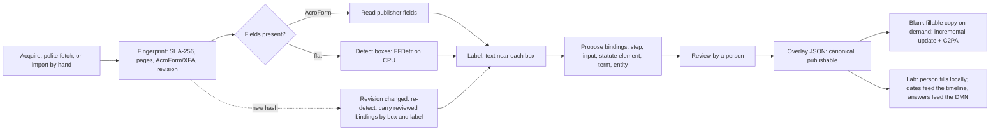

# CommonForms for lexflow: form-field detection, field maps and provenance

_10 October 2026. Scope: whether CommonForms (https://github.com/jbarrow/commonforms) can make lexflow's flat
official forms fillable, and what a small backend needs so that each detected field links to a process step, a DMN
input, a statute element or a defined term. It also covers how to keep a clean audit trail, C2PA included, for
everything derived from an official form._

_Method. Research and design only. The repository was read through the GitHub API and raw files at commit
`f5f4007` on `main` (17 June 2026): README, `pyproject.toml`, all of `commonforms/`, the tests and the issue
tracker. Also read: the paper (arXiv 2509.16506v1, HTML version), the five model cards and the dataset card through
the Hugging Face API, PyPI metadata for the package and its dependencies, the C2PA Technical Specification 2.4
(HTML), and the cited court rules and regulations. File sizes come from the Hub API, PyPI metadata or HTTP `HEAD`
responses. Nothing was downloaded, installed or run. No weights, datasets, packages or official PDFs were fetched.
Every request used the User-Agent `lexflow-research/0.1 (https://github.com/alibama/lexflow)` with at least 1.2 s
between requests to one host. Facts about lexflow come from this repository: `fixtures/forms/forms.json`,
`lexflow/forms/`, `lexflow/ir.py`, `lexflow/pipeline/`, `lexflow/store/db.py` and the design notes cited below. The
only live check of lexflow was a read of installed package versions in the `lexflow-app-1` container._

_Revision (10 October 2026). [verify-canonical.md](verify-canonical.md) found two errors here, and both are fixed.
In §3.2, `form_fields` joins the existing `EXCLUSIVE` job group instead of a duplicate group. In §3.3, the form tables
gain the `state`, `updated_at` and `origin` columns that `db.SYNCED` requires. Both were re-read in
`lexflow/pipeline/jobs.py`, `lexflow/store/db.py` and `lexflow/store/turso.py`._

_Privacy and credit. People appear only as authors in citations. Nobody is named as a partner, advisor or endorser
of lexflow. Issue-tracker comments are cited by issue number, without names. This is information, not legal
advice._

## Summary

- **What it is.** CommonForms detects where form fields belong on a page image. It finds three classes: text box,
  "choice button" (checkbox or radio) and signature. It then writes them into a copy of the PDF as AcroForm widgets.
  The fields are named `textbox_0_3`, `choicebutton_1_7` and so on. They get no labels, no tooltips, no radio
  groups and no data types beyond those three classes, and the detection confidence is thrown away. `prepare_form()`
  returns nothing (issue #29 asks for the widgets). So CommonForms gives lexflow **boxes**. The field map, which
  matters more, is lexflow's own work.
- **Models.**
  - FFDNet-S and FFDNet-L: YOLO11 detectors with 9 M and 25 M parameters, trained at 1216 px.
  - FFDetr: an RF-DETR Medium detector, added in v0.2.0 and the default of the Python API.
  - Reported accuracy: FFDNet-L reaches 81.0 mAP50-95 on CommonForms' own test split (text 71.4, choice 78.1,
    signature 93.5), and 82.8 on government and administrative pages.
  - Speed: no CPU figure is published. The paper's figures are for a GPU (3090 Ti: about 16 ms a page for L, 5 ms
    for S). An estimate from Ultralytics' own CPU table is about 1 s a page with `--fast` and about 3 s a page with
    the default settings, to be measured (§1.7).
- **Licences are the blocker, not the code.**
  - The repository has no LICENSE file, and neither does the PyPI package. In issue #9 the repository owner wrote
    that the code is Apache; that is a statement, not a licence file.
  - The FFDNet weights state no licence (issue #41, still open, asks for one), and Ultralytics' licence page says
    YOLO-trained models fall under AGPL-3.0.
  - Only FFDetr carries a licence tag: `apache-2.0`.
  - The package imports `ultralytics` (AGPL-3.0) when it loads, whichever model is chosen.
  - **Recommendation:** do not make the `commonforms` package a lexflow dependency. Write a small adapter on `rfdetr`
    (Apache-2.0), the FFDetr weights, `pypdfium2` and `pypdf`. Use FFDNet-L only for a local comparison, and only if
    the user accepts the licence uncertainty.
- **Fit with the 82 forms in `fixtures/forms/forms.json`:**
  - 48 are already AcroForm PDFs: 3,577 fields on 221 pages.
  - **6 are flat official PDF forms, 16 pages in all. These are the ones CommonForms could make fillable.**
  - 9 more PDF forms could not be read (robots.txt, HTTP 403, a timeout, no official URL). Some of them may turn out
    to be flat.
  - 1 is a Word form, which CommonForms does not take.
  - The other 18 are portals, sample letters, guides and web pages.
  - Only 3 of the 6 flat forms link to a modelled step today: two Virginia DPOR forms and the Illinois PAC request
    for review. The three Washington forms have no Washington model yet. Two of them are **mandatory pattern forms**
    under Washington GR 39(d).
- **The 48 fillable forms are a free test set.** Remove their fields, run detection and compare with the
  publisher's own boxes. That measures both box accuracy and lexflow's field naming (§2.4).
- **Keep the official PDF untouched.**
  - The overlay (a JSON field map keyed to the official file's SHA-256) is the canonical record, and it is what
    lexflow publishes.
  - A blank fillable copy is made on demand as a **pypdf incremental update**. The official bytes are then an exact
    prefix of the copy, which anyone can check by hashing.
  - Filled values never reach the server (§3.7).
- **Provenance.** The canonical audit record is a hash-chained run log. C2PA is the portable wrapper on the copies
  people download: the official PDF as a `parentOf` ingredient, `c2pa.opened` and `c2pa.edited` actions, a
  `c2pa.ai-disclosure` assertion for the detector, and a hashed `c2pa.external-reference` to the run log. Start with
  a sidecar `.c2pa` manifest and embed one only after testing. Without a certificate from a CA on the C2PA trust
  list, validators will not show lexflow as a trusted signer (§3.8).
- **Downloads a prototype needs** (none made; each needs the user's approval; §4):
  - FFDetr weights, 135 MB;
  - CPU-only torch, 196 MB, and torchvision, 1.7 MB;
  - `rfdetr`, `transformers`, `supervision`, `pypdfium2` and `pypdf`, about 18 MB together, plus their dependencies;
  - optionally `c2pa-python`, 15 MB;
  - the six official PDFs.
  The 153 GB dataset is not needed.

---

## 1. What CommonForms is

### 1.1 Task and output

The paper casts form preparation as object detection. Given a page image, it predicts the location and type of each
fillable element ("Text Input, Choice Button, Signature"; arXiv 2509.16506, abstract). The README calls the tool a
way to "Automatically convert a PDF into a fillable form": a PDF goes in and a PDF with AcroForm fields comes out.
The paper names a second step, *form enrichment* ("grouping the fillable elements and their labels based on the
semantics of the form"), and leaves it to future work (§1, §6). For lexflow, enrichment is the part that matters
(§3.6).

### 1.2 Code layout (commit `f5f4007`)

| Path | What it is |
|---|---|
| `commonforms/inference.py` (14 KB) | Rendering (`render_pdf`), the two detector wrappers (`FFDNetDetector` on Ultralytics YOLO, `FFDetrDetector` on RF-DETR), reading-order sort, the signature-label heuristic (`promote_signature_widgets`) and `prepare_form()` |
| `commonforms/form_creator.py` (6 KB) | `PyPdfFormCreator`: writes `/Tx`, `/Btn` and `/Sig` widget annotations with pypdf |
| `commonforms/utils.py` | Pydantic `BoundingBox` (normalised 0-1, top-left origin), `Widget(widget_type, bounding_box, page)`, `TextFragment`, `Page` |
| `commonforms/__main__.py`, `__init__.py`, `exceptions.py` | CLI, `prepare_form` export, `EncryptedPdfError` |
| `dataset/` | COCO generation, merge and split scripts; `test.csv`, `val.csv` (the split lists) |
| `tests/inference_test.py` | Runs all three models on `tests/resources/input.pdf`; tests the encrypted-PDF error and the signature heuristic |
| `pyproject.toml` | `commonforms` 0.2.1, Python ≥ 3.10; depends on `ultralytics`, `rfdetr`, `transformers`, `onnxruntime`, `onnx`, `onnxslim`, `pypdf`, `formalpdf`, `huggingface-hub`, `pillow`, `pydantic`, `cryptography` |
| (none) | **No LICENSE file** anywhere in the tree |

`inference.py` imports `pypdfium2` directly but does not list it. It arrives through `formalpdf`, which requires
`pypdfium2>=4.30` (PyPI metadata).

### 1.3 Models

| Model | Architecture | Size | Weights file (Hub) | Bytes | Licence stated |
|---|---|---|---|---|---|
| FFDNet-S | YOLO11, trained from scratch, 1216 px | 9 M parameters (paper §4) | `jbarrow/FFDNet-S` `FFDNet-S.pt`; ONNX: `jbarrow/FFDNet-S-cpu` `FFDNet-S.onnx` | 19,272,467; ONNX 38,370,092 | none on either card |
| FFDNet-L | YOLO11, trained from scratch, 1216 px | 25 M parameters (paper §4; card) | `jbarrow/FFDNet-L` `FFDNet-L.pt`; ONNX: `jbarrow/FFDNet-L-cpu` `FFDNet-L.onnx` | 51,203,538; ONNX 101,944,542 | none on either card |
| FFDetr | RF-DETR (card: `base_model: Roboflow/RF-DETR`), loaded as `RFDETRMedium` in `inference.py` | RF-DETR-M is listed at 33.7 M parameters and 576 × 576 (RF-DETR README) | `jbarrow/FFDetr` `FFDetr.pth` | 134,960,879 | `license: apache-2.0` (card metadata) |

- Training. The paper says both FFDNet models were trained for 300 epochs on 4 × V100, L for about 5 days and S for
  about 2. Each cost under $500. A footnote says that, "due to a processing error", the models were trained on only
  part of the data. The HTML renders the figure as "3?50k form pages rather than the full 490k".
- FFDetr. The card says only that it is "trained using Roboflow's RF-Detr on CommonForms". It gives no training
  resolution and no accuracy.
- File sizes. The `.pt` files are about half the size of the ONNX exports. That is consistent with 16-bit weights
  in the `.pt` files and 32-bit weights in the ONNX files; this was inferred from the sizes, not checked.
- Hosting. The README also links a hosted service, `detect.semanticdocs.org`. lexflow should not depend on it (§3.8).

### 1.4 How a PDF goes through it (read from the code)

1. **Render.** `pypdfium2` opens the file. A `PdfiumError`, for example on a password-protected file, becomes
   `EncryptedPdfError`. Each page is rendered at `scale=2`, twice the PDF's 72 points per inch, so a US Letter page is
   1224 × 1584 px. The text layer is read line by line into `TextFragment(text, x0, y0)`: the left edge and top of
   each line, with no full box. A scanned page has no text layer.
2. **Detect.**
   - *FFDNet, default path:* the PyTorch `.pt` weights through Ultralytics, with `augment=True` (test-time
     augmentation; Ultralytics runs three passes at scales 1, 0.83 and 0.67), `iou=0.1`, `imgsz` 1600 from the CLI
     and `conf` 0.3.
   - *FFDNet, `--fast`:* the ONNX weights, one page at a time at 1216 px (the code comment says "that's all ONNX
     supports"), with `augment=False` and `iou=1`. Ultralytics documents that lower `iou` values remove more
     overlapping boxes, so `iou=1` removes almost none.
   - *FFDetr:* RF-DETR Medium in batches of 3 or 4 pages, then class-agnostic NMS at 0.1. Its `image_size`
     argument is overwritten to 1024 inside `extract_widgets` and never passed to the model. A comment on issue #9
     reports that the package runs FFDetr at 576 px although the checkpoint was trained at 1024.
   - All paths keep only the class and the box. **The confidence score is dropped.**
3. **Order.** `sort_widgets` sorts boxes by y, then x, grouping boxes within 0.01 of page height into one row (tab
   order).
4. **Signatures (optional).** With `use_signature_fields`, a page that has no signature detection but has a text
   line containing "signature" gets its nearest text-box row's left-most box retyped as a signature.
5. **Write.** `PyPdfFormCreator` clones the file with `PdfWriter(clone_from=reader)` and writes it out whole, not as
   an incremental update.
   - **Unless `--keep-existing-fields` is given, it empties `/AcroForm /Fields` and replaces every page's `/Annots`
     with an empty array.** That drops all annotations, links and comments included, not only form widgets.
   - It then adds:
     - text fields: `/FT /Tx`, `/DA "/Helv 0 Tf 0 0 0 rg"` (auto font size), the Multiline flag with
       `--multiline`, and `/F 4` (print);
     - checkboxes: `/FT /Btn`, `/V` and `/AS` set to `/Off`, with no appearance streams (open PR #39 adds them,
       because check marks disappear when the form is flattened);
     - signature fields: `/FT /Sig`, unsigned, only with `--use-signature-fields`; otherwise the box becomes a text
       field.
   - Rectangles map the normalised boxes onto the CropBox, or the MediaBox when there is none.
   - Nothing writes `/TU` (the accessible name), `/MaxLen` or comb fields, radio groups, or values.

### 1.5 Command line and Python API

```
commonforms <input.pdf> <output.pdf> [--model FFDNet-L|FFDNet-S|FFDetr|path] [--keep-existing-fields]
            [--use-signature-fields] [--device cpu] [--image-size 1600] [--confidence 0.3] [--fast] [--multiline]
```

```python
from commonforms import prepare_form
prepare_form("in.pdf", "out.pdf", model_or_path="FFDetr", keep_existing_fields=False, use_signature_fields=False,
             device="cpu", image_size=1024, confidence=0.4, fast=False, multiline=False, batch_size=4,
             signature_label_terms=("signature",))      # returns None
```

- **The defaults differ between the two entry points.** The CLI defaults to FFDNet-L at 1600 px with confidence 0.3.
  The function defaults to FFDetr at 1024 px with confidence 0.4. The README says the CLI arguments are "keyword
  arguments to the `prepare_form` function", but not that the defaults differ.
- Input is PDF only. The CLI help says "only .pdf files are supported for now."
- **Weights download on first use.** `hf_hub_download(repo_id, filename)` is called with no `revision`, so it
  follows each repo's `main` branch. A lexflow job must never trigger this implicitly (§4).
- **PyPI lags `main`.** 0.2.1 was uploaded on 26 November 2025. Four merged fixes came later: #28 (fields printable
  by default), #31 (an FFDetr crash on a one-page final batch), #35 (signature promotion) and #36 (a `--help` crash).
  - At commit `612ada4`, made the same minute as the 0.2.1 upload, text boxes and checkboxes carry no `/F` flag.
    Whether the published wheel matches that commit was not checked, because that would mean downloading it.
  - Issue #40 (open) reports the FFDetr crash in code shaped like the 0.2.1 version.

### 1.6 Accuracy reported

All figures are mAP50-95 on the CommonForms test split. The dataset was split by document, so test pages come from
documents not seen in training but from the same Common Crawl distribution (paper §3.1, §5).

| Model (1216 px) | Text | Choice | Signature | All |
|---|---|---|---|---|
| FFDNet-S | 61.5 | 71.3 | 84.2 | 72.3 |
| FFDNet-L | 71.4 | 78.1 | 93.5 | 81.0 |

- **By domain (FFDNet-L):** government and administrative 82.8 (17.3% of pages), law and justice 79.7 (6.0%). By
  language: English 80.6.
- **Resolution matters.** A 6 M-parameter model trained on 10k pages scores 42.7 at 640 px, 52.8 at 960, 57.9 at 1216
  and 62.1 at 1536. Choice buttons and signatures gain most (Table 4).
- **Filtering helps.** On 10k pages, a model trained on the filtered set scores 57.9, against 53.6 when trained on
  all form PDFs (§5.4).
- **The comparison with Adobe Acrobat is qualitative** (Table 2 is a set of images). The text says Acrobat "does not
  detect choice buttons at all".
- **The labels are other people's form fields.** Table 1 of the paper lists the inconsistencies that remain in them:
  "For Official Use" areas, "circle/check all that apply" items, signatures made as text fields, scans, and
  misplaced fields. Errors of exactly these kinds will show up on lexflow's forms.
- **FFDetr has no published accuracy.** One comment on issue #9 reports recall 0.85 and precision 0.85 at IoU 0.5 on
  19 public fillable forms (68 pages, 2,075 fields) at 1024 px, against 0.64 and 0.78 at 576 px. It also says that
  signatures were "still found mostly as text fields at 1024". Another comment found FFDNet-L better aligned, with
  fewer false positives. These are third-party reports and were not reproduced.

### 1.7 Speed on a 4-core laptop CPU

**No CPU timing is published.** The paper gives GPU times only: on a 3090 Ti, about 16 ms a page for FFDNet-L and
5 ms for FFDNet-S (§5). The README says `--fast` runs "in about half the time" on a CPU. Issue #5, which proposed
a `--fast` option running FFDNet-S at low resolution, set the aim that it "should run sub-second per page on most
CPUs". The option as built runs the chosen model's ONNX export at 1216 px, which is FFDNet-L by default.

**Estimate, not a measurement.** Ultralytics' YOLO11 table lists YOLO11l (25.3 M parameters, the size of FFDNet-L)
at 238.6 ms a 640 px image with ONNX on CPU. The page does not name the CPU. Compute grows with pixel count, which
gives:

| Path | Scale over 640 px | Estimated time a page |
|---|---|---|
| `--fast` (ONNX, 1216 px, one pass) | (1216/640)² ≈ 3.6 | about 0.9 s |
| Default CLI (1600 px, three augmented passes) | (1600/640)² × (1 + 0.83² + 0.67²) ≈ 6.25 × 2.14 ≈ 13.4 | about 3.2 s, in PyTorch, for which no CPU figure is published |

On a 4-core laptop the real numbers may be a few times slower. For the 6 flat forms (16 pages), that is under a
minute with `--fast` and a few minutes with the default settings. For the 221-page test set (§2.4), it is a few
minutes to about a quarter of an hour. No CPU figure exists for FFDetr. All of this is measured in the first step of
the prototype (§5).

### 1.8 Known limits

| Case | What happens | Source |
|---|---|---|
| Scanned pages | Detection runs on the image, but there is no text layer, so the signature heuristic (and any label matching) finds no words. The paper lists scans among its noisy cases and names "performance on scans" as future work. | `inference.py`; paper Table 1, §6 |
| Multi-page | Supported: every page is rendered and detected. An old page-order bug (#12) is closed. | code; #12 |
| Rotated pages | `/Rotate` is not applied when the boxes are mapped back, so fields land in the wrong place (open). | #34 |
| Checkboxes | Detected well (choice AP 78.1), but always written as independent checkboxes: no radio groups and no appearance streams. | `form_creator.py`; #39 |
| Signatures | Off by default (written as text fields). With the flag, an unsigned `/Sig` field. The FFDetr signature class is weak according to an issue comment. | code; #9, #33 |
| Tables | No table or cell model. Each cell is a separate text box, with no row or column grouping. | code; paper §5.2 (Acrobat mis-detects tables) |
| Comb fields (one box per character) | Not supported (open). | #32 |
| Duplicate cross-class boxes | Class-aware NMS can stack a text box and a checkbox on one spot (open PR). | #37 |
| XFA | pypdfium2 without XFA support warns; XFA-only forms are not handled. | #16 |
| Encrypted | A file that needs a password raises `EncryptedPdfError`. A password option is a TODO in the tests. | code; tests |
| Existing annotations | Removed by default, links included (§1.4). | `form_creator.py` |
| Output bytes | A full rewrite, so the official bytes are not preserved inside the output. | `form_creator.py` |

### 1.9 Licences

| Part | What its source says | What it means for lexflow |
|---|---|---|
| `commonforms` code | No LICENSE file in the tree. GitHub's API reports no licence, and PyPI 0.2.1 declares none. In issue #9 (12 Oct 2025) the repository owner wrote: "The code is Apache, but I need to check if the model weights can be since they're YOLO models." | The intent is stated, but there is no licence file. Read it as a reference; do not copy code until a LICENSE file exists. |
| FFDNet-S/L weights (`.pt`, `.onnx`) | No `license` on the four model cards. Issue #41 (open, 21 Aug 2026) says "there is no grant that would let anyone redistribute the weights". Ultralytics' licence page: "All Ultralytics YOLO trained models fall under the AGPL-3.0 License by default." | Do not ship or redistribute them. A local comparison only, if the user accepts the risk. |
| FFDetr weights | `license: apache-2.0` and `base_model: Roboflow/RF-DETR` in the card metadata. A comment on issue #9 (Oct 2026) notes the tag is the only licence statement, with no LICENSE file in the Hub repo. | The clearest option. Keep the Apache notice and record the Hub revision. |
| `rfdetr` | Apache-2.0 (GitHub, PyPI). RF-DETR-M is listed under Apache 2.0, while the "Plus" models (Atto, Femto, Pico, XL, 2XL) are under PML 1.0. | Fine. Use only the Apache models. |
| `ultralytics` (and `ultralytics-thop`) | AGPL-3.0 (PyPI). The licence page offers an Enterprise License as the alternative, for "SaaS platforms, APIs, or cloud systems that use YOLO behind the scenes". | `commonforms.inference` imports it at load even for FFDetr. lexflow already depends on AGPL-3.0 packages (`pm4py`, `powl` in `requirements.txt`), but this would add one more for a network service. Keep it out of the main image. |
| Dataset `jbarrow/CommonForms` | `license: apache-2.0` on the card. The pages come from Common Crawl PDFs. | Not needed. The card's grant does not clear the rights in the third-party documents in it. |
| Paper | CC BY 4.0 (arXiv). | Cite it and quote with attribution. |
| `formalpdf` | No licence on PyPI. The GitHub repo `jbarrow/formalpdf` is Apache-2.0. | Only the route to `pypdfium2`; not needed by an adapter. |
| `pypdfium2`, `pypdf` | "BSD-3-Clause, Apache-2.0, dependency licenses"; BSD-3-Clause (PyPI). | Fine. |

None of these licences addresses the detector's output. Whether an official form may be altered and passed on is
governed by the form's own publisher and by court rules (§3.9), not by the model licence.

---

## 2. Fit with lexflow's forms

### 2.1 The 82 entries in `fixtures/forms/forms.json`

| Group | Count | Pages, fields | CommonForms? |
|---|---|---|---|
| AcroForm PDF (`fillable: true`) | 48 | 221 pages, 3,577 fields (9 also carry XFA, 7 are permission-encrypted) | Not needed; a ready test set (§2.4) |
| **Flat PDF form** (`fillable: false`, PDF) | **6** | **16 pages** | **Yes: the candidates (§2.2)** |
| Word form (`fillable: false`, `.docx`) | 1 (`wa-cr-08-0900`) | – | No: PDF only, and the official file is already editable |
| PDF form not read (`fillable: null`, kind `pdf_form`) | 9 | unknown | Perhaps, once a person fetches them (§2.3) |
| Sample letters | 4 (2 flat PDFs: Maryland PIA Appendix A, 2 p; New York COOG letters, 6 p) | – | No: templates, which lexflow's statute drafts cover (`docs/design/forms-plan.md` §6) |
| Instructions | 3 (2 flat PDFs: Texas OCA overview, 24 p; Washington CROP instructions, 5 p) | – | No: not forms |
| Web pages | 5 | – | No |
| Online portals | 6 | – | No |

So **7 entries are marked not fillable**: 6 flat PDFs and 1 Word file. **CommonForms could make 6 of them fillable
now, and up to 15** if the 9 unread PDF forms turn out to be flat.

### 2.2 The six flat forms

| Fixture id | Form, publisher | Pages | Step it serves (match) | Law in the fixture | Status of the form |
|---|---|---|---|---|---|
| `va-dpor-a406-01ccr` | A406-01CCR Criminal Conviction Reporting Form, DPOR | 2 | `va.license_conviction` `apply` (partial) | Va. Code § 54.1-204 | Filed with a licence application that reports a conviction (fixture note) |
| `va-dpor-a713-01iff` | A713-01IFF, request for an informal fact-finding conference, DPOR | 2 | `present_case` (partial), `informal_conference` (related) | Va. Code § 2.2-4019 | Board form |
| `il-pac-request-for-review` | FOIA Request for Review, Illinois Attorney General (PAC) | 1 | `il.records` `request_review` (exact) | 5 ILCS 140/9.5 | "Sample form, not required" (fixture note) |
| `wa-crrlj-09-0100` | CrRLJ 09.0100 Petition to vacate a misdemeanor conviction, AOC pattern form, rev. 11/2024 | 5 | none (no Washington model) | RCW 9.96.060 | Pattern form |
| `wa-cr-08-0800-lfo-petition` | CR 08.0800 Petition re: LFOs, rev. 01/2022 | 3 | none | RCW 10.01.160(4), GR 39 | **Mandatory:** GR 39(d), "The petitioner shall complete and file a mandatory pattern form petition, declaration of mailing and proposed order created by the Administrative Office of the Courts (AOC)." |
| `wa-cr-08-0810-lfo-order` | CR 08.0810 Order re: LFOs, rev. 01/2022 | 3 | none | same | The mandatory proposed order of GR 39(d) |

Two things found while checking these:

- **A newer Washington file exists.** `courts.wa.gov` also serves `CR 08.0800wi Petition re LFO 202311.pdf`, 150,050
  bytes, last modified 1 November 2023 (headers only). The fixture records the 01/2022 file (122,388 bytes, last
  modified 28 December 2021). Whether the 2023 file supersedes it was not confirmed. The revision check of
  `forms-plan.md` §5 should settle this before any work on that form.
- **GR 39(d) names three forms; the fixture lists two.** The rule names a petition, a declaration of mailing and a
  proposed order. In the form text printed with the rule (WSR 22-01-031), the petition's item 4 reads "I mailed or
  delivered this Petition, Declaration and proposed Order to the Court on (date) … and to the Prosecuting Attorney
  on (date) …". So the declaration of mailing appears to be part of the petition file. The PDF itself should confirm
  this.

### 2.3 The nine unread PDF forms

These are `va-llc-1011` (robots.txt), `il-sos-llc-5-5` (timeout), `tx-statement-of-inability` (no official URL),
and `dc-superior-court-fee-waiver`, `ny-cpl-160-59-application`, `nc-aoc-cr-281`, `nc-aoc-cr-415`, `nc-aoc-g-106`
and `nc-aoc-cr-273` (HTTP 403). The fixture's rule stands: no retries and no bypass. A person downloads the file in a
browser and imports it (§3.4). Only then does lexflow know whether a form is flat.

### 2.4 The 48 fillable forms as a test set

The publishers' own fields are ground truth that costs nothing. A proposed evaluation (not run):

1. Copy each file and remove its widget annotations, keeping each field's `/Rect`, `/FT`, `/T` and `/TU`. Decrypt
   the 7 permission-encrypted files with the empty user password first, as the link checker already does. Use the
   AcroForm layer of the 9 XFA hybrids.
2. Render and detect, keeping the confidence scores.
3. Match boxes to publisher fields at IoU ≥ 0.5 per class: `/Tx` to text, `/Btn` checkbox or radio to choice, `/Sig`
   to signature. Report recall and precision by class, state and process, the size of the alignment error, and the
   seconds per page on the 4-core machine.
4. Score the naming step (§3.6) against the publishers' `/T` and `/TU`. This measures how often lexflow's label
   matching finds the label the publisher used.

**Caution.** Some of these forms may be in the training data, which comes from a 2021 Common Crawl sample (paper §3).
Forms revised since then, such as Maryland's "rev. 10/01/2026", are less likely to be. The repository's `test.csv`
and `val.csv` list the split, but whether they identify source URLs was not checked.

---

## 3. A backend: the canonical form workflow

"Canonical" here means three things. Each official form is pinned to its exact bytes. Each field on it is bound to
the process model, the decision inputs and the statute words it serves. Every derived artefact can be traced, by
hash, to its inputs and to the person who reviewed it.

### 3.1 The workflow



Every arrow writes a run record (§3.3). The revision branch hooks into the re-check of `forms-plan.md` §5: a new
SHA-256 invalidates the overlay. The new boxes are matched to the old ones by IoU and label. Reviewed bindings carry
over only when both match, and everything else goes back to review.

### 3.2 Job step and Setup row

The step goes in `lexflow/pipeline/steps.py`, after the `forms` step (proposed, not written):

```python
Step(id="form_fields", title="Find and map the fields of flat official forms",
     why="Flat official PDFs get field boxes (FFDetr on CPU), each tied to the step, decision input or statute "
         "words it serves; reviewed by a person; the official file is never changed",
     level="optional", status=st_form_fields, run=run_form_fields, needs=["forms"],
     params=["states", "force"],
     cost="CPU only, about 1-4 s a page (to be measured); 6 flat forms, 16 pages; one-off model download (approved)",
     credits=[FFDETR, RFDETR, PYPDFIUM2, PYPDF])   # credits.py format; FFDetr "by": "CommonForms project"
```

- **Status.**
  - `done`: every flat PDF form of the chosen states has a reviewed overlay for its current SHA-256.
  - `partial`: proposals are waiting for review, or a fingerprint changed.
  - `todo`: no overlays.
  - `blocked`: `forms` is not done.
- **Jobs.** Detection takes every core of a 4-core laptop, so it must never run beside a model build. The group
  already exists: `EXCLUSIVE = {"build", "quickstart", "models", "ask"}` (`lexflow/pipeline/jobs.py:24`), one of the
  `GROUPS`. Adding `form_fields` to it is enough. (An earlier version of this note proposed a new `CPU_HEAVY` group
  with the same members, which would only have duplicated `EXCLUSIVE`.)
- **No hidden downloads.** Run with `HF_HUB_OFFLINE=1` and an explicit weights path. Then any fetch that `rfdetr` or
  `transformers` tries during model construction fails loudly instead of downloading. Whether `rfdetr` fetches
  anything when given a local checkpoint was not checked.

### 3.3 Storage

Files:

| Path | What | Published? |
|---|---|---|
| `/data/raw/forms/<sha256>.pdf` | Official bytes, written once, read-only. `docker-compose.yml` bind-mounts `./data/raw`, "downloads stay on the host". | Never. Link to the publisher's URL. |
| `/data/forms/<form_id>/<sha12>/detect-<run>.json` | Raw detections: page, box, class, confidence, detector, weights SHA-256, parameters | No |
| `/data/forms/<form_id>/<sha12>/overlay.json` | The reviewed field map (§3.5) | Yes: a table on the wiki |
| `/data/forms/<form_id>/<sha12>/runlog.jsonl` | Hash-chained run records | Yes, as the audit trail; no personal data |

Today the link checker keeps no downloads ("bytes parsed in memory", fixture `checker.pdf`). Storing official PDFs
changes that, and the user has to approve it.

Tables (new, `lexflow/store/db.py` style; no person's data in any of them, since forms are blank). Each carries
`state` (the form's state in the fixture), `updated_at` and `origin`. `db.py` requires those three columns of every
table in `SYNCED` ("Tables listed in `SYNCED` carry `state`, `updated_at` and `origin`"), and `turso.push` and `pull`
filter on `state IN (…)` and `updated_at >= ?`. An earlier version of this note left them out, so none of the four
tables could have been synced as written.

```sql
form_files(sha256 TEXT PRIMARY KEY, form_id TEXT, url TEXT, final_url TEXT, bytes INT, pages INT,
           source TEXT CHECK (source IN ('fetched','imported')), fetched_at TEXT, etag TEXT, last_modified TEXT,
           revision TEXT, state TEXT NOT NULL, updated_at TEXT NOT NULL, origin TEXT)
form_runs(run_id TEXT PRIMARY KEY, form_sha256 TEXT, kind TEXT, -- detect | label | bind | review | export
          tool TEXT, tool_version TEXT, model TEXT, weights_sha256 TEXT, params TEXT, inputs TEXT, outputs TEXT,
          prev_hash TEXT, record_sha256 TEXT, created_at TEXT,
          state TEXT NOT NULL, updated_at TEXT NOT NULL, origin TEXT)
form_fields(field_key TEXT PRIMARY KEY, form_id TEXT, form_sha256 TEXT, page INT, x0 REAL, y0 REAL, x1 REAL, y1 REAL,
            widget TEXT, confidence REAL, origin TEXT, label TEXT, value_type TEXT, grp TEXT, pdf_name TEXT,
            tooltip TEXT, privacy TEXT, status TEXT, run_id TEXT,
            state TEXT NOT NULL, updated_at TEXT NOT NULL, row_origin TEXT)
field_bindings(field_key TEXT, kind TEXT, target_key TEXT, section TEXT, subsection TEXT, quote TEXT, level TEXT,
               method TEXT, score REAL, status TEXT, determination TEXT, run_id TEXT,
               state TEXT NOT NULL, updated_at TEXT NOT NULL, origin TEXT,
               PRIMARY KEY (field_key, kind, target_key))
```

- `record_sha256` is the SHA-256 of the canonical JSON of a run record, `prev_hash` included, so any edit to the log
  breaks the chain. The three sync columns sit outside the hashed record.
- **A naming clash.** `form_fields` already has an `origin` column (`detected`, `publisher` or `manual`). So the sync
  column needs another name there, written `row_origin` above. Either `db.upsert` and `turso` learn a per-table name
  for the origin column, or the field column is renamed (for example `field_origin`) and the sync column keeps
  `origin`. The rename is simpler, and the choice belongs with the code.
- With the three columns, all four tables can go into `db.SYNCED`. For `form_files` only the metadata syncs; the
  bytes never do. The other way is to keep the tables local and rebuild them on each machine from `overlay.json` and
  `runlog.jsonl`.

### 3.4 API endpoints

| Endpoint | Does |
|---|---|
| `POST /api/jobs {"step": "form_fields", "args": {...}}` | Runs detection through the existing job runner; no new route |
| `POST /api/forms/{form_id}/files` | Imports a PDF a person downloaded by hand, for the hosts that refuse automated clients. Records `source='imported'`, the publisher URL and the SHA-256. Refuses a file whose page count or title disagrees with the fixture. |
| `GET /api/forms/{form_id}/overlay` | The current overlay (fields and bindings) for the latest SHA-256 |
| `GET /api/forms/{form_id}/pages/{n}.png?boxes=1` | A page image with numbered boxes for review (pypdfium2, made on request, not stored) |
| `PUT /api/forms/{form_id}/fields/{field_key}` | Review edits: move, retype, rename, delete, or add a missed field (`origin='manual'`) |
| `PUT /api/forms/{form_id}/fields/{field_key}/bindings` | Accept or reject a proposed binding. Records `determination` ("reviewed by <role>, suggested by lexflow.forms.fields (date)"), as `docs/design/terms-wikibase.md` §4 does for Wikidata links. |
| `GET /api/forms/{form_id}/fillable.pdf` | A blank fillable copy, made on demand from the cached bytes and the reviewed overlay (§3.7); never stored and never filled |
| `GET /api/forms/{form_id}/provenance` | The run log chain and the C2PA manifest as JSON |

`GET /api/forms?state=&question=` and `GET /api/models/{mid}` (proposed in `forms-plan.md` §3.2) gain a `fields`
count and the overlay hash on each `FormRef`.

### 3.5 The field map

A sketch for a new `lexflow/forms/fields.py`. It reuses `ir.Source` and `ir.Review`, and leaves `ir.py` alone.

```python
class FieldBinding(BaseModel):
    kind: Literal["step", "message", "input", "element", "term", "role", "entity", "deadline"]
    key: str            # lexflow:step:il.records:request_review | lexflow:input:ca.license_conviction:conviction_dismissed
                        # lexflow:term:wa:10.101.010:indigent | lexflow:agency:<scope>:<slug> | lexflow:private-party
    source: Source | None = None      # for "element" and "deadline": section, subsection and the exact quote
    level: Literal["required", "if_asked", "right", "context", "duty", "notice", "form_only"] | None = None
    method: Literal["citation-in-label", "quote-match", "label-match", "vocabulary", "manual"]
    score: float | None = None
    status: Literal["proposed", "reviewed", "rejected"] = "proposed"
    determination: str = ""

class FormField(BaseModel):
    key: str            # lexflow:field:<form_id>:<slug>
    page: int
    box: tuple[float, float, float, float]   # x0, y0, x1, y1 in 0-1, top-left origin (CommonForms' convention)
    widget: Literal["text", "checkbox", "signature"]
    confidence: float | None                 # None for publisher and manual fields
    origin: Literal["detected", "publisher", "manual"]
    label: str | None                        # verbatim from the page's text layer
    value_type: Literal["text", "multiline", "date", "number", "money", "phone", "email", "postal_code",
                        "case_number", "choice", "signature", "initials"] = "text"
    group: str | None = None                 # radio or choice group
    pdf_name: str                            # AcroForm partial name: no "."
    tooltip: str | None = None               # /TU, the accessible name: the verbatim label
    privacy: Literal["personal", "case", "none"] = "personal"
    bindings: list[FieldBinding] = []

class FormOverlay(BaseModel):
    schema_: Literal["lexflow-form-overlay/1"] = Field("lexflow-form-overlay/1", alias="schema")
    form_id: str; url: str; sha256: str; bytes: int; pages: int; revision: str | None
    detector: dict                           # name, Hub repo and revision, weights SHA-256, parameters
    fields: list[FormField]
    review: Review                           # draft | machine-checked | legal-reviewed
    runs: list[str]                          # run ids, oldest first
```

- **The keys reuse lexflow's.**
  - `lexflow:step:<model>:<step>` is already minted by `lexflow/publish/wikibase_lexipedia.py:358`.
  - `lexflow:input:<model>:<variable>` comes from `bpc-480-decision.md` §6.2.
  - `lexflow:term:<st>:<ref>:<slug>` comes from `terms-wikibase.md` §1.
  - `lexflow:agency:…` and `lexflow:private-party` come from `entities-contacts.md` §1.2.
- **Levels.** They are the draft levels of `lexflow/forms/draft.py`, plus `form_only`: the form asks for it, but no
  statute element of the form's steps does. The page then says "asked by the form", never "required by law". This
  is draft rule 4 ("No invented requirements") applied to official forms.
- **Default privacy.** Every field defaults to `personal`. That class decides what the lab keeps in the browser
  (`lab-plan.md` §3).

### 3.6 Naming and typing detected fields

1. **Labels.** Read the words on the page with their boxes from pypdfium2's text page, not CommonForms' line-start
   fragments. Rank candidates:
   - text that ends at the box's left edge on the same baseline;
   - text just above the box and within its width;
   - text just below a signature or date line;
   - for checkboxes, text to the right.

   Strip leaders, underscores, colons and item numbers. A scanned page has no words and needs OCR, which is not in
   scope here; such fields stay unlabelled for a person.
2. **Citations in labels first.** Many court forms print their authority next to the box. Washington's LFO petition
   does, for example ("(RCW 10.101.010 (3)(b).)", §3.6.1). A citation in the label is the strongest binding:
   `method="citation-in-label"`, an element binding to that section and subsection. lexflow already ships citation
   parsers (`citeurl` and `eyecite` in `requirements.txt`). Whether they parse these pinpoints needs a test.
3. **Quotes next.** The candidate targets of a form are:
   - the curated steps it serves (fixture `steps`), with each step's `source.quote` and its deadline quote;
   - the fixture's `statutes` and the `no_form.must_contain` lines for those steps;
   - the input data and input clauses of the step's model decisions;
   - the terms defined in the cited sections;
   - a small fixed vocabulary for generic slots: name, address, telephone, email, date, signature, case number,
     county, court, date of birth.

   Score each label against the targets by shared words, the same "shares a word with its quote" rule as `draft.py`.
   Exact containment of a quoted phrase scores higher. Keep the top three as proposals. Nothing is accepted without
   review.
4. **Types.**
   - From the detector class.
   - From label cues: date or DOB → `date`; `$` → `money`; ZIP → `postal_code`; "No." next to the court → `case_number`.
   - From shape: a box two text lines tall or more → `multiline`.
   - Evenly spaced vertical ticks inside one box → comb (`/MaxLen` plus the comb flag), which CommonForms lacks
     (#32).
   - Checkboxes under one question whose labels are alternatives ("Yes"/"No") are proposed as one radio `group`.
5. **Names.**
   - `pdf_name` is the slug of the label, prefixed with the step id when bound: `request_review__signature`. It has
     no periods, because the AcroForm partial name (`/T`) must not contain one: periods join partial names into the
     fully qualified name (ISO 32000-1:2008 Table 220, as documented by ABCpdf).
   - Duplicates get `_2`, `_3`, in reading order.
   - `/TU` gets the verbatim label. W3C's PDF10 technique: "The TU entry (which is the tooltip) of the field
     dictionary is the programmatically associated label." A flat official form has no programmatic labels at all,
     so this is a real accessibility gain.
   - `/TU` says nothing that the page does not say. In particular, no "(required)" unless the binding's level is
     `required`.

#### 3.6.1 Worked example: Washington CR 08.0800, Petition re: Legal Financial Obligations

The labels below are from the form's text as the Supreme Court adopted it, printed in WSR 22-01-031 (order of
3 December 2021). The PDF was not opened. At run time, the labels come from the PDF's own text layer.

| Expected box | Label on the form | Bindings proposed |
|---|---|---|
| checkbox | "I am involuntarily committed to a public mental health facility. (RCW 10.101.010 (3)(b).)" | element RCW 10.101.010(3)(b) (citation in label); term `lexflow:term:wa:10.101.010:indigent`, because GR 39(a)(2) says "'Indigent' is defined in RCW 10.101.010"; element GR 39(c), "A petition shall allege that the petitioner is indigent or lacks the financial ability to pay the LFO.", level `required` (one of the grounds); input `indigent` once a Washington court-debt model exists |
| checkbox | "I am receiving an annual income, after taxes, of 125% or less of the current federally established poverty level. (RCW 10.101.010 (3)(c); GR 34 …" | element RCW 10.101.010(3)(c); the same term and GR 39(c) binding |
| checkbox and text | the public-assistance ground, citing "RCW 10.101.010 (3)(a); GR 34 (a)(3)(A)", then "I am receiving the following forms of public assistance: ____" | element RCW 10.101.010(3)(a); the text box is `personal` |
| checkboxes under "The undersigned requests that the sentencing court grant an order that will (check the boxes that apply)" | interest, remission, reduction and the other forms of relief | element GR 39(b), "may petition the sentencing court for a waiver of interest and remission or reduction of any unpaid portion of the LFOs", level `right` |
| text | "Court of Washington, County/City of ____" | entity: the sentencing court (an office type, `entities-contacts.md` §1.2); level `context` |
| text | "No." | `case_number`, privacy `case` |
| text | "DOB", "PCN/TCN:", "SID:" | privacy `personal`; level `form_only` unless a rule that asks for them is found |

GR 39(d) makes this a mandatory pattern form. The fillable copy must therefore leave every printed word where it is
(§3.9).

#### 3.6.2 Worked example: Illinois PAC Request for Review

The form was not opened here. The bindings come from the curated step (`curated/il/records.json`, step
`request_review`), and the detected labels confirm or reject them.

| Statute element (5 ILCS 140/9.5(a), quoted in the curated step) | Expected field | Level |
|---|---|---|
| "The request for review must be in writing, signed by the requester" | signature, date | `required` |
| "include (i) a copy of the request for access to records" | attachment checkbox or note | `required` |
| "(ii) any responses from the public body" | attachment checkbox | `required` |
| "not later than 60 days after the date of the final denial" | date of the denial | `context`; also a `deadline` binding, so a date typed in the lab can start the step's 60-day clock in the browser (`lab-plan.md` §0) |
| (the public body) | text | entity: `lexflow:agency:…` or a government id; `context` |

Any other field, such as a telephone number, is `form_only`. The fixture already notes that this form is a sample and
not required.

#### 3.6.3 Worked example: Virginia DPOR A406-01CCR

The form serves step `apply` (partial) of `va.license_conviction`. Section 54.1-204(B) lists the nine criteria a board
"shall consider". `bpc-480-decision.md` §8 models "directly relates" as a **finding** with one input per criterion.
The form's answers (offence, dates, sentence, age at the time, rehabilitation evidence) become bindings to those
inputs with evidence kind `document`, in the sense of §6.2 of that note: they are what the applicant brings. **They
are never the finding itself**, which the board makes. The form was not opened; its labels decide which of the nine
inputs its fields reach.

### 3.7 Untouched official PDF, overlay, or fillable copy

| | A. Overlay only | **B. Overlay + blank fillable copy on demand** | C. Stored and published fillable copy |
|---|---|---|---|
| Official bytes | Untouched | Untouched; also an exact prefix of the copy | Rewritten unless done incrementally |
| What lexflow publishes | The field map and a link to the publisher | The same; copies are made only on the user's own lexflow | A modified official PDF |
| When the form changes | Re-map | Re-map; old copies identify themselves by the official hash inside them | Stale copies keep circulating |
| For the person | Needs an HTML form or a PDF library in the lab | Opens in any PDF reader; filled offline | Same as B |
| Legal exposure (§3.9) | Lowest | Low: blank, unchanged print content, not redistributed | Highest |

**Recommendation: B.**

- **Write the copy as an incremental update.** pypdf has supported this since 5.0.0 (2024-09-15): "When writing
  incrementally, the original document is written first and new/modified content is appended." Then
  `sha256(copy[:len(official)]) == official_sha256`. An auditor can check this with nothing but a hash tool, and the
  page content is unchanged by construction.
- **Keep the existing annotations.** Never clear `/Annots`, which CommonForms does by default.
- **Write no field values and no defaults.** This is the draft rule "no field has a default value". Add `/TU`,
  checkbox appearance streams (so check marks survive flattening, PR #39) and `/F 4`.
- **Do not stamp a notice on the page.** For a mandatory form, a banner would itself change the form. Put the notice
  in lexflow's download page and in the copy's metadata and C2PA manifest instead: "Fields added by lexflow to the
  publisher's file of <date> (SHA-256 …); the printed content is unchanged; check the publisher for the current
  version."
- **Filled values stay with the person.** They exist only in the person's PDF reader, or in the lab page's browser
  memory. The server never receives them (`lab-plan.md` §3).
- **Two later options:**
  - an HTML rendering of the overlay in the lab, like the statute drafts, that prints over the official page;
  - in-browser PDF filling, which needs a JavaScript PDF library (for example `pdf-lib` 1.17.1, MIT, last released
    in November 2021). That is another download to approve.

### 3.8 Provenance and C2PA

**The canonical audit record is the run log** (§3.3). Each record holds the input hashes (official PDF, weights,
overlay), the tool version and parameters, the output hashes, the reviewer's role and `prev_hash`. It maps directly
onto W3C PROV-O (a W3C Recommendation of 30 April 2013) for export:

- `prov:used` for the official file and the weights;
- `prov:wasGeneratedBy` for the overlay;
- `prov:wasAssociatedWith` for lexflow's version and the reviewer role;
- `prov:wasDerivedFrom` from the fillable copy to the official file.

**C2PA wraps the files people download.** Below is what the C2PA Technical Specification 2.4 provides, and how
lexflow would use each part.

| Need | C2PA 2.4 | lexflow's use |
|---|---|---|
| Say the copy came from the official file | Ingredient relationships `parentOf`, `componentOf`, `inputTo`; action `c2pa.opened`: "An existing asset was opened and is being set as the parentOf ingredient" | The official PDF as the `parentOf` ingredient, with its SHA-256 and publisher URL. **No manifest is ever made for the official file itself:** lexflow did not create it and does not change it. |
| Say what was done | `c2pa.edited`: "Generalized actions that would be considered editorial transformations of the content." | "Added N AcroForm fields; page content unchanged." For `digitalSourceType`, IPTC's `algorithmicallyEnhanced` ("Modification or correction by algorithm without changing the main content of the media") fits a detector. The generative values (`trainedAlgorithmicMedia`, `compositeWithTrainedAlgorithmicMedia`, "Edited using Generative AI") do not. |
| Disclose the model | `c2pa.ai-disclosure` (new in 2.4): `modelType` (for example `c2pa.types.model.pytorch` or `.onnx`), `modelName`, `modelIdentifier`, `contentProfile.humanOversightLevel` (`fully_autonomous`, `prompt_guided`, `human_validated`) | `FFDetr`; `modelIdentifier` = the Hub repo and revision; `human_validated` only after review, `fully_autonomous` before |
| Point at the evidence | `c2pa.external-reference` with a hashed URI, data type `c2pa.types.audit-log` ("A structured log of creation-phase events") | The run log and overlay, hash-bound to the manifest |
| Bind it to the PDF | Annex A.4.2.1: an embedded file with `AFRelationship` `C2PA_Manifest`, referenced from the catalog's `AF` and from EmbeddedFiles, or from a FileAttachment annotation "when adding a C2PA Manifest Store to a PDF that already has an existing PDF certifying signature" | **Sidecar first.** A validator that finds no embedded store "should look for files at the same path or URI, but with a filename extension of .c2pa". A sidecar leaves the copy as official bytes plus exactly one update. |
| Multiple updates | §15.5.2.2: one manifest store per incremental update section; several in one section make all of them invalid | If embedded later, the C2PA store goes in its own update section, after the fields' update |
| A PDF signature as well | A.4.2.2: decide the signature's size and place before C2PA signing, exclude it in `c2pa.hash.data`; "The PDF signature shall be over the entire PDF" | Not planned: lexflow does not sign forms for anyone |

Limits and cautions:

- **Trust.** The C2PA conformance page says a conforming generator "signs a claim using a valid X.509 certificate on
  the C2PA trust list". A prototype signed with a test or self-made key will verify against lexflow's own anchor, but
  general validators will not show it as a trusted signer. That is enough for internal audits and not for public
  claims.
- **Tooling.** `c2pa-rs` lists PDF as a supported format, and its PDF handler writes the store as an `EmbeddedFiles`
  entry or a FileAttachment annotation through `lopdf`. Its changelog's first PDF entry said "simple PDFs (without
  incremental updates or signatures)". Whether today's writer appends or rewrites was not checked. If it rewrites,
  the prefix property of §3.7 is lost, which is another reason to start with the sidecar. `c2pa-python` 0.38.0 wraps
  it (MIT OR Apache-2.0).
- **No personal data in any manifest.** No values, no thumbnails, no reviewer names (roles only). Copies are blank,
  so this holds by construction. A person's filled copy is never signed by the server.
- **What C2PA does not prove.** It does not show that the form is current, that the boxes are right, that the
  mapping states the law, or that a court will accept the copy. It shows who made the copy, from which bytes, with
  which tool, and who reviewed it.
- **Other lexflow artefacts.** BPMN and DMN XML, and overlay JSON, are not among `c2pa-rs`'s embeddable formats.
  Its experimental structured-text list has Markdown, YAML and TOML among others. Of the XML formats it lists only
  Atom and RSS, not generic XML, and it lists no JSON. Use sidecar manifests, or simply list their hashes in the run
  log.

### 3.9 Legal and practical cautions

1. **Mandatory pattern forms.** Washington GR 39(d) requires the AOC's "mandatory pattern form petition, declaration
   of mailing and proposed order". A fillable copy may add fields but must not reflow, retype, translate or annotate
   the printed content, nor drop pages. The same care applies to any court's official form. Check whether the
   publisher already offers a fillable version, and link to it instead.
2. **Revisions.** An overlay is valid only for the SHA-256 it was made from. Run the revision check first. The
   Washington petition already shows a newer file on the server (§2.2).
3. **Not an official version.** The copy is lexflow's. It must never be presented as the publisher's file. The
   publisher's URL and the official hash travel with it (metadata, C2PA, download page).
4. **Detection errors change meaning.** A missed checkbox can drop a ground, such as indigence. A shifted box can put
   an answer next to the wrong sworn statement. The Washington petition ends "I declare under penalty of perjury
   under the laws of the state of Washington that the foregoing is true and correct" (WSR 22-01-031). Every overlay
   needs a person's review against the page image before any copy is offered. Boxes are never ticked by default.
5. **Signatures.** An `/FT /Sig` field is an empty slot. lexflow never signs for a person. Whether a court or agency
   accepts electronic signatures is its own rule; link to the rule rather than assert it.
6. **Personal data.** The server holds blank forms only. Filled values, dates of birth, SIDs and case numbers stay
   in the person's PDF reader or the lab's browser storage, under the rules of `lab-plan.md` §3.
7. **Copyright and redistribution.**
   - 17 U.S.C. § 105 removes copyright only from "any work of the United States Government". State and court forms
     are outside it.
   - 37 C.F.R. § 202.1(c) excludes from copyright "Blank forms … which are designed for recording information and do
     not in themselves convey information". Many court forms carry instructions that do convey information.
   - Default: lexflow does not redistribute modified official PDFs. The wiki gets the field table and the
     publisher's link.
8. **Blocked hosts.** No bypass of robots.txt or bot protection. Forms on those hosts are imported by a person
   (§2.3), and the import is recorded as such.
9. **Existing signatures.** If an official PDF carries a certifying signature, adding fields may conflict with its
   modification permissions, and a full rewrite would break it. Check before writing. The fixture does not record
   PDF signatures today.
10. **No advice.** Help text restates its own quote (draft rule 9). The overlay says which statute words a field
    serves. It never says what to answer.

---

## 4. Downloads a prototype would need

Nothing here has been downloaded. Each item needs the user's approval. Sizes are wheel or file sizes for Linux
x86_64 and CPython 3.12, the app image's platform. They come from PyPI metadata, the Hub API or `HEAD` responses, on
10 October 2026. The container already has `numpy` 2.5.3, `pillow` 12.3.0, `pydantic` 2.14.0 and `huggingface-hub`
2.2.0; it has no `pypdf` and no `pypdfium2`.

**A. Detection with FFDetr (recommended)**

| What | Source | Size (bytes) | Licence | Why |
|---|---|---|---|---|
| `FFDetr.pth` | https://huggingface.co/jbarrow/FFDetr, revision `56f4e4235e28dcb2953513dc020bb191a2f54cfe`, SHA-256 `f852e1bac18c8f435b82270fc8ff8e2ca4a2cd8869c411fa8f473f16e69585ef` | 134,960,879 | Apache-2.0 (card tag) | The detector |
| `rfdetr` 1.11.2 | PyPI | 788,908 | Apache-2.0 | Loads and runs RF-DETR Medium. Requires `torch>=2.2.0`, `torchvision>=0.17.0`, `transformers>=5.1,<6`, `supervision>=0.29`, `pyDeprecate`, `tqdm`. |
| `torch` 2.14.1+cpu | https://download.pytorch.org/whl/cpu/ (`cp312`, `manylinux_2_28_x86_64`) | 196,253,677 | Apache-2.0 AND BSD-2/3-Clause AND MIT and others (PyPI licence expression) | Runtime. **Not the PyPI wheel:** that one is 554,618,695 bytes and pulls CUDA packages on Linux. |
| `torchvision` 0.29.1+cpu | same index | 1,708,098 | BSD | Required by `rfdetr` |
| `transformers` 5.19.0 | PyPI | 12,599,123 | Apache-2.0 | Required by `rfdetr`; pulls `tokenizers` (3,396,193), `safetensors` (516,040) and others |
| `supervision` 0.30.9 | PyPI | 409,708 | MIT | Required by `rfdetr` (detections, NMS) |
| `pypdfium2` 5.14.0 | PyPI | 3,799,581 | BSD-3-Clause, Apache-2.0, dependency licences | Render pages; read words and their boxes |
| `pypdf` 6.20.0 | PyPI | 401,710 | BSD-3-Clause | Write fields as an incremental update |

**B. Comparison with FFDNet (optional, only if the user accepts the licence uncertainty of §1.9)**

| What | Source | Size (bytes) | Licence | Why |
|---|---|---|---|---|
| `FFDNet-L.onnx` | https://huggingface.co/jbarrow/FFDNet-L-cpu, revision `f411267bf3472e451946897f3b17f1a72e6f67aa`, SHA-256 `e00c59edd9a5275dab5847d38f042c8ecc827063650c8aac22b0e486c414cd35` | 101,944,542 | none stated | `--fast` path |
| `FFDNet-L.pt` | https://huggingface.co/jbarrow/FFDNet-L, revision `82547d6c89fd35120ff944cdce866ac2202e2152`, SHA-256 `2a69102275c8950b04c7f7281f01e1f8ee7aa88179ac450b8df25819c07b8275` | 51,203,538 | none stated | Default path |
| `onnxruntime` 1.31.0 | PyPI | 23,760,984 | MIT | ONNX on CPU |
| `ultralytics` 8.4.175 | PyPI | 1,422,930 | AGPL-3.0 | YOLO runtime. Pulls `opencv-python` (about 71-74 MB, Apache 2.0), `polars` with `polars-runtime-32` (54,475,036), `ultralytics-thop` (AGPL-3.0), `psutil`, `nvidia-ml-py` and others. |
| `commonforms` | GitHub `main` at `f5f400727132f0c03ce8a8bffe4dc6416fa9cfd0`, or PyPI 0.2.1 (9,741) | – | no licence file | Only to run their CLI as a reference. It also pulls `onnx` (8,881,633, Apache-2.0), `onnxslim` (245,766, MIT), `formalpdf` (9,900) and `cryptography` (4,719,841). |

**C. Provenance (optional)**

| What | Source | Size (bytes) | Licence | Why |
|---|---|---|---|---|
| `c2pa-python` 0.38.0 | PyPI (`manylinux_2_28_x86_64`) | 15,334,006 | MIT OR Apache-2.0 | Build, sign and read C2PA manifests |
| A signing certificate | A local test key for the prototype; for trusted status, a CA on the C2PA trust list issuing to a conforming product | – | CA terms | Sign manifests |

**D. Data**

| What | Source | Size | Licence | Why |
|---|---|---|---|---|
| The 6 flat official PDFs (§2.2) | The fixture's URLs (all `robots_txt: ok`, status `ok`) | Known only for CR 08.0800 01/2022: 122,388 bytes | The publishers' terms (§3.9) | Detection and mapping |
| The 48 fillable official PDFs | The fixture's URLs | unknown | The publishers' terms | Test set (§2.4) |

**Not needed:** the CommonForms dataset (`download_size` 153,336,406,972 bytes), FFDNet-S, `pdf-lib`.

**Later, a lighter runtime.** Export FFDetr to ONNX once, in a throwaway environment built from list A. lexflow then
runs it with `onnxruntime` (23.8 MB) plus `pypdfium2` and `pypdf`, with no torch in the app image. RF-DETR's ONNX
guide warns that the graph returns raw tensors, and that with three classes the logits have four slots, the same last
dimension as the boxes. Outputs must therefore be matched "by name, not by shape" (`dets`, `labels`).

Whichever list is approved, install it in a separate image layer or a `detect` compose profile, so that the main
image and its dependency licences stay as they are.

## 5. Prototype plan

| Phase | Work | Check |
|---|---|---|
| 0 | The user approves list A and the six PDFs (D) | – |
| 1 | `lexflow/forms/fields.py`: render (pypdfium2), detect (rfdetr + FFDetr at 1024 px, keeping confidence), write the detection JSON and run records; `HF_HUB_OFFLINE=1` | Seconds per page on the 4-core laptop; the same boxes on a re-run |
| 2 | The test set of §2.4 (after approval of the 48 PDFs) | Recall and precision by class at IoU 0.5; FFDetr at 576 and at 1024 px |
| 3 | Labels, binding proposals and the review endpoints, for the 3 linked flat forms and the 2 GR 39 forms | Every `required` binding quotes a "must" or "shall" with the person as bearer (the `draft.check` rules); no `/TU` adds an obligation word |
| 4 | The blank fillable copy as an incremental update | The prefix hash equals the official hash; fields print; checkboxes survive flattening; opens in two PDF readers |
| 5 | A C2PA sidecar with a test key; read it back with `c2pa-python` | The manifest validates; its ingredient hash equals the official hash; no personal data |
| 6 | Setup row, API, a "Fields" table on the process pages of the wiki (no PDFs) | `tests/test_forms.py` style tests with a tiny synthetic PDF in `tests/`, and no network |

## 6. Open questions

- Will the CommonForms maintainer add a LICENSE file for the code, and state a licence for the FFDNet weights? Both
  are open in issues #9 and #41. The user could ask; this research made no network writes.
- Does the Washington AOC treat a copy with added AcroForm fields, and no change to the print, as the mandatory form
  under GR 39(d)? Does it publish fillable versions itself?
- Is `CR 08.0800wi … 202311.pdf` the current petition? Does the current PDF still carry the declaration of mailing
  as item 4, as the 2021 text does?
- Does `rfdetr` fetch anything (backbone configs) when given a local checkpoint? Phase 1 shows this under
  `HF_HUB_OFFLINE=1`.
- Should `form_fields` and `field_bindings` become Wikibase items (a field "serves" a step, "rests on" a statute
  quote), or stay as a table on the wiki pages?
- Who reviews bindings, and under which role name, so that `determination` stays free of personal names?

## Sources

CommonForms:
- Repository, README, code and tests at commit `f5f4007`: https://github.com/jbarrow/commonforms
- Issues cited: #5, #9, #12, #16, #29, #32, #33, #34, #37, #39, #40, #41:
  https://github.com/jbarrow/commonforms/issues
- PyPI: https://pypi.org/project/commonforms/
- Barrow, J. (2025). *CommonForms: A Large, Diverse Dataset for Form Field Detection.* arXiv:2509.16506.
  https://arxiv.org/abs/2509.16506 (HTML: https://arxiv.org/html/2509.16506v1; CC BY 4.0)
- Model cards: https://huggingface.co/jbarrow/FFDNet-L, https://huggingface.co/jbarrow/FFDNet-S,
  https://huggingface.co/jbarrow/FFDNet-L-cpu, https://huggingface.co/jbarrow/FFDNet-S-cpu,
  https://huggingface.co/jbarrow/FFDetr
- Dataset card: https://huggingface.co/datasets/jbarrow/CommonForms

Dependencies:
- RF-DETR (licences, model sizes, ONNX guide): https://github.com/roboflow/rf-detr,
  https://github.com/roboflow/rf-detr/blob/develop/docs/exports/onnx.md
- Ultralytics licence: https://www.ultralytics.com/license; YOLO11 table: https://docs.ultralytics.com/models/yolo11/;
  prediction arguments: https://docs.ultralytics.com/modes/predict/; test-time augmentation scales:
  https://github.com/ultralytics/ultralytics/blob/main/ultralytics/nn/tasks.py
- formalpdf: https://github.com/jbarrow/formalpdf
- pypdf incremental writer: https://github.com/py-pdf/pypdf/blob/main/pypdf/_writer.py, changelog 5.0.0:
  https://github.com/py-pdf/pypdf/blob/main/CHANGELOG.md
- PyPI pages for each package listed in §4; PyTorch CPU index: https://download.pytorch.org/whl/cpu/

C2PA and provenance:
- C2PA Technical Specification 2.4:
  https://spec.c2pa.org/specifications/specifications/2.4/specs/C2PA_Specification.html (actions, ingredients,
  §15.5.2.2, §18.24 External Reference, §18.28 AI Disclosure, Annex A.4)
- C2PA conformance program: https://opensource.contentauthenticity.org/docs/conformance/
- c2pa-rs supported formats and PDF handler: https://github.com/contentauth/c2pa-rs/blob/main/docs/supported-formats.md,
  https://github.com/contentauth/c2pa-rs/blob/main/sdk/src/asset_handlers/pdf.rs, changelog:
  https://github.com/contentauth/c2pa-rs/blob/main/CHANGELOG.md
- c2pa-python: https://github.com/contentauth/c2pa-python
- IPTC digital source types: https://cv.iptc.org/newscodes/digitalsourcetype/
- W3C PROV-O: https://www.w3.org/TR/prov-o/

PDF fields and accessibility:
- AcroForm `/T` partial names: https://www.websupergoo.com/helppdfnet/source/9-abcpdf.elements/12-interactive/1440-fieldelement/2-properties/05-entryt.htm
- W3C WCAG techniques PDF10 and PDF12: https://www.w3.org/WAI/WCAG21/Techniques/pdf/PDF10,
  https://www.w3.org/WAI/WCAG21/Techniques/pdf/PDF12

Law:
- Washington GR 39 as adopted, with the pattern forms: WSR 22-01-031,
  https://lawfilesext.leg.wa.gov/Law/WSR/2022/01/22-01-031.htm
- Washington LFO petition files (headers only): https://www.courts.wa.gov/forms/documents/CR%2008.0800%20Petition%20re%20LFO%202022%2001.pdf,
  https://www.courts.wa.gov/FORMS/documents/CR%2008.0800wi%20Petition%20re%20LFO%20202311.pdf
- 17 U.S.C. § 105: https://www.law.cornell.edu/uscode/text/17/105
- 37 C.F.R. § 202.1: https://www.ecfr.gov/current/title-37/section-202.1

lexflow:
- `fixtures/forms/forms.json`, `curated/il/records.json`, `lexflow/forms/draft.py`, `lexflow/forms/registry.py`,
  `lexflow/ir.py`, `lexflow/pipeline/steps.py`, `lexflow/pipeline/jobs.py`,
  `lexflow/publish/wikibase_lexipedia.py`, `requirements.txt`, `docker-compose.yml`, and the design notes
  `forms-plan.md`, `forms-research.md`, `bpc-480-decision.md`, `terms-wikibase.md`, `entities-contacts.md` and
  `lab-plan.md`
